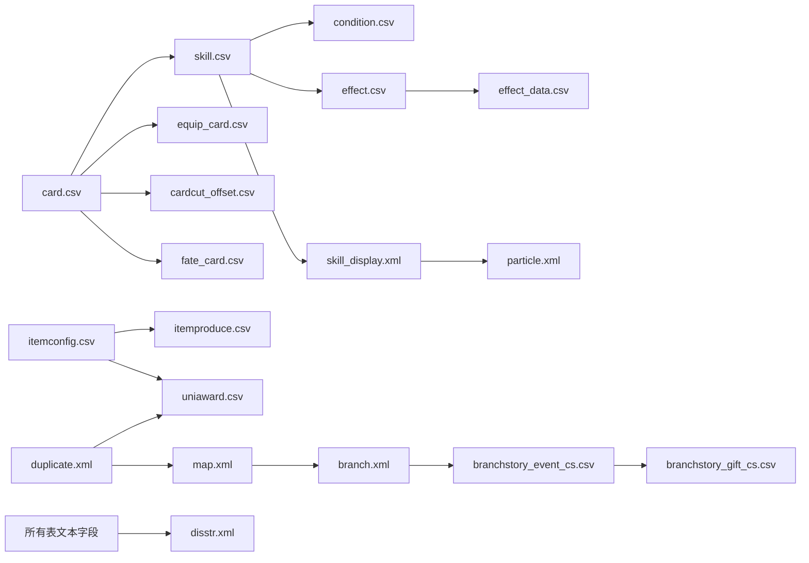

> 本文按实际解包目录逐文件整理，记录每个配置文件的规模、字段、主键与用途。
> 统计口径：行数不含表头；大小为解密后明文大小；数据来自 `com.sdg.woool.xuezu.x7sy_decrypted/files/patch2/config`（2026-10-17 解包）。

## 机内路径

`config` 目录对应游戏私有目录中的热更资源（设备内路径按包名与解包结构推断）：

```text
设备内（需 root / run-as）：
  /data/data/com.sdg.woool.xuezu.x7sy/files/patch2/config/

解包副本（本工作区）：
  com.sdg.woool.xuezu.x7sy_decrypted/files/patch2/config/
```

- 包名：`com.sdg.woool.xuezu.x7sy`；`files/` 下同时存在 `patch2/` 与 `patch_dyupdate/` 两套热更目录。
- `patch2/` 除 `config/` 外还有 `effect/`、`fonts/`、`item/`、`libs/`、`lua/`、`maps/`、`music/`、`role/`、`Shaders/`、`spine/`、`ui/`、`uinew/`、`updateui/`。
- 文本资源（`.csv` / `.xml` / `.lua`）统一以 `SQG\0` 尾签加密，解密后才是本目录中的明文。

## patch2/config内文件

### 目录树

```text
config/
├─ achivement.csv
├─ activitypass.xml
├─ branch.xml
├─ branchstory_event_cs.csv
├─ branchstory_gift_cs.csv
├─ branchstory_oath.xml
├─ branchstory_resources_c.csv
├─ card.csv
├─ card_break.csv
├─ card_changer.csv
├─ card_detail.csv
├─ card_material_type.csv
├─ card_skilltips.csv
├─ card_tag.csv
├─ cardcut_offset.csv
├─ chat_emoticon_group.csv
├─ chat_frame.csv
├─ CombatPoint.csv
├─ condition.csv
├─ connect.csv
├─ connectcard.csv
├─ disstr.xml
├─ drop_display.csv
├─ dup_autonext.csv
├─ dup_bpdamage.csv
├─ dup_bpdamage_basic.csv
├─ dup_challenge_cs.csv
├─ dup_challenge_limit_cs.csv
├─ duplicate.xml
├─ effect.csv
├─ effect_data.csv
├─ equip.csv
├─ equip_card.csv
├─ error_code.csv
├─ fate_card.csv
├─ fate_node.csv
├─ guide_card.csv
├─ help_pic.csv
├─ help_text.xml
├─ help_tips.xml
├─ hero-level.xml
├─ heropass.xml
├─ intimacy_contract.csv
├─ intimacy_gift.csv
├─ intimacy_main.csv
├─ item_badge.csv
├─ item_frame.csv
├─ item_giftchange.csv
├─ item_portrait.csv
├─ item_signboard.csv
├─ itemconfig.csv
├─ itemconfig_guide.csv
├─ itemproduce.csv
├─ levelup_open.csv
├─ looks.csv
├─ magiccircle_main.csv
├─ magiccircle_type.csv
├─ manor_area.csv
├─ manor_build.csv
├─ manor_build_skill.csv
├─ manor_build_skill_tips.csv
├─ manor_house_furniture.xml
├─ manor_house_furnituregroup.xml
├─ manor_house_shareevent.csv
├─ manor_house_showcase.xml
├─ map.xml
├─ mapcut.csv
├─ mapstaraward.csv
├─ minigame_chef_food.csv
├─ minigame_sawpuzzle_dup.csv
├─ multi_team_map.xml
├─ music.csv
├─ particle.xml
├─ pet_growth.csv
├─ pet_guide.csv
├─ pet_info.csv
├─ pet_skill_group.csv
├─ pet_star.csv
├─ plot_duplicate_achievement.csv
├─ plot_duplicate_battle.csv
├─ plot_duplicate_chapter.csv
├─ plot_duplicate_control.csv
├─ plot_duplicate_event.csv
├─ plot_duplicate_gift.csv
├─ plot_duplicate_limit.csv
├─ plot_duplicate_limitdata.csv
├─ plot_duplicate_map.xml
├─ plot_duplicate_sence.csv
├─ privilege_info.csv
├─ resources_public.csv
├─ robot_pvpdup.csv
├─ roleconfig.csv
├─ sab_gacha_drop.csv
├─ sab_gacha_info.csv
├─ sab_gacha_mission.csv
├─ sab_gacha_reward.csv
├─ sab_gacha_weight.csv
├─ signboard.csv
├─ skill.csv
├─ skill_display.xml
├─ skill_effect_target.csv
├─ skill_scope.csv
├─ skill_splash.csv
├─ skill_target.csv
├─ soulstone_base.csv
├─ soulstone_main.csv
├─ soulstone_skill.csv
├─ soulstone_value.csv
├─ task_type.csv
├─ timelimitact_spshop01_group.csv
├─ timelimitact_spshop01_shop.csv
├─ title_control.csv
├─ uniaward.csv
├─ worldboss_pixeldata.csv
├─ ai/
│  ├─ ai_action.csv
│  ├─ ai_actionGroup.csv
│  ├─ ai_strategy.csv
│  ├─ ai_strategyGroup.csv
│  └─ ai_target.csv
├─ bloodball/
│  ├─ minigame_block_buff.csv
│  ├─ minigame_block_buffgroup.csv
│  ├─ minigame_block_buffname.csv
│  ├─ minigame_block_control.csv
│  ├─ minigame_block_dup.csv
│  ├─ minigame_block_monster.csv
│  ├─ minigame_block_skill.csv
│  └─ minigame_block_tips.csv
├─ career_transfer/
│  ├─ career_branch.csv
│  ├─ career_detail.csv
│  └─ career_level.csv
└─ golilo/
   ├─ golilo_adventure.xml
   ├─ golilo_box_gift.xml
   ├─ golilo_event.xml
   ├─ golilo_event_group.xml
   ├─ golilo_fail.csv
   ├─ golilo_getfly.csv
   ├─ golilo_looks.csv
   ├─ golilo_particle.xml
   ├─ golilo_rogueskill.xml
   └─ golilo_tag.xml
```

### 格式约定

**CSV**：绝大多数表是固定三段表头——第 1 行中文列名（策划注释）、第 2 行英文/程序字段名、第 3 行类型；第 4 行起才是数据。
读取时应跳过前 3 行（`looks.csv`、`music.csv`、`card_detail.csv`、`soulstone_base.csv` 例外，见各文件说明）。

- 数组字段用分号 `;` 分隔，例如 `1;2;3`；多维数组再用 `|` 分隔，例如 `500;500|500;500`。
- 引用其他表时，数组字段通常是 ID 列表（`;` 分隔），单值字段则是单个 ID。
- 文本字段（`NameId`、`Desc`、`DisstrId`、`Tips` 等）存的是 `disstr.xml` 的文本 ID，不是最终文案。
- 编码：绝大多数 CSV 为 GBK；`error_code.csv`、`help_text.xml`、`help_tips.xml`、`disstr.xml` 等为 UTF-8；`hero-level.xml` 声明为 GB2312。

**XML**：根节点即为表名（`<duplicates>`、`<skill>`、`<maps>` 等），属性名即字段名；数组型属性常用逗号或分号分隔。

### 总览

| 分类        |     文件数 |        解包后大小 |
| --------- | ------: | -----------: |
| 卡牌与角色     |      13 |      7.91 MB |
| 技能与战斗     |      12 |      4.49 MB |
| 道具与装备     |      10 |      3.01 MB |
| 命运、羁绊与好感  |       7 |     330.3 KB |
| 副本与地图     |      13 |      4.88 MB |
| 剧情与篇章     |      15 |      1.22 MB |
| 养成与收集     |      16 |     922.8 KB |
| 家园        |       8 |     370.6 KB |
| 活动、商店与抽卡  |      10 |     141.9 KB |
| 血球小游戏     |       8 |      31.8 KB |
| 职业转职      |       3 |     348.4 KB |
| AI        |       5 |     140.5 KB |
| Golilo 冒险 |      10 |      1.22 MB |
| 系统与通用     |      10 |      9.34 MB |
| **合计**    | **140** | **34.28 MB** |

## 1. 卡牌与角色

角色卡池是全部数值与表现的起点。`card.csv` 用 `Serial` 标识行、`Looks` 分组角色；其余表多数以卡牌 ID（`Looks`）回指。

### `card.csv` — 卡牌主表

- **规模**：36,014 行 × 76 列 · 7.02 MB · GBK
- **字段**：
	- `Serial`（图鉴编号） · `Looks`（卡牌编号） · `NameId`（卡牌名称(disstr.xml)） · `Star`（卡牌星级） · `MaxStar`（卡牌最高星级） · `Attrib`（卡牌属性） · `Race`（种族） · `Gender`（性别） · `Career`（职业） · `Cost`（领导力）
	- `Hp`（1级血量） · `Att`（1级攻击） · `Def`（1级防御） · `Rev`（1级回复） · `Speed`（1级先手） · `HpAdd`（血量成长） · `AttAdd`（攻击成长） · `DefAdd`（防御成长） · `RevAdd`（回复成长） · `SpeedAdd`（先手成长）
	- `MaxLv`（等级上限） · `Break`（满破次数）
	- `CriPer`（基础暴率） · `HitPer`（基础受击概率）
	- `NormalSkill`（普通攻击） · `NormalSkillClient`（普通攻击客户端配置） · `SuperSkill`（怒气技能） · `SuperSkillClient`（怒气技能客户端配置） · `CaptainSkill`（队长技能） · `PassiveSkill`（被动技能） · `PassiveSkillUnlockLevel`（被动技能解锁等级） · `SkillPoint`（怒气）
	- `Card3d`（3D卡牌展示(card3d.xml)） · `ExpPrice`（经验折算的售价？）
	- `SuperSkillDesc`（怒气技名字） · `CaptainSkillDesc`（队长技名字） · `PassiveSkillDesc`（被动技名字）
	- `BackGround`（背景）
	- `actionid`（动作组编号） · `strategyid`（策略组编号） · `AppearEffect`（卡牌出场特效） · `crystal`（出售的水晶碎片数量） · `SuperSkillMusic`（怒气技能声音） · `CardShowMusic`（抽卡展示声音） · `BBSkillType`（必杀技类型） · `BBSkillLevelup`（提供的技能升级概率） · `BBSkillExpID`（技能升级经验库） · `NormalSkillMusic`（普通攻击声音） · `SuperSkillAttMusic`（怒气技能攻击声音） · `Line`（出场台词） · `itemid`（道具编号） · `Boss`（Boss标记） · `UniqueID`（卡牌唯一标示） · `PieceName`（卡牌碎片名字(0则显示卡牌名)） · `Comment`（服务器注释） · `PassiveCanForget`（被动技能是否可以被遗忘） · `SkinSourceCardId`（皮肤原卡ID） · `UnlockSkinNeed`（解锁该皮肤所需） · `IntimacyMax`（好感度等级上限） · `IsMaterial`（素材卡） · `Tips`（特殊标记（0<=x<=255）） · `PieceItem`（碎片道具配置） · `SkinHide`（时装隐藏） · `SkillEffectType`（必杀效果类型） · `SkillEffectId`（必杀效果资源） · `AppearEffectType`（出场效果类型） · `AppearEffectId`（出场效果资源） · `Tag`（角色特征） · `ditto`（可变形场地） · `dittotrue`（合法变形对象） · `SoulStoneBonusMax`（魂石数值上限） · `SoulStoneSkill1`（专属组合技） · `SoulStoneSkill2`（通用组合技） · `SuperSkillDesc2`（怒气技描述） · `CaptainSkillDesc2`（队长技描述） · `PassiveSkillDesc2`（被动技描述）
- **主键/索引**：`Serial`（行标识，35,954 个唯一值）/ `Looks`（角色分组）/ `itemid`（可获得卡标记）
- **说明**：全角色卡池的核心表：星级/最高星级、属性、种族、性别、职业、领导力、五维与成长、等级上限与突破、普攻/怒气/队长/被动技能及其客户端配置、立绘与 3D 资源、语音、碎片、魂石与组合技等。注意：同一 `Looks` 会对应多条不同数值的版本（玩家卡、NPC/敌人、特殊难度等），36,014 行只覆盖 1,069 个 `Looks`；可获得玩家卡通常以 `itemid` 非 0 标记，不能把 `Looks` 当唯一键。
- **关联**：`card_detail.csv`、`card_tag.csv`、`card_break.csv`、`CombatPoint.csv`、`skill.csv`、`disstr.xml`

### `card_break.csv` — 卡牌突破

- **规模**：40 行 × 3 列 · 10.2 KB · GBK
- **字段**：`CardID`（卡牌ID） · `UseCards`（可使用卡牌） · `LimitUp`（突破次数）
- **主键/索引**：`CardID` + `LimitUp`
- **说明**：记录每张卡突破时可消耗的卡牌列表与突破次数上限。
- **关联**：`card.csv`

### `card_changer.csv` — 变形者卡

- **规模**：1 行 × 2 列 · 655 B · GBK
- **字段**：`Id`（变形者卡ID） · `ChangerCards`（可变化卡角色ID列表）
- **主键/索引**：`Id`
- **说明**：配置“变形者”卡及其可变化的角色 ID 列表（仅 1 条）。
- **关联**：`card.csv`

### `card_detail.csv` — 卡牌图鉴补充

- **规模**：978 行 × 4 列 · 20.9 KB · GBK
- **字段**：`卡牌ID` · `角色名称` · `推荐潜能` · `推荐转职`
- **主键/索引**：`卡牌ID`
- **说明**：卡牌的角色显示名、推荐潜能与推荐转职；无英文字段行，只有中文表头 + 类型行。
- **关联**：`career_transfer/career_detail.csv`

### `card_material_type.csv` — 素材卡分类

- **规模**：105 行 × 3 列 · 3.5 KB · GBK
- **字段**：`Id`（卡牌ID） · `Type`（标题） · `Disstr`（说明文字）
- **主键/索引**：`Id`
- **说明**：素材卡的分类标题与说明文本，用于背包/图鉴分组显示。
- **关联**：`card.csv`、`disstr.xml`

### `card_skilltips.csv` — 卡牌技能提示

- **规模**：255 行 × 2 列 · 4.4 KB · GBK
- **字段**：`Id`（卡牌ID） · `Tips`（tips内容）
- **主键/索引**：`Id`
- **说明**：每张卡额外的技能 tips 数组，用于详情页补充说明。
- **关联**：`skill.csv`、`disstr.xml`

### `card_tag.csv` — 角色特征标签

- **规模**：35 行 × 7 列 · 2.5 KB · GBK
- **字段**：`ID`（tagid） · `looks`（资源uinew/card/tag） · `name`（名称disstr） · `tips`（简介disstr） · `showone`（是否展示标签） · `showall`（是否展示同类角色） · `showcardlist`（同类角色列表）
- **主键/索引**：`ID`
- **说明**：角色标签（如阵营、作品、属性等）的定义：资源、名称/简介文本 ID、是否单独展示、是否展示同类角色、同类角色列表。
- **关联**：`card.csv`、`uinew/card/tag`

### `cardcut_offset.csv` — 卡牌立绘裁切偏移

- **规模**：3,276 行 × 9 列 · 111.0 KB · GBK
- **字段**：`Id`（主键） · `Card`（卡牌ID（0是默认值)(所有卡牌锚点设置于中心点)） · `Type`（UI 1-主界面  2-详情界面 3-名片界面 4-未使用 5-好…） · `OffestX`（X偏移（允许负值 值越大越向左）游戏的（0,0）在主界面上边的中心） · `OffestY`（2340Y偏移（允许负值 值越大越向上）） · `MinOffestY`（1920Y偏移（允许负值 值越大越向上）（计算公式：2340Y偏移…） · `Zoom`（缩放(100-100%显示 最小1%）） · `Rotate`（旋转（卡牌向右旋转角度）） · `IndexId`（索引界面ID（索引某个UI ID，并在此基础上额外偏移））
- **主键/索引**：`Id`
- **说明**：同一张卡面在 19 类界面（主界面、详情、名片、好感、升星上/下、大图、PVE 结算、战前、竞技场排名等）中的 X/Y 偏移、缩放、旋转，以及可叠加的索引界面 ID。
- **关联**：`card.csv`、`resources_public.csv`

### `CombatPoint.csv` — 战斗力公式参数

- **规模**：1,002 行 × 16 列 · 80.0 KB · GBK
- **字段**：`ID`（卡牌id） · `BasicPoint`（1级时基础战斗力） · `HpPoint`（1级时1%生命潜能战斗力） · `AtkPoint`（1级时1%攻击潜能战斗力） · `DefPoint`（1级时1%防御潜能战斗力） · `HelPoint`（1级时1%回复潜能战斗力） · `AllPoint`（1级时1%全属性潜能战斗力） · `LevelupPoint`（表示角色每升1级的战斗力） · `HpTalentPoint`（角色每1点生命潜能，每升1级带来的战斗力） · `AtkTalentPoint`（角色每1点攻击潜能，每升1级带来的战斗力） · `DefTalentPoint`（角色每1点防御潜能，每升1级带来的战斗力） · `HelTalentPoint`（角色每1点回复潜能，每升1级带来的战斗力） · `AllTalentPoint`（角色每1点全属性潜能，每升1级带来的战斗力） · `StarPoint`（星级战斗力） · `PassiveSkillPoint`（天赋战斗力） · `PassiveSkillLevel`（天赋解锁等级）
- **主键/索引**：`ID`
- **说明**：按卡牌配置战斗力计算参数：1 级基础战力、五维每 1% 潜能折算的战力、每级成长、星级战力、天赋战力及解锁等级。
- **关联**：`card.csv`、`fate_node.csv`

### `equip_card.csv` — 卡牌装备映射

- **规模**：908 行 × 8 列 · 437.9 KB · GBK
- **字段**：`Serial`（图鉴编号） · `Star`（卡牌星级） · `MaxStar`（卡牌最高星级） · `Career`（职业） · `weapon1st`（默认武器） · `weaponid`（进阶武器） · `armor1st`（默认防具） · `armorid`（进阶防具）
- **主键/索引**：`Serial`
- **说明**：按卡牌星级/职业配置默认武器、进阶武器、默认防具、进阶防具。
- **关联**：`equip.csv`、`card.csv`

### `guide_card.csv` — 卡牌图鉴收集

- **规模**：734 行 × 8 列 · 33.9 KB · GBK
- **字段**：`CardId`（卡牌ID） · `Priority`（卡牌页签(0 常规角色 1 限定角色)） · `CardNumId`（卡牌图鉴ID(100000不显示num)） · `NumOpen`（收集计数） · `Portrait`（搜集状态） · `ItemIcon`（道具角标） · `OpenTime`（图鉴开启时间） · `CloseTime`（图鉴开启时间）
- **主键/索引**：`CardId`
- **说明**：卡牌图鉴的页签（常规/限定）、图鉴 ID、收集计数与状态、道具角标、图鉴开启/关闭时间。
- **关联**：`card.csv`、`disstr.xml`

### `looks.csv` — 战斗单位外观与动作

- **规模**：1,074 行 × 21 列 · 202.2 KB · GBK
- **字段**：`id` · `stand` · `run` · `attack` · `attacked` · `modeWidth` · `modeHeight` · `speed` · `range` · `drop_offX` · `drop_offY` · `pick_offX` · `pick_offY` · `rate` · `shadowID` · `shadowOffX` · `shadowOffY` · `attackxp` · `turned` · `newmove` · `moveY`
- **主键/索引**：`id`
- **说明**：战斗表现层配置：spine 待机/跑步/攻击/受击动作串、模型宽高、移动速度、攻击距离、掉落/拾取偏移、影子、攻击经验、转向与移动逻辑（newmove/moveY）。仅一行中文表头，无英文字段与类型行。
- **关联**：`card.csv`、`spine/`

### `privilege_info.csv` — 卡牌特权

- **规模**：15 行 × 12 列 · 1.6 KB · GBK
- **字段**：`Id`（主键(连续自然数)） · `Tips`（策划备注） · `CardId`（卡牌id） · `CardBreak`（卡牌最高突破情况） · `Type`（类型） · `data1`（效果参数1） · `data2`（效果参数2） · `data3`（效果参数3） · `data4`（效果参数4） · `data5`（效果参数5） · `data6`（效果参数6） · `data7`（效果参数7）
- **主键/索引**：`Id`
- **说明**：按卡牌与最高突破等级配置特权效果（如鱼人莉萝艾提升大冒险每日行动力恢复）。
- **关联**：`card.csv`、`card_break.csv`

## 2. 技能与战斗

战斗结算的主链路是 `skill.csv` → `condition.csv` / `skill_effect_target.csv` → `effect.csv` → `effect_data.csv`，表现层再由 `skill_display.xml` / `particle.xml` 绑定。

### `skill.csv` — 技能主表

- **规模**：22,827 行 × 22 列 · 1.58 MB · GBK
- **字段**：`ID`（序号） · `SkillType`（技能类别） · `SkillMode`（技能模块） · `Target`（技能对象） · `AngerSkillAtkRate`（必杀技和治疗数值比例） · `StandAtkTimesRate`（一次攻击分割比例） · `SpeAtkFamular1`（（特殊伤害公式1）固定x点伤害 不受任何参数影响） · `SpeAtkFamular2`（（特殊伤害公式2）） · `BaseRestoreRate`（基础回复系数） · `HOT`（HOT回合数） · `DispelDebuff`（驱散Debuff） · `TriggerIdex`（条件表编号（Condition）） · `EffectTarget`（异常对象（Skill_Target_effect)） · `EffectId`（效果表编号） · `ItemId`（消耗物品） · `Comment`（服务器注释） · `EnableHealResult`（治疗是否产生效果） · `CoolDown`（冷却回合） · `ActionScope`（作用域） · `Quantity`（技能生效控制数） · `RoundQuantity`（大回合生效次数） · `Display`（技能表现）
- **主键/索引**：`ID`
- **说明**：战斗技能总表：技能类别/模块/对象、必杀与治疗比例、一次攻击分割比例、两种特殊伤害公式、基础回复、HOT 回合、驱散、触发条件（condition）、异常对象（skill_effect_target）、效果表（effect）、消耗物品、冷却、作用域、生效控制数与表现 ID。
- **关联**：`effect.csv`、`condition.csv`、`skill_display.xml`、`particle.xml`

### `skill_effect_target.csv` — 效果作用对象

- **规模**：5,297 行 × 5 列 · 135.6 KB · GBK
- **字段**：`ID` · `Type`（类型） · `Param`（参数） · `Enemy`（敌我（我0敌1）） · `Param2`（参数2）
- **主键/索引**：`ID`
- **说明**：效果的目标筛选配置：类型、参数、敌我标记（0=我，1=敌）、参数 2。被 `skill.csv` 的 `EffectTarget` 引用。
- **关联**：`skill.csv`、`effect.csv`

### `skill_scope.csv` — 技能作用域

- **规模**：82 行 × 3 列 · 1.4 KB · GBK
- **字段**：`Id`（主键） · `Type`（类型） · `Data`（参数）
- **主键/索引**：`Id`
- **说明**：技能作用范围/形状配置：类型 + 数据数组。
- **关联**：`skill.csv`

### `skill_splash.csv` — 技能溅射

- **规模**：107 行 × 5 列 · 2.0 KB · GBK
- **字段**：`Key`（主键） · `ID`（target序号） · `Target`（攻击目标站位编号） · `SplashTarget`（额外溅射目标站位编号） · `Damage`（额外溅射伤害系数）
- **主键/索引**：`Key`
- **说明**：按目标站位配置溅射：攻击目标站位、额外溅射目标站位、额外伤害系数。
- **关联**：`skill.csv`、`skill_target.csv`

### `skill_target.csv` — 目标选取

- **规模**：200 行 × 4 列 · 3.4 KB · GBK
- **字段**：`Id`（序号） · `ChooseType`（选取类型） · `ChooseNum`（选取人数） · `SpecialTarget`（筛选条件）
- **主键/索引**：`Id`
- **说明**：技能选取目标的方式：选取类型、选取人数、筛选条件。
- **关联**：`skill.csv`、`ai/ai_target.csv`

### `skill_display.xml` — 技能演出时间轴

- **规模**：819.2 KB · XML
- **结构**：
  - `<Root>` → `<skill id name>` → `<attack>` / `<hurt>` / `<sound>` / `<screen>` → `<event>`。
  - `event` 常用属性：`time`（毫秒时间轴）、`id`（特效/音效 ID）、`offX/offY`（偏移）、`ranX/ranY`（随机范围）、`order`、`type`、`lastT`、`iX/iY`、`range`、`amplitude`、`radius`、`id_golilo`。
- **主键/索引**：`skill@id`
- **说明**：技能表现配置：每个 `<skill>` 下分 `attack`/`hurt`/`sound`/`screen` 四类轨道，`<event>` 用 time 排时间轴，绑定特效 id、偏移、随机范围、层级等。
- **关联**：`skill.csv`、`particle.xml`

### `effect.csv` — 战斗效果主表

- **规模**：26,078 行 × 23 列 · 1.48 MB · GBK
- **字段**：`ID`（效果表序号） · `EffectId`（效果编号） · `EffectPoint`（效果点） · `Type`（异常对象） · `Buff`（buff标示（1buff，0debuff）） · `Value`（数值） · `Round`（效果持续回合） · `Icon`（图标编号） · `EffectTypes`（驱散&抵抗效果&染色） · `MultiEffect`（多重效果） · `ConditionType`（生效条件(Effect Target)） · `ConditionLogic`（判断逻辑） · `ConditionRequire`（生效要求） · `Value2`（特殊数值） · `Round2`（特殊回合） · `ConditionSet`（生效条件设定） · `WorkedTimes`（生效次数） · `TargetType`（自身条件判断） · `TruePoint`（是否添加后立即生效） · `Effects1`（特效配置） · `Location`（特效锚点） · `Layer`（特效层级） · `Mode`（特效播放方式）
- **主键/索引**：`ID`
- **说明**：战斗效果总表：效果点、异常对象、buff/debuff、数值、持续回合、图标、驱散/抵抗/染色、多重效果、生效条件与逻辑、特殊数值/回合、生效次数、自身条件、立即生效标记、特效资源/锚点/层级/播放方式。
- **关联**：`skill.csv`、`effect_data.csv`、`condition.csv`

### `effect_data.csv` — 效果数值分段

- **规模**：629 行 × 9 列 · 26.3 KB · GBK
- **字段**：`ID`（序号（与使用此效果的effetID相同）） · `Type`（类型） · `InfoType`（判断属性） · `EitherType1`（条件处理） · `Param1`（条件参数） · `EitherType2`（数值分段） · `Param2`（结果分段） · `Min`（结果下限） · `Max`（结果上限）
- **主键/索引**：`ID`
- **说明**：将效果数值按判断属性与条件分段，映射到结果区间（Min~Max）。序号与引用它的 EffectId 对应。
- **关联**：`effect.csv`

### `condition.csv` — 战斗触发条件

- **规模**：5,361 行 × 10 列 · 233.3 KB · GBK
- **字段**：`ID`（条件表序号） · `TriggerPoint`（触发点） · `CastType`（状态施加条件） · `CastValue`（状态施加条件数值） · `CastRate`（触发概率：所有满足触发条件的触发概率） · `TeamMate`（队友id） · `TriggerRoundNo`（触发回合数） · `TriggerEffect`（触发EFFECT条件（实际上是int!） · `TriggerEffectOr`（触发EFFECT条件（真正的array，关系为或） · `TriggerEffectAnd`（触发EFFECT条件（真正的array，关系为且）
- **主键/索引**：`ID`
- **说明**：战斗触发条件表：触发点、施加条件与数值、触发概率、队友、触发回合、Effect 条件（或/且两组数组）。被技能、效果等表按 ID 引用。
- **关联**：`skill.csv`、`effect.csv`

### `particle.xml` — 特效资源绑定

- **规模**：233.9 KB · XML
- **结构**：
  - `<SkillConfig>` → `<skill id name>` → `<effect>`。
  - `effect` 属性：`achrx/achry`（锚点比例）、`duration`、`type`（如 hit）、`dynrot`、`file` / `file2`（ccbi）。
- **主键/索引**：`skill@id`
- **说明**：技能/特效 ID 到 ccbi 资源的绑定：`<skill id name>` → `<effect>`（锚点 achrx/achry、duration、type、动态旋转、主/副文件）。
- **关联**：`skill_display.xml`、`effect.csv`

### `dup_bpdamage.csv` — 战力差增减伤分段

- **规模**：6 行 × 6 列 · 211 B · GBK
- **字段**：`Id`（序号） · `Group`（组） · `BpMin`（下限） · `BpMax`（上限） · `AtkAdd`（增伤系数） · `DefAdd`（减伤系数）
- **主键/索引**：`Id`
- **说明**：按战斗力差区间（BpMin~BpMax）配置增伤/减伤系数。
- **关联**：`dup_bpdamage_basic.csv`

### `dup_bpdamage_basic.csv` — 战力差增减伤上下限

- **规模**：1 行 × 7 列 · 237 B · GBK
- **字段**：`MaxAtk`（增伤上限（百分比）） · `MinAtk`（增伤下限（百分比）） · `MaxDef`（减伤上限（百分比）） · `MinDef`（减伤下限（百分比）） · `RedBp`（红上限（千分比）） · `YelloBp`（黄上限（千分比）） · `GreenBp`（绿上限（千分比））
- **主键/索引**：—
- **说明**：战斗力差计算的全局上下限：增伤/减伤上下限百分比、红/黄/绿战力上限（千分比）。
- **关联**：`dup_bpdamage.csv`

## 3. 道具与装备

`itemconfig.csv` 是道具总表，`equip.csv` 是装备明细；奖励发放统一走 `uniaward.csv` 的奖励 ID。

### `itemconfig.csv` — 道具主表

- **规模**：15,639 行 × 35 列 · 1.54 MB · GBK
- **字段**：`Serial`（图鉴编号） · `Looks`（道具icon） · `NameId`（道具名称） · `Price`（出售价格） · `Type`（道具种类（0:全部1:武器2:防具3:药剂4:材料5:卡牌6:卡牌…） · `job`（职业/家具标签） · `Hp`（血量） · `Att`（攻击） · `Def`（防御） · `Rev`（回复） · `Speed`（先手/26碎片类型用于配置合成所需碎片数 27关联自选宝箱角色组ID） · `Skill1ID`（技能1） · `Skill2ID`（技能2） · `Skill3ID`（技能3） · `EffectID`（技能特效） · `Condition`（药品使用条件） · `BuffID`（对应状态） · `Limit`（回合使用限制） · `StackNum`（堆叠上限） · `Equilimit`（携带上限） · `tips`（简述） · `account`（描述） · `DupId`（产出副本） · `Duptips`（副本产出描述） · `level`（解锁等级） · `Effect`（特效） · `Star`（星级） · `CanUse`（能否使用/家具阵营） · `MagiccircleId`（法阵id） · `Guide`（获取途径） · `SoulStone`（魂石品质（箱子以外的新道具请配100） · `SoulStoneNum`（镶嵌数量（根据产量配） · `SoulStoneType`（魂石类型（根据道具颜色配1-6分别对应水火树雷光暗，拿不准就配99…） · `SoulStoneLevel`（魂石数值（从这些数里面选一个>102;103;104;202;20…） · `SoulStoneExp`（魂石经验（配0就行）
- **主键/索引**：`Serial`
- **说明**：道具总表：类型 0-26（武器/防具/药剂/材料/卡牌/碎片/头像/徽章/气泡/家具/魂石…）、职业或家具标签、五维、三个技能、效果、使用条件、堆叠/携带上限、产出副本、解锁等级、法阵、获取途径、魂石品质/数量/类型/数值/经验。
- **关联**：`equip.csv`、`itemproduce.csv`、`uniaward.csv`、`item_portrait.csv`

### `itemconfig_guide.csv` — 道具获取途径引导

- **规模**：449 行 × 8 列 · 10.5 KB · GBK
- **字段**：`Id`（编号） · `Type`（功能类型） · `Param`（索引参数） · `Icon`（图标资源） · `Name`（名称） · `Tips`（说明） · `LevelLimit`（等级限制） · `Tips`（注释(策划注释用）
- **主键/索引**：`Id`
- **说明**：道具来源引导：功能类型、索引参数、图标、名称/说明文本、等级限制与策划注释。
- **关联**：`itemconfig.csv`

### `itemproduce.csv` — 道具产出/合成配方

- **规模**：8,779 行 × 20 列 · 476.9 KB · GBK
- **字段**：`Serial`（图鉴编号） · `Material1`（产出材料1） · `Material1Num`（产出材料1数量） · `diamond1`（钻石1） · `Material2`（产出材料2） · `Material2Num`（产出材料2数量） · `diamond2`（钻石2） · `Material3`（产出材料3） · `Material3Num`（产出材料3数量） · `diamond3`（钻石3） · `Material4`（产出材料4） · `Material4Num`（产出材料4数量） · `diamond4`（钻石4） · `Material5`（产出材料5） · `Material5Num`（产出材料5数量） · `diamond5`（钻石5） · `gold`（金币） · `diamondgold`（钻石金币） · `Teamlevel`（战队等级） · `level`（角色等级）
- **主键/索引**：`Serial`
- **说明**：最多 5 种材料 + 数量 + 钻石，外加金币、钻石金币、战队等级与角色等级条件；按成品道具编号（Serial）索引。
- **关联**：`itemconfig.csv`

### `equip.csv` — 装备表

- **规模**：8,967 行 × 22 列 · 818.3 KB · GBK
- **字段**：`equipid`（道具编号） · `Looks`（道具icon） · `NameId`（道具名称） · `Price`（出售价格） · `Type`（道具种类（1为武器，2为防具）） · `level`（装备星级） · `job`（职业） · `Hp`（血量） · `Att`（攻击） · `Def`（防御） · `Rev`（回复） · `Speed`（先手） · `Skill1ID`（技能1） · `Skill2ID`（技能2） · `Skill3ID`（技能3） · `Condition`（角色等级） · `itempoint`（战斗力） · `tips`（简述） · `account`（描述） · `skilltips`（技能描述） · `diamondupgrate`（是否允许一键升级） · `strengthen`（强化词缀）
- **主键/索引**：`equipid`
- **说明**：武器/防具：星级、职业、五维、先手、三个技能、角色等级、战力、简述/描述/技能描述、一键升级、强化词缀。
- **关联**：`equip_card.csv`、`itemconfig.csv`

### `item_badge.csv` — 徽章

- **规模**：513 行 × 4 列 · 6.2 KB · GBK
- **字段**：`Id`（徽章Id，与绑定道具相同的Id） · `Skill`（徽章技能） · `Show`（显示状态（0不可见1可见显示灰态可点击查看详情不可装备）） · `Achivement`（成就回溯（配置在此处的成就如果是已完成状态，则为玩家发放相应徽章））
- **主键/索引**：`Id`
- **说明**：徽章技能、显示状态（不可见/可见灰态/可查看）、成就回溯列表。ID 与绑定道具相同。
- **关联**：`itemconfig.csv`、`achivement.csv`

### `item_frame.csv` — 头像框

- **规模**：273 行 × 5 列 · 9.3 KB · GBK
- **字段**：`Id`（头像框Id） · `Resource`（头像框资源） · `Effect`（头像框特效） · `ExclusiveType`（互斥类型(1限用2禁用)） · `ExclusiveId`（互斥ID）
- **主键/索引**：`Id`
- **说明**：头像框资源、特效、互斥类型（1 限用 / 2 禁用）与互斥 ID 列表。
- **关联**：`itemconfig.csv`

### `item_giftchange.csv` — 礼包/兑换内容

- **规模**：231 行 × 6 列 · 26.3 KB · GBK
- **字段**：`Id`（主键） · `GiftType`（奖励类型） · `ItemType`（道具类型） · `ItemId`（道具ID） · `ItemCount`（道具数量） · `TimeLimit`（使用期限）
- **主键/索引**：`Id`
- **说明**：礼包或兑换道具的内容：奖励类型、道具类型/ID/数量、使用期限。
- **关联**：`itemconfig.csv`、`uniaward.csv`

### `item_portrait.csv` — 头像索引

- **规模**：5,229 行 × 3 列 · 64.3 KB · GBK
- **字段**：`Id`（配置Id） · `Type`（头像类型（1-索引角色；2-索引道具）） · `IndexId`（索引Id（1-cardid；2-itemid））
- **主键/索引**：`Id`
- **说明**：头像配置：类型（1=角色卡，2=道具）→ 索引 ID（cardid / itemid）。
- **关联**：`card.csv`、`itemconfig.csv`

### `item_signboard.csv` — 看板娘索引

- **规模**：5,008 行 × 6 列 · 81.5 KB · GBK
- **字段**：`Id`（看板角色Id） · `Type`（看板角色类型（1：索引角色；2：索引道具）） · `IndexId`（索引Id（1-cardid，2-itemid）） · `ResourcesIndex`（资源Id） · `StartTime`（活动起始时间） · `EndTime`（活动结束时间）
- **主键/索引**：`Id`
- **说明**：看板角色：类型（1=角色，2=道具）、索引 ID、资源 ID、活动起止时间。
- **关联**：`signboard.csv`

### `drop_display.csv` — 掉落展示

- **规模**：271 行 × 5 列 · 5.0 KB · GBK
- **字段**：`Id`（序号） · `Type`（道具类型） · `Itemid`（道具id） · `NumberUpperLimit`（数量上限） · `NumberLowLimit`（数量下限）
- **主键/索引**：`Id`
- **说明**：掉落物的展示区间：道具类型、道具 ID、数量上下限。
- **关联**：`duplicate.xml`、`uniaward.csv`

## 4. 命运、羁绊与好感

塔罗（命运）由 `fate_card.csv`（卡组/链）与 `fate_node.csv`（节点）组成；命运连接是 `connect.csv` + `connectcard.csv`；好感度是 `intimacy_*` 三表。

### `fate_card.csv` — 塔罗卡组

- **规模**：9 行 × 14 列 · 3.4 KB · GBK
- **字段**：`CardId`（卡牌编号） · `Comment`（注释） · `Name`（名字） · `DisStrId`（说明） · `UnlockNeed1`（解锁条件1配置a队伍等级限制（1;25）队伍等级25级解锁|b塔罗…） · `UnlockNeed2`（解锁条件2配置a队伍等级限制（1;25）队伍等级25级解锁|b塔罗…） · `UnlockNeed3`（解锁条件3配置a队伍等级限制（1;25）队伍等级25级解锁|b塔罗…） · `UnlockNeed4`（解锁条件4配置a队伍等级限制（1;25）队伍等级25级解锁|b塔罗…） · `Line1`（节点链1） · `Line2`（节点链2） · `Line3`（节点链3） · `Line4`（节点链4） · `Line5`（节点链5） · `CenterIcon`（中间宝石）
- **主键/索引**：`CardId`
- **说明**：9 张塔罗（水/火/树/雷/光/暗等）的卡组定义：名称/说明文本、4 条解锁条件（队伍等级、塔罗激活数、链节点、成就）、5 条节点链与中间宝石。
- **关联**：`fate_node.csv`

### `fate_node.csv` — 塔罗节点

- **规模**：458 行 × 26 列 · 34.6 KB · GBK
- **字段**：`NodeId`（节点编号） · `Comment`（注释） · `IconId`（图片） · `DisStrId`（说明） · `disskill`（技能说明） · `CardId`（所属卡牌编号） · `PositionInCard`（在卡牌上的位置） · `UnlockNeed1`（解锁条件1配置a队伍等级限制（1;25）队伍等级25级解锁|b塔罗…） · `UnlockNeed2`（解锁条件2配置a队伍等级限制（1;25）队伍等级25级解锁|b塔罗…） · `UnlockNeed3`（解锁条件3配置a队伍等级限制（1;25）队伍等级25级解锁|b塔罗…） · `UnlockNeed4`（解锁条件4配置a队伍等级限制（1;25）队伍等级25级解锁|b塔罗…） · `EffectRange`（生效范围0：表示全部角色收益或者读取塔罗链中每个节点的收益对象配置…） · `AddAttack`（攻击加成） · `AddDefense`（防御加成） · `AddHp`（血量加成） · `AddRecover`（回复加成） · `BattlePower`（战斗力） · `SkillId`（技能） · `AchievementPointCost`（消耗成就点数） · `ResourceNeed`（资源需求） · `TimerTowerExpAddup`（计时塔经验加成） · `QianNengAddup`（潜能觉醒觉醒值加成） · `StarPieceAddup`（获得星霜之石收益增加） · `MaxPhysicalPowerAddup`（体力上限） · `VipExpEverydayAddup`（VIP经验每日增加） · `CompensateResource`（重置初始化回退资源）
- **主键/索引**：`NodeId`
- **说明**：塔罗链上的每个节点：图标/说明/技能说明、所属卡牌与位置、4 条解锁条件、生效范围（性别/属性/职业/乐趣卡）、五维与战力加成、技能、成就点消耗、资源需求、计时塔/潜能/星霜/VIP/体力等加成、重置返还。
- **关联**：`fate_card.csv`、`CombatPoint.csv`

### `connect.csv` — 命运连接

- **规模**：1,078 行 × 17 列 · 238.9 KB · GBK
- **字段**：`ConnectID`（ID） · `Card`（卡牌） · `ConnectNeed`（前置命运） · `Change(0:增加；1：替换必杀；2：替换天赋；3：替换队长技；替换只能一对一)`（替换技能） · `SkillID`（命运技ID） · `MaxLevel`（最大等级） · `LevelArea`（解锁等级） · `HPBonus`（） · `AttackBonus`（） · `DefBonus`（） · `RecBonus`（） · `AddCost`（费用） · `AddBattleNum`（） · `MoneyType`（） · `MoneyCost`（） · `ConnectName`（） · `ConnectWord`（）
- **主键/索引**：`ConnectID`
- **说明**：卡牌的命运（羁绊）配置：前置命运、替换类型（0 增加 / 1 替换必杀 / 2 替换天赋 / 3 替换队长技）、命运技、最大/解锁等级区间、五维加成、费用与货币、名称/台词。
- **关联**：`connectcard.csv`、`skill.csv`

### `connectcard.csv` — 命运槽开放

- **规模**：517 行 × 5 列 · 10.0 KB · GBK
- **字段**：`CardID`（卡牌） · `Level`（开放等级） · `Connect1`（） · `Connect2`（） · `Connect3`（）
- **主键/索引**：`CardID`
- **说明**：每张卡可开启的命运连接数量与开放等级。
- **关联**：`connect.csv`、`card.csv`

### `intimacy_main.csv` — 角色好感主表

- **规模**：356 行 × 11 列 · 28.9 KB · GBK
- **字段**：`UniqueId`（角色唯一id） · `ExpType`（好感经验库） · `LikeList`（喜好的道具） · `HateList`（厌恶的道具） · `CV_like`（收到喜欢的礼物台词） · `CV_normal`（收到常规的礼物台词） · `CV_hate`（收到讨厌礼物台词） · `LoveWords`（缔结契约时对白文字） · `UnlockItemId`（解锁羁绊消耗的道具） · `UnlockItemNum`（解锁羁绊消耗道具数量） · `Gift`（好感度奖励）
- **主键/索引**：`UniqueId`
- **说明**：角色好感：经验库、喜好/厌恶道具、收到喜欢/常规/讨厌礼物的台词、契约对白、羁绊解锁消耗、好感奖励。
- **关联**：`intimacy_contract.csv`、`intimacy_gift.csv`、`card.csv`

### `intimacy_contract.csv` — 好感契约

- **规模**：420 行 × 11 列 · 11.1 KB · GBK
- **字段**：`Cardid`（角色ID） · `IntimacyLevel`（好感等级要求） · `LevelLimitUp`（角色等级上限提升） · `HP`（生命增加） · `ATK`（攻击增加） · `DEF`（防御增加） · `HEL`（回复增加） · `SkillType`（变更技能参数） · `SkillId`（变更技能id） · `SkillName`（变更技能名称） · `SkillDesc`（变更技能描述）
- **主键/索引**：`Cardid` + `IntimacyLevel`
- **说明**：好感等级达到要求后的契约效果：角色等级上限提升、五维增加、替换技能类型/ID/名称/描述。
- **关联**：`intimacy_main.csv`

### `intimacy_gift.csv` — 好感礼物

- **规模**：168 行 × 6 列 · 3.4 KB · GBK
- **字段**：`ItemId`（道具ID） · `Value`（基础好感度） · `UniqueId`（隐藏好感度角色） · `Value2`（隐藏好感度） · `SpecialAddId`（指定加成参数） · `SpecialAddNumber`（指定加成数量）
- **主键/索引**：`ItemId`
- **说明**：礼物道具的好感值：基础好感、隐藏角色与隐藏好感、指定角色额外加成。
- **关联**：`intimacy_main.csv`、`itemconfig.csv`

## 5. 副本与地图

`duplicate.xml` 是副本实体，`map.xml` 负责把副本挂到地图节点上；英雄/活动副本分别由 `hero-level.xml` / `heropass.xml` / `activitypass.xml` 组织入口。

### `duplicate.xml` — 副本主表

- **规模**：4.61 MB · XML
- **结构**：
  - `<duplicates>` → `<dup>`（36 个属性，见下）→ `<battles>` → `<battle id>` + `<consume type beforenumber afternumber freetime>`；部分副本有 `<consumeitems type id beforenumber afternumber freetime>`。
  - `dup` 关键属性：`id`、`name`、`type`（1 主线 / 2 奇遇 / 3 英雄 / 4 活动）、`juqing`、`monster_attr`、`difficulty`、`possibility`、`exp`、`formationexp`、`goldrate`、`soulrate`、`back/mid/front`、`eff1/eff2`、`desc`、`bgm`、`herodup`、`enterlevel`、`predup/nextdup`、`loopSounds`、`bosstips`、`duplimittype/duplimit/duplimittips`、`sweep`、`battletype`、`round`、`onlyhelpcard/helpcard`、`intimacy`、`bg`、`bossportrait`、`dropdisplay`、`serverloop`。
  - ID 号段（文件头注释）：1-2000 普通主线；2001-2500 奇遇；2501-3000 英雄；3001-3500 活动。
- **主键/索引**：`dup@id`
- **说明**：5,957 个副本的完整定义：类型（1 主线 / 2 奇遇 / 3 英雄 / 4 活动）、剧情标记、怪物属性、难度、经验/战队经验/金币/魂率、背景与前后景、描述、BGM、英雄副本关联、进入等级、前置/后置副本、循环音效、Boss 提示、副本限制、扫荡、战斗类型、回合、助战卡、好感、Boss 立绘、掉落展示等；每个 dup 下还有 battles/consume/consumeitems。
- **关联**：`map.xml`、`dup_autonext.csv`、`skill.csv`、`uniaward.csv`

### `map.xml` — 世界地图

- **规模**：23.3 KB · XML
- **结构**：
  - `<maps>` → `<world_map>` + `<area_maps>` → `<area_map>` → `<pass>` / `<adventure>`。
  - `area_map`：`id`、`title`、`ccb_name`、`scale`、`entry`、`show_effect`、`audio_effect`、`minx/miny/maxx/maxy`、`role`。
  - `pass`：`id`、`dup`（逗号分隔副本 ID）、`min_level`、`pass_node`、`pass_label`、`node_map_position`、`title`、`unlock_road_node`、`unlock_animation`。
- **主键/索引**：`area_map@id` / `pass@id`
- **说明**：世界地图骨架：`world_map` 与 `area_maps` → `area_map`（标题、ccb、缩放、入口、特效、音效、可视范围）→ `pass`（关联 dup 列表、最低等级、节点/标签、坐标、解锁道路与动画、标题）→ `adventure` 节点。
- **关联**：`duplicate.xml`、`hero-level.xml`

### `multi_team_map.xml` — 多队地图

- **规模**：12.6 KB · XML
- **结构**：
  - `<maps>` → `<area_map>` → `<pass>` → `<config>`；`<area_map>` 下另有 `<icon>`。
  - `config`：`id`、`type`、`name`、`res_name`、`position`、`ZOrder`、`unlockevent/unlocktype`、`lockevent/locktype`、`senceid`。
  - `icon`：`id`、`name`、`ccb_name`、`ZOrder`。
  - `pass`：`id`、`name`、`position`、`camera_position`、`cursor_position`、`new_position`、`name_y`、`click_pos`、`click_size`。
- **主键/索引**：`area_map@id` / `pass@id`
- **说明**：多队伍玩法的地图：`area_map` → `pass`（位置、摄像机/光标/新位置、点击区域）→ `config`（场景物件、层级、解锁/锁定事件）与 `icon`。
- **关联**：`plot_duplicate_map.xml`

### `mapcut.csv` — 地图裁切

- **规模**：198 行 × 7 列 · 8.5 KB · GBK
- **字段**：`Id`（主键） · `Resources`（资源路径） · `PosX`（x（越大越靠左）） · `PosY`（y（越大越靠上）） · `CutW`（w（越大越宽）） · `CutH`（h（越大越高）） · `TexScale`（缩放）
- **主键/索引**：`Id`
- **说明**：地图贴图的裁切参数：资源路径、X/Y/W/H、缩放。
- **关联**：`map.xml`

### `mapstaraward.csv` — 地图星级奖励

- **规模**：36 行 × 10 列 · 1.4 KB · GBK
- **字段**：`Id`（编号） · `MapId`（地图序号） · `AwardId`（奖励序号） · `StarNumber`（要求星数） · `Award1Type`（物品类型(1:卡牌 2:道具 3:金币 4:能量 10:体力值 1…） · `AwardId1`（奖励1的ID） · `AwardNum1`（奖励1的数量） · `Award2Type`（物品类型(1:卡牌 2:道具 3:金币 4:能量 10:体力值 1…） · `AwardId2`（奖励2的ID） · `AwardNum2`（奖励2的数量）
- **主键/索引**：`Id`
- **说明**：地图达到指定星数时的两档奖励（类型、ID、数量）。
- **关联**：`map.xml`、`uniaward.csv`

### `dup_autonext.csv` — 副本自动下一关

- **规模**：622 行 × 3 列 · 7.1 KB · GBK
- **字段**：`DupId`（副本id） · `MapId`（所属关卡） · `NextDupId`（下一关ID）
- **主键/索引**：`DupId`
- **说明**：副本 → 所属关卡 → 下一关副本 ID。
- **关联**：`duplicate.xml`、`map.xml`

### `dup_challenge_cs.csv` — 挑战副本入口

- **规模**：20 行 × 11 列 · 1.7 KB · GBK
- **字段**：`Id`（活动编号） · `Name`（活动名称） · `ShowType`（显示类型0-无条件显示 1-时间解锁(活动开启N秒后) 2-指定活…） · `ShowInfo`（显示参数） · `UnlockType`（解锁类型 0-无条件解锁  1-时间解锁(活动开启N秒后)  2-…） · `UnlockInfo`（解锁参数） · `DupId`（关联副本） · `LimitInfo`（限制条件） · `Tips`（指令描述） · `Gift`（奖励配置） · `Bg`（底板资源）
- **主键/索引**：`Id`
- **说明**：挑战副本活动的显示/解锁条件（无条件、时间、指定活动完成、指定副本通关/3 星）、关联副本、限制、指令描述、奖励与底板。
- **关联**：`dup_challenge_limit_cs.csv`、`duplicate.xml`

### `dup_challenge_limit_cs.csv` — 挑战副本限制

- **规模**：31 行 × 6 列 · 1.7 KB · GBK
- **字段**：`Id`（限制条件序号） · `Tips`（注释(策划注释不用读取)） · `LimitType`（限定条件类型） · `LimitData1`（限定条件参数1） · `LimitData2`（限定条件参数2） · `LimitData3`（限定条件参数3 1-增加副本入场限制|限制类型|限制参数 2-修改…）
- **主键/索引**：`Id`
- **说明**：副本限制类型：1 增加入场限制、2 修改 WAVE 最大回合、3 指定怪物修改（血/攻/防/回/被动/动作组/策略组）、4 玩家角色修改（全体/队长/援助者）。
- **关联**：`dup_challenge_cs.csv`、`plot_duplicate_limit.csv`

### `hero-level.xml` — 英雄副本关卡

- **规模**：2.9 KB · XML
- **结构**：
  - `<levels>` → `<level id>` → `<dups>` → `<dup id>`。
  - 文件头注释：普通关卡 1-10000，挑战（英雄）10001-15000，活动 15001-20000。
- **主键/索引**：`level@id`
- **说明**：12 个英雄副本关卡，每组列出包含的 dup ID（2501 起）。
- **关联**：`heropass.xml`、`duplicate.xml`

### `heropass.xml` — 英雄副本通行证

- **规模**：1.9 KB · XML
- **结构**：
  - `<pass>` → `<heropass>`。
  - `heropass`：`id`、`dup`、`title`、`desc`、`bg`、`gift`（类型,ID,数量）。
- **主键/索引**：`heropass@id`
- **说明**：12 个英雄副本的 dup 列表、标题、说明、背景、奖励（类型,ID,数量）。
- **关联**：`hero-level.xml`、`activitypass.xml`

### `activitypass.xml` — 活动副本通行证

- **规模**：201.0 KB · XML
- **结构**：
  - `<pass>` → `<activitypass>`。
  - `activitypass` 属性：`id`、`dup`（逗号分隔副本列表）、`title`、`desc`、`bg`、`challenge`、`Priority`、`storyact`、`uiicon`、`uiid`、`uiParam`、`bg2`。
- **主键/索引**：`activitypass@id`
- **说明**：1,473 个活动副本入口：dup 列表、标题、开放说明、背景、挑战标记、优先级、剧情活动、UI icon/ID/参数。
- **关联**：`duplicate.xml`、`heropass.xml`

### `robot_pvpdup.csv` — 机器人 PVP 副本

- **规模**：67 行 × 15 列 · 5.0 KB · GBK
- **字段**：`Id`（序号） · `RobotRole`（机器人信息()） · `RobotMpAdd`（机器人初始怒气） · `PlayerAttacker`（玩家攻守方设置 1-进攻 0-防守） · `DupTips`（副本攻略） · `StarLimit`（星级条件） · `Difficulty`（副本难度标识） · `MapId`（地图ID） · `DupType`（战斗类型(1-书册决斗 2-属性塔 3-书册讨伐)） · `Param`（通用参数(类型为书册时(chapterId))） · `LimitType`（入场限制类型） · `LimitData`（入场限制参数） · `LimitDisstr`（入场限制文本） · `Tips`（策划注释(不读取)） · `Consume`（消耗）
- **主键/索引**：`Id`
- **说明**：机器人 PVP：机器人信息与初始怒气、玩家攻守方、攻略、星级条件、难度、地图、战斗类型（书册决斗/属性塔/书册讨伐）、通用参数、入场限制、消耗。
- **关联**：`duplicate.xml`、`plot_duplicate_*`

### `worldboss_pixeldata.csv` — 世界 Boss 像素图

- **规模**：20 行 × 7 列 · 1.2 KB · GBK
- **字段**：`ID`（主键） · `资源ID` · `缩放` · `偏移X` · `偏移Y` · `镜像` · `注释`（源文件第 2/3 行以 `array` 占位，实际按列序读取）
- **主键/索引**：`ID`
- **说明**：世界 Boss 头像像素图：资源 ID、缩放、X/Y 偏移、镜像、注释（角色名）。
- **关联**：`uinew/worldBoss`

## 6. 剧情与篇章

主线篇章（`branch.xml` + `branchstory_*`）与书册式剧情副本（`plot_duplicate_*`）是两套独立结构：前者是事件树，后者是“章节 → 场景 → 事件 → 战斗”的活动框架。

### `branch.xml` — 主线篇章结构

- **规模**：96.0 KB · XML
- **结构**：
  - `<branch>` → `<world>` → `<chapter>` → `<event>`。
  - `world`：`worldID`、`worldName`、`worldBanner`、`worldCell`。
  - `chapter`：`chapterID`、`chapterName`、`chapterBanner`、`chapterBkgrnd`、`chapterScene`、`bgpic`、`bgevent`、`bgm`、`bgset`。
  - `event`：仅 `eventID` 与 `pos`（在章节中的位置）。
- **主键/索引**：`world@worldID` / `chapter@chapterID`
- **说明**：主线结构：13 个 world → 37 个 chapter → 2,351 个 event。world 配名称/横幅/入口；chapter 配横幅、背景图、场景图、背景图列表、背景事件、BGM；event 只配事件 ID 与位置。
- **关联**：`branchstory_event_cs.csv`、`disstr.xml`

### `branchstory_event_cs.csv` — 分支剧情事件

- **规模**：2,351 行 × 20 列 · 278.1 KB · GBK
- **字段**：`ID`（事件ID） · `Name`（事件名） · `Icon`（事件图标） · `Info`（事件简介） · `Default`（初始状态） · `BeforeEvent`（前置事件） · `UnlockType`（解锁类型） · `UnlockData`（解锁参数） · `EventType`（事件类型） · `EventData`（事件参数） · `EventGift`（事件奖励） · `Hidden`（是否为隐藏事件） · `Back`（卡背资源） · `FollowJump`（完成后跳转） · `Sort`（排序） · `Icon2`（额外图标） · `Icon3`（事件UI） · `ChapterPercent`（纳入篇章进度） · `SuperEventType`（事件特殊显示类型） · `SuperEventIcon`（事件特殊资源）
- **主键/索引**：`ID`
- **说明**：分支剧情事件：前置事件、解锁类型/参数、事件类型/参数、奖励、隐藏标记、卡背、完成后跳转、排序、额外图标、事件 UI、篇章进度、特殊显示类型与资源。
- **关联**：`branch.xml`、`branchstory_gift_cs.csv`

### `branchstory_gift_cs.csv` — 分支剧情奖励组

- **规模**：2,594 行 × 7 列 · 66.4 KB · GBK
- **字段**：`ID`（奖励ID） · `Gift1`（奖励1） · `Gift2`（奖励2） · `Gift3`（奖励3） · `Gift4`（奖励4） · `Gift5`（奖励5） · `Gift6`（奖励6）
- **主键/索引**：`ID`
- **说明**：分支剧情事件引用的奖励组，每组 6 格（类型;ID;数量）。
- **关联**：`branchstory_event_cs.csv`、`uniaward.csv`

### `branchstory_oath.xml` — 誓约挑战

- **规模**：658.3 KB · XML
- **结构**：
  - `<oathevents>` → `<event>` → `<pos>` + `<oath>` → `<oatheffect>`。
  - `event`：`id`、`maxlevel`（最高等级，用于进度统计）、`posnum`（debuff 孔位数）、`magicaneffect`。
  - `pos`：`id`、`unlocktype`（0 无条件 / 1 难度等级 / 2 指定誓约通关）、`unlockparam`、`mandatory`。
  - `oath`：`id`、`name`、`icon`、`level`、`tip`、`unlocktype`、`unlockparam`。
  - `oatheffect`：`id`、`effecttype`、`effectparam`、`targettype`、`targetparam`。
- **主键/索引**：`event@id` / `oath@id`
- **说明**：誓约事件：`event`（最高等级 maxlevel、debuff 孔位数 posnum）、`pos`（孔位解锁类型/参数/是否强制）、`oath`（誓约名/图标/等级/提示/解锁）、`oatheffect`（效果类型/参数/目标）。
- **关联**：`duplicate.xml`、`branchstory_event_cs.csv`

### `branchstory_resources_c.csv` — 分支剧情界面资源

- **规模**：28 行 × 6 列 · 1.2 KB · GBK
- **字段**：`ID`（序号） · `Resource`（路径） · `PosX`（坐标x） · `PosY`（坐标y） · `Zoom`（缩放） · `Rotate`（旋转）
- **主键/索引**：`ID`
- **说明**：分支剧情界面元素的资源路径与坐标（X/Y、缩放、旋转）。
- **关联**：`resources_public.csv`

### `plot_duplicate_achievement.csv` — 书册成就

- **规模**：178 行 × 7 列 · 20.4 KB · GBK
- **字段**：`Id`（21） · `AchievementTaskGroup`（成就任务组） · `AchievementAward`（成就奖励） · `AchievementPriority`（成就优先级） · `AchievementName`（成就名称（艺术字）） · `AchievementIcon`（成就封面） · `AchievementFrame`（成就边框）
- **主键/索引**：`Id`
- **说明**：剧情副本/书册玩法的成就：任务组、奖励、优先级、名称艺术字、封面、边框。
- **关联**：`achivement.csv`、`plot_duplicate_event.csv`

### `plot_duplicate_battle.csv` — 书册战斗事件

- **规模**：186 行 × 8 列 · 4.9 KB · GBK
- **字段**：`Event1DataId`（事件参数id） · `EventType`（事件类型） · `DuplicateId`（副本id） · `DupLimitID`（副本限制） · `DuplimitRelation`（副本限制关系(0=或，1=且）） · `DupLimitTips`（副本限制文字） · `TeamNumber`（队伍人数限制） · `NextEvent3DataId`（关联镜像事件参数）
- **主键/索引**：`Event1DataId`
- **说明**：事件参数 → 事件类型/副本 ID、副本限制与关系（0 或 / 1 且）、限制文字、队伍人数、关联镜像事件。
- **关联**：`duplicate.xml`、`plot_duplicate_event.csv`

### `plot_duplicate_chapter.csv` — 书册篇章

- **规模**：16 行 × 10 列 · 3.6 KB · GBK
- **字段**：`Id`（章节编号） · `Name`（名称（注释 disstr）） · `ChapterEvents`（篇章内事件（仅主线）） · `ProgressOpenEventId`（进度条起始事件id） · `OpenEffect`（特效出现条件） · `CloseEffect`（特效结束条件） · `FinalGift`（通关奖励） · `EffectTextId`（文本id） · `EffectON`（开始特效） · `EffectOFF`（结束特效）
- **主键/索引**：`Id`
- **说明**：篇章编号/名称、篇章内事件（仅主线）、进度条起始事件、特效开关条件、通关奖励、文本、开始/结束特效。
- **关联**：`plot_duplicate_control.csv`、`plot_duplicate_event.csv`

### `plot_duplicate_control.csv` — 书册总控

- **规模**：8 行 × 31 列 · 3.6 KB · GBK
- **字段**：`Id`（序号） · `MapId`（地图id） · `MapName`（地图名（注释）） · `PrepareTime`（预告时间） · `OpenTime`（开启时间） · `CloseTime`（关闭时间） · `ShowTime`（公示时间） · `TeamLevelLimit`（队伍等级限制） · `ServerLimitType`（区服限制类型） · `ServerLimitData`（区服限制参数） · `Banner`（活动banner） · `SenceId`（场景表对应id） · `CaptherId`（篇章id） · `ShopId`（商店id(newshop)） · `ShopIcon`（商店入口icon(图片）） · `AchievementId`（成就表id） · `MissionIcon`（成就入口icon） · `Rule`（规则介绍） · `TicketItem`（门票道具类型和ID） · `SendDays`（发放天数） · `SendNumber`（发放数量（与天数一一对应）） · `AddUporNot`（累计选项（1：可累加；2：不可累加）） · `MapType`（地图类型） · `Stamina`（特殊体力成长组） · `StandupAssistance`（待机援助） · `MapUnlockType`（地图解锁类型（1=完成配置id的事件后解锁；2=完成配置id的副本…） · `MapUnlockdata`（地图解锁条件(mapid;eventid）） · `ClearRewards`（通关奖励） · `DiamondNumber`（购买支付数量） · `BuyNumber`（购买数量） · `Buylimit`（购买上限）
- **主键/索引**：`Id`
- **说明**：书册活动总控：地图/名称、预告/开启/关闭/公示时间、队伍等级与区服限制、Banner、场景/篇章/商店 ID、成就、规则、门票、发放天数/数量、累计选项、地图类型、体力、待机援助、解锁条件、通关奖励、购买参数。
- **关联**：`plot_duplicate_chapter.csv`、`plot_duplicate_map.xml`

### `plot_duplicate_event.csv` — 书册事件

- **规模**：534 行 × 19 列 · 45.9 KB · GBK
- **字段**：`EventId`（事件ID） · `EventName`（事件名称） · `InitialState`（初始状态） · `EventStage`（事件分类） · `EventTypeIcon`（事件类型icon） · `AppearType`（出现类型1:// 指定事件解锁2:// 指定事件完成3:// 指定…） · `AppearData`（出现参数） · `EventUnlockType`（事件解锁类型1:// 支付道具2:// 指定事件完成3:// 指定…） · `EventUnlockIdData`（事件解锁参数） · `EventType`（事件类型） · `EventData`（事件参数） · `TicketItem`（事件消耗道具（除战斗）） · `EventGift`（事件奖励） · `AvailableTimes`（可挑战次数） · `TimesRefresh`（挑战次数刷新类型） · `EventPriority`（事件优先级） · `AchievementId`（成就ID） · `EventDsecriptions`（事件描述） · `BlitzGroup`（扫荡列表）
- **主键/索引**：`EventId`
- **说明**：书册事件：初始状态、分类、图标、出现类型/参数、解锁类型/参数、事件类型/参数、消耗道具、奖励、可挑战次数与刷新、优先级、成就、描述、扫荡组。
- **关联**：`plot_duplicate_sence.csv`、`plot_duplicate_battle.csv`、`plot_duplicate_limit.csv`

### `plot_duplicate_gift.csv` — 书册奖励组

- **规模**：573 行 × 7 列 · 13.7 KB · GBK
- **字段**：`Id`（奖励ID） · `Gift1`（奖励1） · `Gift2`（奖励2） · `Gift4`（奖励4） · `Gift5`（奖励5） · `Gift6`（奖励6）
- **主键/索引**：`Id`
- **说明**：书册事件/成就引用的奖励组，6 格（第 3 格为空列）。
- **关联**：`plot_duplicate_event.csv`、`uniaward.csv`

### `plot_duplicate_limit.csv` — 书册副本限制

- **规模**：186 行 × 24 列 · 10.7 KB · GBK
- **字段**：`ID`（序号） · `DupLimit1`（副本限制参数1） · `DupLimit1`（副本限制判断逻辑1） · `DupLimitType1`（副本限制生效要求1） · `DupLimitIcon1`（副本限制icon1） · `DupLimitTxt1`（副本限制文本1） · `DupLimit2`（副本限制参数2） · `DupLimit2`（副本限制判断逻辑2） · `DupLimitType2`（副本限制生效要求2） · `DupLimitIcon2`（副本限制icon2） · `DupLimitTxt2`（副本限制文本2） · `DupLimit3`（副本限制参数3） · `DupLimit3`（副本限制判断逻辑3） · `DupLimitType3`（副本限制生效要求3） · `DupLimitIcon3`（副本限制icon3） · `DupLimitTxt3`（副本限制文本3） · `DupLimit4`（副本限制参数4） · `DupLimit4`（副本限制判断逻辑4） · `DupLimitType4`（副本限制生效要求4） · `DupLimitIcon4`（副本限制icon4） · `DupLimitTxt4`（副本限制文本4） · `CostLimitType`（副本队伍COST限制生效要求） · `CostLimitIcon`（副本队伍COST限制icon） · `CostLimitTxt`（副本队伍COST限制文本）
- **主键/索引**：`ID`
- **说明**：每副本 4 组限制（参数/判断逻辑/生效要求/icon/文本）+ 队伍 COST 限制。
- **关联**：`plot_duplicate_battle.csv`、`plot_duplicate_limitdata.csv`

### `plot_duplicate_limitdata.csv` — 书册限制参数

- **规模**：71 行 × 4 列 · 1.3 KB · GBK
- **字段**：`ID`（序号） · `Type`（类型） · `Param`（参数）
- **主键/索引**：`ID`
- **说明**：限制参数枚举：类型 → 参数（性别、人形等）。
- **关联**：`plot_duplicate_limit.csv`

### `plot_duplicate_map.xml` — 书册地图

- **规模**：37.2 KB · XML
- **结构**：
  - 与 `multi_team_map.xml` 同构：`<maps>` → `<area_map>` → `<pass>` → `<config>`，另有 `<icon>`。
  - 区别是面向书册玩法，`area_map` 只有 6 张，`config` 的 `senceid` 指向 `plot_duplicate_sence.csv`。
- **主键/索引**：`area_map@id` / `pass@id`
- **说明**：书册玩法地图：6 个 area_map → pass → config（场景物件/解锁事件/层级）与 icon。
- **关联**：`plot_duplicate_control.csv`、`multi_team_map.xml`

### `plot_duplicate_sence.csv` — 书册场景

- **规模**：50 行 × 9 列 · 4.6 KB · GBK
- **字段**：`Id`（场景id） · `SenceName`（场景名称（disstxx）） · `SenceEvents`（场景内事件） · `InitialState`（初始状态） · `AppearType`（出现类型） · `AppearData`（出现参数） · `SenceLevel`（场景解锁等级） · `SenceUnlockType`（场景解锁类型） · `SenceUnlockData`（场景解锁参数）
- **主键/索引**：`Id`
- **说明**：场景：名称文本、场景内事件、初始状态、出现类型/参数、解锁等级/类型/参数。
- **关联**：`plot_duplicate_event.csv`

## 7. 养成与收集

魂石（`soulstone_*`）、法阵（`magiccircle_*`）、使魔（`pet_*`）是三套独立养成线；`achivement.csv` / `title_control.csv` 负责收集与展示。

### `achivement.csv` — 成就

- **规模**：2,473 行 × 22 列 · 223.0 KB · GBK
- **字段**：`Id`（成就id） · `Name`（成就名） · `Desc`（成就描述） · `CompleteCondition`（完成条件） · `CompleteValue`（数值要求） · `AwardId`（奖励id） · `AchivePoint`（成就点数） · `RearId`（后置成就编号） · `GotoUI`（前往编号） · `SortID`（分类编号） · `Comment`（注释(不要使用逗号)） · `InitStatus`（成就初始状态） · `DupCompleteNeedType`（完成副本指定类型(0-不需要;1-指定数量角色;2-指定属性角色…） · `DupCompleteNeedValue`（完成副本指定数值/卡牌属性值(属性值;卡牌ID类型[0-无\1-i…） · `SpeDupId`（指定副本Id） · `NowStep`（当前进度） · `AllStep`（总进度） · `GoToTarget`（前往目的） · `FuncSource`（功能来源） · `ActionWay`（行为方式） · `CompleteExtraNeedValue`（完成所需要的附加数值要求） · `FrontId`（前置成就Id(默认为0，如不为0则会检查对应成就的状态)）
- **主键/索引**：`Id`
- **说明**：成就定义：完成条件/数值、奖励、成就点、后置/前置成就、前往界面、分类、初始状态、副本完成类型与数值（按数量/属性/星级/指定角色）、指定副本、进度、前往目标、功能来源、行为方式、附加数值要求。
- **关联**：`item_badge.csv`、`fate_node.csv`、`disstr.xml`

### `title_control.csv` — 称号

- **规模**：20 行 × 25 列 · 4.4 KB · GBK
- **字段**：`Id`（序号(与道具id保持一致）） · `Note`（备注名称） · `TitleItemId`（称号道具id） · `UnlockTaskId`（解锁条件（任务id）） · `TitleResources1`（排行榜称号资源） · `ScaleLevel1`（缩放比1） · `TitleResources2`（战报称号资源） · `ScaleLevel2`（缩放比2） · `TitleResources3`（好友列表称号资源） · `ScaleLevel3`（缩放比3） · `TitleResources4`（公会列表称号资源） · `ScaleLevel4`（缩放比4） · `TitleResources5`（阵营战称号资源） · `ScaleLevel5`（缩放比5） · `TitleResources6`（竞技场称号资源） · `ScaleLevel6`（缩放比6） · `TitleResources7`（名片设置称号资源） · `ScaleLevel7`（缩放比7） · `TitleExpiredType`（称号过期类型（0=永久；1=获取后持续时间；2=时间段）） · `TitleExpiredData1`（称号过期参数1） · `TitleExpiredData2`（称号过期参数2） · `TitleFirstState`（初始状态（0=未激活；1=已激活）） · `RankScope`（排行榜作用域） · `RankResourcesChange`（排行榜替换资源） · `TitleText`（称号文本）
- **主键/索引**：`Id`
- **说明**：称号：道具 ID、解锁任务、7 种展示场景（排行榜/战报/好友/公会/阵营战/竞技场/名片）的资源与缩放、过期类型（永久/获取后持续/时间段）与参数、初始状态、排行榜作用域/替换资源、称号文本。
- **关联**：`itemconfig.csv`、`achivement.csv`

### `soulstone_base.csv` — 魂石系统常量

- **规模**：14 行 × 3 列 · 727 B · GBK
- **字段**：无表头，每行一个键值对：`功能开放账号等级` / `功能开放角色等级` / `魂石存放上限` / `全属性加成` / `经验折损` / `经验转换道具（分解和强化溢出）` / `每点经验所需金币` / `属性筛选` / `进阶属性` / `稀有度筛选` / `首次进入界面时发放新手道具` / `新获取时显示new的稀有度` / `默认锁定的稀有度` / `更新后锁定的稀有度`
- **主键/索引**：键名
- **说明**：魂石系统的全局常量键值对：功能开放账号/角色等级、存放上限、全属性加成、经验折损、经验转换道具、每点经验金币、属性筛选/进阶属性、稀有度筛选与新手/锁定稀有度。无表头。
- **关联**：`soulstone_main.csv`、`soulstone_value.csv`

### `soulstone_main.csv` — 魂石主属性成长

- **规模**：962 行 × 8 列 · 31.5 KB · GBK
- **字段**：`Id`（序号） · `MainId`（组ID） · `Level`（等级） · `Exp`（升级所需经验） · `Value1`（解锁基础属性） · `Value1Add`（基础属性成长） · `Value2`（解锁进阶属性） · `Value2Add`（进阶属性成长）
- **主键/索引**：`Id` / `MainId`
- **说明**：魂石主属性：组 ID、等级、升级经验、解锁基础/进阶属性及成长曲线。
- **关联**：`soulstone_value.csv`、`soulstone_base.csv`

### `soulstone_skill.csv` — 魂石技能

- **规模**：77 行 × 13 列 · 7.2 KB · GBK
- **字段**：`ID`（主键） · `Name`（技能名） · `Account`（技能描述） · `Icon`（技能图标） · `Point`（战斗力） · `TypeTrue`（必要类型） · `TypeFalse`（排斥类型） · `Skill`（技能ID） · `Condition1`（条件1） · `Condition2`（条件2） · `Condition3`（条件3） · `Condition4`（条件4） · `Condition5`（条件5）
- **主键/索引**：`ID`
- **说明**：魂石技能：名称/描述/图标/战力、必要类型、排斥类型、技能 ID、5 个条件。
- **关联**：`soulstone_value.csv`、`skill.csv`

### `soulstone_value.csv` — 魂石属性池

- **规模**：1,165 行 × 7 列 · 104.5 KB · GBK
- **字段**：`Id`（序号） · `ValueId`（组ID） · `Weight`（权重） · `Type`（属性类型1血2攻3防4回10000+技能） · `Name`（属性名称） · `Value`（初始数值） · `ValueAdd`（数值成长）
- **主键/索引**：`Id`
- **说明**：魂石随机属性池：组、权重、属性类型（1 血 / 2 攻 / 3 防 / 4 回 / 10000+技能）、名称、初始值、成长。
- **关联**：`soulstone_main.csv`、`soulstone_skill.csv`

### `magiccircle_main.csv` — 法阵主表

- **规模**：981 行 × 22 列 · 283.3 KB · GBK
- **字段**：`Id`（法阵ID） · `Star`（星级） · `CircleCount`（附魔位） · `NameId`（法阵名称） · `EffectDescId`（效果描述） · `BaseCost`（基本cost） · `MagicCost`（附魔cost） · `BaseAttack`（基本战力） · `CombineAttack`（融合战力） · `BaseSkill`（基础技能） · `SkillFactor`（技能系数） · `CombineFactor`（融合系数） · `CircleEffect1`（法阵特效1） · `CircleEffect2`（法阵特效2） · `CircleEffect3`（法阵特效3） · `MagicEffect`（附魔特效） · `UniqueID`（唯一标识） · `StimulateCost`（潜能激发消耗的货币数量） · `StimulateCircleId`（潜能激发后法阵id） · `CircleEffect1_new`（新法阵特效1） · `CircleEffect2_new`（新法阵特效2） · `CircleEffect3_new`（新法阵特效3）
- **主键/索引**：`Id`
- **说明**：法阵：星级、附魔位、名称/效果描述、基础/附魔 cost、基础/融合战力、基础技能与系数、三组法阵特效、附魔特效、唯一标识、潜能激发消耗与激发后法阵、新特效。
- **关联**：`magiccircle_type.csv`、`itemconfig.csv`

### `magiccircle_type.csv` — 法阵类型

- **规模**：29 行 × 2 列 · 407 B · GBK
- **字段**：`uniqueid`（唯一标示） · `name`（名称）
- **主键/索引**：`uniqueid`
- **说明**：法阵类型 ID → 名称文本 ID。
- **关联**：`magiccircle_main.csv`

### `pet_info.csv` — 使魔定义

- **规模**：5 行 × 14 列 · 766 B · GBK
- **字段**：`id`（主键(连续自然数)） · `remark`（备注） · `name_id`（使魔名字） · `desc_id`（使魔描述） · `quality`（品质） · `res_id`（使魔资源id） · `sort`（排序） · `is_online`（是否投放） · `growth_group_id`（升级组） · `star_group_id`（升星组） · `skill_group_id`（技能组） · `fragment_item_id`（碎片id） · `duplicate_fragment_count`（重复获得是转换碎片的数量） · `itemid`（信物道具id）
- **主键/索引**：`id`
- **说明**：使魔：名称/描述、品质、资源 ID、排序、是否投放、成长/升星/技能组、碎片 ID、重复获得转换数量、信物道具。
- **关联**：`pet_growth.csv`、`pet_star.csv`、`pet_skill_group.csv`

### `pet_growth.csv` — 使魔成长

- **规模**：2,400 行 × 23 列 · 210.6 KB · GBK
- **字段**：`id`（主键(连续自然数)） · `remark`（备注） · `growth_group_id`（升级组:10001高级均衡10002高级攻击10003高级防御20…） · `level`（等级） · `rank`（阶级） · `exp_item_id`（升级道具id） · `exp_count`（升级所需道具数量） · `is_rank_up_node`（是否升阶节点） · `rank_up_need_item_id_1`（升阶材料1） · `rank_up_need_item_count_1`（升阶材料数量1） · `rank_up_need_item_id_2`（升阶材料2） · `rank_up_need_item_count_2`（升阶材料数量2） · `fixed_hp`（固定值hp） · `fixed_atk`（固定值atk） · `fixed_def`（固定值def） · `fixed_rev`（固定值rev） · `percent_hp`（百分比hp） · `percent_atk`（百分比atk） · `percent_def`（百分比def） · `percent_rev`（百分比rev） · `name_id`（进阶天赋名） · `desc_id`（进阶天赋描述）
- **主键/索引**：`id`
- **说明**：按升级组与等级/阶级配置：经验道具与数量、是否升阶节点、升阶材料、固定值与百分比五维、进阶天赋名/描述。
- **关联**：`pet_info.csv`

### `pet_star.csv` — 使魔升星

- **规模**：12 行 × 14 列 · 847 B · GBK
- **字段**：`id` · `remark`（备注） · `star_group_id`（升星组ID） · `star`（目标星级） · `need_fragment_count`（需要碎片数量） · `star_desc`（升星描述） · `fixed_hp`（固定值hp） · `fixed_atk`（固定值atk） · `fixed_def`（固定值def） · `fixed_rev`（固定值rev） · `percent_hp`（百分比hp） · `percent_atk`（百分比atk） · `percent_def`（百分比def） · `percent_rev`（百分比rev）
- **主键/索引**：`id`
- **说明**：升星组 + 星级：所需碎片、升星描述、固定值与百分比五维。
- **关联**：`pet_info.csv`

### `pet_skill_group.csv` — 使魔升星技能

- **规模**：30 行 × 9 列 · 2.0 KB · GBK
- **字段**：`id` · `remark`（备注） · `skill_group_id`（升星技能组ID） · `pet_star`（目标星级） · `passive_skill_name`（被动技能名） · `passive_skill_desc`（被动技能描述） · `passive_skill_teammate`（被动技能己方队员每人触发） · `passive_skill_captain`（被动技能己方队长触发） · `pet_appear_effect`（出场特效）
- **主键/索引**：`id`
- **说明**：升星技能组：目标星级、被动技能名/描述、己方队员与队长触发、出场特效。
- **关联**：`pet_info.csv`

### `pet_guide.csv` — 使魔图鉴加成

- **规模**：4 行 × 13 列 · 551 B · GBK
- **字段**：`id`（主键(连续自然数)） · `remark`（备注） · `pet_id`（组内使魔id） · `fixed_hp`（固定值hp） · `fixed_atk`（固定值atk） · `fixed_def`（固定值def） · `fixed_rev`（固定值rev） · `percent_hp`（百分比hp） · `percent_atk`（百分比atk） · `percent_def`（百分比def） · `percent_rev`（百分比rev） · `name`（图鉴名称） · `desc`（图鉴描述）
- **主键/索引**：`id`
- **说明**：使魔图鉴的基础五维加成（固定值与百分比）及图鉴名称/描述。
- **关联**：`pet_info.csv`

### `signboard.csv` — 看板娘对话

- **规模**：934 行 × 13 列 · 47.9 KB · GBK
- **字段**：`Id`（ID） · `Type`（类型(1-卡牌 2-L2D 3-静态看板)） · `CardId`（卡牌ID） · `Live2dId`（Live2d资源） · `SignboardId`（静态看板资源） · `dialogue`（对话内容(索引dieetr中的ID)） · `DefultAction`（L2D待机动作） · `ActionGroup`（动作组） · `Cv`（配音(索引music\newcardvoice\目录下的.mp3资…） · `Cd`（点击CD时间） · `ForegroundId`（前景ID） · `BackgroundId`（背景ID） · `Uiresources`（图标资源）
- **主键/索引**：`Id`
- **说明**：看板娘：类型（1 卡牌 / 2 L2D / 3 静态看板）、卡牌 ID、Live2D/静态资源、对话 ID、待机动作、动作组、CV、点击 CD、前景/背景/图标资源。
- **关联**：`item_signboard.csv`、`disstr.xml`、`music/newcardvoice`

### `chat_emoticon_group.csv` — 聊天表情分组

- **规模**：134 行 × 4 列 · 2.0 KB · GBK
- **字段**：`ItemId`（道具id） · `FirstState`（初始状态） · `GroupId`（分组id） · `ScaleLevel`（缩放比）
- **主键/索引**：`ItemId`
- **说明**：聊天表情道具的初始状态、分组 ID、缩放比。
- **关联**：`itemconfig.csv`、`uinew/ImgEmotion`

### `chat_frame.csv` — 聊天气泡框

- **规模**：19 行 × 13 列 · 3.2 KB · GBK
- **字段**：`ItemId`（气泡框id） · `Note`（注释名称（备注，程序不读）） · `ChatFrameEffect`（气泡框特效） · `DisstrId`（解锁条件） · `DisplayOpen`（开启显示时间） · `DisplayClose`（关闭显示时间） · `PullPoint`（拉伸点） · `ChatFrameImage`（气泡框资源） · `ShowFrame`（气泡框展示） · `MsgPosX`（信息X位置） · `MsgPosY`（信息Y位置） · `FirstState`（初始状态） · `TextColor`（字体颜色）
- **主键/索引**：`ItemId`
- **说明**：气泡框：特效、解锁条件、显示起止时间、拉伸点、资源、展示资源、文字 X/Y、初始状态、字体颜色。
- **关联**：`itemconfig.csv`

## 8. 界域（manor）

家园由地块（`manor_area`）、建筑（`manor_build` + 技能）、家具（3 个 XML）与分享事件组成。

### `manor_area.csv` — 家园地块

- **规模**：281 行 × 23 列 · 50.1 KB · GBK
- **字段**：`Id`（序号） · `Name`（名称） · `Type`（地块图标） · `JigsawType`（地块类型） · `ProduceInfo`（拼图类型） · `Star`（星级） · `ProduceType`（资源产出类型） · `ProduceNum`（资源产出数量） · `ProduceSpace`（资源产出间隔） · `GuardPointLevelCost`（防卫等级升级消耗） · `GuardPointExp`（防卫经验） · `GuardPointNum`（防卫力） · `GuardGroup`（守卫组） · `RemoveCostNum`（撤回费用数量） · `MonterGroup`（入侵事件组） · `ProduceRate`（繁荣度系统(万分比)） · `LimitType`（供奉类型） · `LimitTips`（供奉条件说明） · `LimitRoleBP`（角色战力要求） · `LimitRoleType`（角色限制类型） · `LimitRoleData`（角色限制参数） · `LimitItemInfo`（资源放置信息） · `Item`（关联道具）
- **主键/索引**：`Id`
- **说明**：地块：类型/拼图、星级、资源产出类型/数量/间隔、防卫等级消耗/经验/防卫力、守卫组、撤回费用、入侵事件组、繁荣度、供奉类型/条件、角色战力与限制、资源放置信息、关联道具。
- **关联**：`manor_build.csv`、`manor_build_skill.csv`

### `manor_build.csv` — 家园建筑

- **规模**：16 行 × 29 列 · 7.3 KB · GBK
- **字段**：`Id`（序号） · `BuildType`（建筑类别(1核心2祭坛3商店4小屋5地块6初始祭坛)） · `AreaIcon`（地块图标） · `BuildName`（建筑名称） · `BuildPic`（建筑内景资源） · `LevelUpItem`（升级消耗类型(类型;ID)） · `LevelUpNum`（升级消耗数量） · `BuffType`（阵营祭坛:加成类型） · `BuffData`（阵营祭坛:加成参数） · `BuffDataRoleAdd`（阵营祭坛:额外加成角色） · `BuffDataRoleRemove`（阵营祭坛:额外剔除角色） · `SkillGroupId`（阵营祭坛:技能组） · `HouseId`（小屋:关联小屋ID） · `TalentGroupId`（商店街:关联培养ID） · `UnlockPageId`（商店街:解锁页签ID） · `ActivePageNum`（商店街:可激活页签数量） · `ActivePageCostType`（商店街:激活页签消耗类型） · `ActivePageCostNum`（商店街:激活页签消耗数量） · `UnlockPos`（位面核心:解锁格子） · `LevelUpLimit`（位面核心:升级条件） · `LevelUpSkillLimit`（位面核心:升级的技能数量条件） · `LevelUpGift`（位面核心:升级奖励建筑及所在格子ID） · `LevelUpPool`（位面核心:升级奖励解锁卡池组ID） · `LevelUpPic`（位面核心:升级图片以;分隔） · `LevelUpTips`（位面核心:升级文本，以;分隔） · `TargetPosId`（位面核心:摄像机对齐单元格ID） · `ZoomNum`（位面核心:默认缩放系数 100表示100%） · `AltarBuildList`（初始祭坛选项） · `AltarBuildTips`（初始祭坛提示）
- **主键/索引**：`Id`
- **说明**：建筑：类别（1 核心 / 2 祭坛 / 3 商店 / 4 小屋 / 5 地块 / 6 初始祭坛）、地块图标、名称、内景、升级消耗、祭坛加成与技能组、小屋关联、商店页签、位面核心解锁/升级条件与奖励、摄像机对齐、缩放、初始祭坛选项/提示。
- **关联**：`manor_area.csv`、`manor_build_skill.csv`

### `manor_build_skill.csv` — 家园建造技能

- **规模**：575 行 × 19 列 · 61.2 KB · GBK
- **字段**：`Id`（序号） · `Icon`（技能图标） · `Name`（技能名称） · `Info`（技能说明） · `Type`（效果类型） · `data1`（效果参数1） · `data2`（效果参数2） · `data3`（效果参数3） · `data4`（效果参数4） · `data5`（效果参数5） · `data6`（效果参数6） · `data7`（效果参数7） · `PreposeSkill`（前置技能） · `UnlockPrice`（解锁费用） · `UnlockRole`（激活角色(卡牌ID)） · `AreaLimit`（地块要求） · `GuardLimit`（守卫要求） · `Tips`（标签） · `LockSkillId`（冻结技能）
- **主键/索引**：`Id`
- **说明**：建造/祭坛技能：图标、名称、说明、效果类型与 7 个参数、前置技能、解锁费用/角色、地块与守卫要求、标签、冻结技能。
- **关联**：`manor_build.csv`、`manor_build_skill_tips.csv`

### `manor_build_skill_tips.csv` — 祭坛技能文案

- **规模**：36 行 × 11 列 · 7.3 KB · GBK
- **字段**：`Id`（序号） · `Race`（阵营） · `Attrib`（属性） · `Career`（职业） · `BuildSkill`（关联祭坛技能） · `TipsDisstr`（索引技能文本） · `ShowType`（未激活时显示） · `HpCorrect`（生命修正） · `AttCorrect`（攻击修正） · `DefCorrect`（防御修正） · `RevCorrect`（回复修正（用于处理好友援助者面板信息，减去此处数值））
- **主键/索引**：`Id`
- **说明**：按阵营/属性/职业关联祭坛技能，配置索引文本、未激活显示、五维修正（好友援助面板）。
- **关联**：`manor_build_skill.csv`

### `manor_house_furniture.xml` — 家具定义

- **规模**：177.1 KB · XML
- **结构**：
  - `<furnitures>` → `<furniture id name resources star type ...>` → `<directions>` → `<direction>`，以及 `<background pic effectccbi>`。
  - `furniture`：`id`、`name`、`resources`、`star`、`type`、`pileset`、`roleaction`、`touchaction`、`touchevent`、`consumable`、`tab`、`sale`、`tips`、`limit`。
  - `direction`：`id`、`sizetype`、`standbyframe`、`offset`、`windowshadeframe`、`clockframeset`、`touchframe`、`limitleft`、`limitright`。
  - `touchevent`（文件头注释）：1 徽章柜、2 可领取奖励（`2;奖励id`）、3 可陈列（`3;陈列组id`）、4 木鱼（`4;触发概率`）、8 唱片机。
- **主键/索引**：`furniture@id`
- **说明**：家具：id/名称/资源/星级/类型、堆叠、角色动作、触摸动作/事件（徽章柜、领奖、陈列、木鱼、唱片机）、是否消耗、页签、售卖、提示、限制；`<directions>` 配各朝向尺寸/待机帧/偏移/窗影/时钟/触摸区域，`<background>` 配背景图与特效。
- **关联**：`manor_house_furnituregroup.xml`、`manor_house_showcase.xml`

### `manor_house_furnituregroup.xml` — 家具套装

- **规模**：33.2 KB · XML
- **结构**：
  - `<furnituregroups>` → `<furnituregroup id name info pic showset>` → `<furnitures>` → `<furniture id furnitureid pos direction type>`。
- **主键/索引**：`furnituregroup@id`
- **说明**：17 个家具套装：名称、说明、预览图、是否展示套装；套装内家具的 ID、位置、朝向、类型。
- **关联**：`manor_house_furniture.xml`

### `manor_house_showcase.xml` — 家具陈列

- **规模**：33.6 KB · XML
- **结构**：
  - `<showcases>` → `<showcase id name resources group>` → `<directions>` → `<direction id sizetype standbyframe offset>`。
- **主键/索引**：`showcase@id`
- **说明**：110 个可陈列家具：名称、资源、所属组；各朝向的尺寸类型、待机帧、偏移。
- **关联**：`manor_house_furniture.xml`

### `manor_house_shareevent.csv` — 家园分享事件

- **规模**：4 行 × 15 列 · 651 B · GBK
- **字段**：`Id`（序号） · `Name`（事件名称） · `Pic`（图片资源） · `Info`（事件文本） · `OwnerCost`（放置方消耗精力） · `Cost`（消耗精力） · `Times`（领取次数） · `TimeLimit`（有效期（秒）） · `OwnerGift1`（布置奖励1） · `OwnerGift2`（布置奖励2） · `OwnerGift3`（布置奖励3） · `Gift1`（奖励道具1） · `Gift2`（奖励道具2） · `Gift3`（奖励道具3） · `ReturnCost`（返还的精力）
- **主键/索引**：`Id`
- **说明**：分享事件：名称、图片、文本、放置方/领取方精力消耗、领取次数、有效期、布置奖励与领取奖励、返还精力。
- **关联**：`manor_area.csv`、`uniaward.csv`

## 9. 活动、商店与抽卡

Sab 扭蛋是“期数 → 奖励盘 → 权重/掉落”；限时魂石商店是“商店页签 → 合成公式”；`uniaward.csv` 是公共奖励池。

### `sab_gacha_info.csv` — Sab 扭蛋期数

- **规模**：2 行 × 15 列 · 563 B · GBK
- **字段**：`id`（期数） · `mark`（备注） · `name`（名字） · `module_id`（模块ID(80-84)） · `type`（类型（0正常时间，1开服时间）） · `starttime`（开放时间） · `endtime`（结束时间） · `round`（轮次） · `s_times`（S保底次数） · `a_times`（A保底次数） · `bg`（BANNER图） · `free_item_id`（免费抽道具） · `cash_item_id`（付费抽道具） · `s_limit`（S档抽取限制） · `shop_id`（商店ID）
- **主键/索引**：`id`
- **说明**：扭蛋活动期数：名称、模块 ID（80-84）、类型（0 正常时间 / 1 开服时间）、起止时间、轮次、S/A 保底次数、Banner、免费/付费抽道具、S 档限抽、商店 ID。
- **关联**：`sab_gacha_reward.csv`、`sab_gacha_mission.csv`

### `sab_gacha_mission.csv` — Sab 扭蛋任务

- **规模**：20 行 × 9 列 · 838 B · GBK
- **字段**：`id`（唯一id） · `stage`（所属期数） · `mark`（任务备注） · `disstr_id`（任务描述） · `type`（任务类型） · `value`（任务数值） · `reward_type`（道具类型） · `reward_id`（道具id） · `reward_num`（道具数量）
- **主键/索引**：`id`
- **说明**：扭蛋任务：所属期数、描述、类型、数值、奖励类型/ID/数量。
- **关联**：`sab_gacha_info.csv`

### `sab_gacha_reward.csv` — Sab 扭蛋奖励格

- **规模**：32 行 × 15 列 · 1.7 KB · GBK
- **字段**：`id`（唯一id(基数*100+格子位置)） · `mark`（道具备注） · `title`（名字） · `disstr_id`（描述） · `stage`（所属期数） · `pos`（格子位置） · `type`（奖励品质） · `weight`（奖励权重） · `num`（奖励份数） · `is_s_reward`（是否大奖） · `is_optional`（是否自选） · `drop_group`（自选道具） · `reward_type`（道具类型） · `reward_id`（道具id） · `reward_num`（道具数量）
- **主键/索引**：`id`
- **说明**：扭蛋奖励盘：期数、格子位置、品质、权重、份数、是否大奖、是否自选、自选组、道具类型/ID/数量。ID = 基数×100 + 格子位置。
- **关联**：`sab_gacha_weight.csv`、`sab_gacha_drop.csv`

### `sab_gacha_weight.csv` — Sab 扭蛋权重

- **规模**：200 行 × 4 列 · 2.6 KB · GBK
- **字段**：`id`（唯一id） · `group`（权重组） · `times`（次数） · `weight`（额外权重）
- **主键/索引**：`id`
- **说明**：按权重组与次数配置额外权重。
- **关联**：`sab_gacha_reward.csv`

### `sab_gacha_drop.csv` — Sab 扭蛋掉落组

- **规模**：17 行 × 6 列 · 581 B · GBK
- **字段**：`id`（唯一id） · `group`（奖励组） · `mark`（道具备注） · `reward_type`（道具类型） · `reward_id`（道具id） · `reward_num`（道具数量）
- **主键/索引**：`id`
- **说明**：扭蛋掉落组：奖励类型/ID/数量。
- **关联**：`sab_gacha_reward.csv`

### `timelimitact_spshop01_shop.csv` — 限时魂石商店

- **规模**：8 行 × 32 列 · 6.0 KB · GBK
- **字段**：`Id`（商店编号） · `BasePic`（底图资源） · `Options1`（元素页签选项编号） · `OptionsIcon1`（元素页签选项图标） · `OptionsName1`（元素页签选项名称） · `Item1`（元素页签道具列表） · `Pic1`（元素页签图素） · `Priority1`（元素页签图素优先级） · `Tips1`（元素页签说明 disstrID） · `Options2`（主属性页签选项编号） · `OptionsIcon2`（主属性页签选项图标） · `OptionsName2`（主属性页签选项名称） · `Item2`（主属性页签道具列表） · `Pic2`（主属性页签图素） · `Priority2`（主属性页签图素优先级） · `Tips2`（主属性页签说明） · `Options3`（进阶属性页签选项编号） · `OptionsIcon3`（进阶属性页签选项图标） · `OptionsName3`（进阶属性页签选项名称） · `Item3`（进阶属性页签道具列表） · `Pic3`（进阶属性页签图素） · `Priority3`（进阶属性页签图素优先级） · `Tips3`（进阶属性页签说明） · `CostItem`（固定消耗 道具类型;道具编号） · `Group`（关联合成组） · `TabIcon`（页签资源） · `ShopInfo`（商店信息） · `Pic0`（默认图素） · `Priority0`（默认图素层级） · `Pic0Close`（默认图素隐藏规则） · `Blessing`（祝福组） · `Tasks`（任务区间）
- **主键/索引**：`Id`
- **说明**：限时魂石合成商店：底图、三组页签（元素/主属性/进阶属性）的选项、图标、名称、道具列表、图素、优先级、说明，固定消耗、关联合成组、页签资源、商店信息、默认图素/层级/隐藏规则、祝福组、任务区间。
- **关联**：`timelimitact_spshop01_group.csv`

### `timelimitact_spshop01_group.csv` — 限时魂石合成公式

- **规模**：864 行 × 16 列 · 74.0 KB · GBK
- **字段**：`Id`（合成公式编号） · `GroupId`（合成组编号） · `Page1Item`（元素页签选项编号） · `Page2Item1`（主属性页签选项1编号） · `Page2Item2`（主属性页签选项2编号） · `Page3Item`（进阶属性页签选项编号） · `Price`（固定道具消耗数量） · `ItemGet`（领取奖励消耗道具） · `Gift1Id`（合成奖励1） · `Gift2Id`（合成奖励2） · `Gift3Id`（合成奖励3） · `SoulStoneId`（合成魂石编号） · `SoulStoneLevel`（魂石等级） · `SoulStoneExp`（预存经验） · `Value1`（主属性类型） · `Value2`（进阶属性类型）
- **主键/索引**：`Id`
- **说明**：合成公式：合成组、三页签选项、固定消耗数量、领取奖励道具、3 个合成奖励、产出魂石 ID/等级/预存经验、主属性与进阶属性类型。
- **关联**：`timelimitact_spshop01_shop.csv`、`soulstone_value.csv`

### `uniaward.csv` — 通用奖励表

- **规模**：1,606 行 × 6 列 · 50.6 KB · GBK
- **字段**：`id`（奖励ID） · `Desc`（描述） · `AwardType`（奖励类型） · `AwardId`（奖励id） · `AwardNum`（奖励数量） · `AwardParam`（奖励参数）
- **主键/索引**：`id`
- **说明**：全局奖励定义：描述、奖励类型、奖励 ID、数量、参数。被副本、活动、任务、邮件等大量系统按奖励 ID 引用。
- **关联**：`duplicate.xml`、`itemconfig.csv`、`achivement.csv`

### `minigame_chef_food.csv` — 料理小游戏食物

- **规模**：55 行 × 7 列 · 1.6 KB · GBK
- **字段**：`Id`（食物ID） · `Icon`（食物图标） · `Bg`（食物背景） · `Level`（食物等级） · `Group`（食物分组） · `Point`（食物分数） · `Auto`（最大等级标识）
- **主键/索引**：`Id`
- **说明**：料理玩法食物：图标、背景、等级、分组、分数、满级标识。
- **关联**：`uinew/activity/cook`

### `minigame_sawpuzzle_dup.csv` — 锯拼图小游戏关卡

- **规模**：20 行 × 12 列 · 3.5 KB · GBK
- **字段**：`Id`（关卡序号） · `OpenTime`（开启时间） · `Nmae`（标题名称(disstr)） · `Icon`（关卡图标） · `IconClose`（未开启状态关卡图标） · `Gift`（关卡奖励(类型;ID;数量)） · `Pic`（关卡资源） · `Border`（整体边框资源） · `PuzzleNum`（拆分数量(横向数量;纵向数量)） · `PuzzleBorder`（拼图边框资源） · `PuzzleSelect`（拼图选中资源） · `SuccessEffect`（完成特效资源）
- **主键/索引**：`Id`
- **说明**：锯拼图关卡：开启时间、标题、图标（含未开启）、奖励、关卡资源、整体边框、拆分数量（横向;纵向）、拼图边框/选中/完成特效。
- **关联**：`uinew/activity/SawPuzzle`

## 10. 血球小游戏

`minigame_block_*` 是一套完整的打砖块/弹球玩法：活动总控 → 关卡 → 敌人（砖块）→ 技能 → BUFF 组。

### `bloodball/minigame_block_control.csv` — 血球活动总控

- **规模**：1 行 × 15 列 · 488 B · GBK
- **字段**：`Id`（活动Id） · `OpenLevel`（活动开放队伍等级(大于等于)） · `AreaLimitType`（区服限制类型） · `AreaLimitParams`（区服限制参数） · `PrepareShowTime`（活动预告时间） · `OpenTime`（活动开始时间） · `EndTime`（活动结束时间） · `CloseTime`（活动公示时间） · `EntranceIcon`（活动入口Icon） · `BannerPicture`（活动Banner） · `GiftTips`（Banner处奖励提示） · `RuleTitle`（活动规则标题） · `RuleInfo`（活动规则） · `GiftTipsIcon`（活动领奖提示） · `GameInfo`（索引关卡）
- **主键/索引**：`Id`
- **说明**：血球小游戏的活动总控（仅 1 条）：开放等级、区服限制、预告/开始/结束/公示时间、入口 icon、Banner、奖励提示、规则、领奖提示、索引关卡。
- **关联**：`bloodball/minigame_block_dup.csv`

### `bloodball/minigame_block_dup.csv` — 血球关卡

- **规模**：20 行 × 16 列 · 21.6 KB · GBK
- **字段**：`Id`（关卡序号） · `OpenTime`（开启时间） · `Name`（标题名称） · `Icon`（关卡图标） · `Gift`（关卡奖励） · `LastDup`（前置关卡） · `TipsIcon`（关卡说明头像） · `Tips`（关卡说明文本） · `MonsterId`（初始敌人信息） · `Speed`（敌人移动速度） · `TimeBuff`（关卡时间BUFF） · `KillBuff`（关卡击杀BUFF） · `BallRes`（小球资源） · `HP`（关卡血量） · `BallCount`（关卡小球数量） · `DupTips`（必要提示）
- **主键/索引**：`Id`
- **说明**：血球关卡：开启时间、名称、图标、奖励、前置关卡、说明头像/文本、初始敌人信息、敌人移速、时间 BUFF、击杀 BUFF、小球资源、关卡血量/小球数量、必要提示。
- **关联**：`bloodball/minigame_block_monster.csv`、`minigame_block_buffgroup.csv`

### `bloodball/minigame_block_monster.csv` — 血球敌人/砖块

- **规模**：42 行 × 6 列 · 3.3 KB · GBK
- **字段**：`Id`（敌人序号） · `Resources`（砖块资源） · `Size`（敌人尺寸） · `Hp`（敌人生命） · `Atk`（敌人攻击力） · `Skill`（技能组）
- **主键/索引**：`Id`
- **说明**：敌人（砖块）：资源、尺寸、生命、攻击力、技能组。
- **关联**：`bloodball/minigame_block_dup.csv`、`minigame_block_skill.csv`

### `bloodball/minigame_block_skill.csv` — 血球技能效果

- **规模**：28 行 × 11 列 · 1.5 KB · GBK
- **字段**：`Id`（效果编号） · `Target`（作用对象） · `TargetData`（作用对象参数） · `Condition`（触发类型） · `ConditionData`（触发参数） · `EffectType`（效果类型） · `EffectData1`（效果参数1） · `EffectData2`（效果参数2） · `EffectData3`（效果参数3） · `Tips`（提示文本） · `Name`（名字）
- **主键/索引**：`Id`
- **说明**：技能效果：作用对象/参数、触发类型/参数、效果类型、3 个效果参数、提示文本、名称。
- **关联**：`bloodball/minigame_block_monster.csv`

### `bloodball/minigame_block_buff.csv` — 血球 BUFF

- **规模**：29 行 × 10 列 · 2.1 KB · GBK
- **字段**：`Id`（序号） · `Name`（名称） · `Icon`（图标） · `Type`（效果类型） · `Speed`（下落速度） · `Data`（效果参数1） · `Data`（效果参数2） · `Pre`（前置类型） · `Tips`（提示） · `Notes`（描述）
- **主键/索引**：`Id`
- **说明**：BUFF：名称、图标、效果类型、下落速度、2 个效果参数、前置类型、提示、描述。
- **关联**：`bloodball/minigame_block_buffgroup.csv`

### `bloodball/minigame_block_buffgroup.csv` — 血球 BUFF 组

- **规模**：32 行 × 4 列 · 579 B · GBK
- **字段**：`Id`（序号） · `Icon`（图标） · `Type`（类型） · `Data`（效果组）
- **主键/索引**：`Id`
- **说明**：BUFF 组：图标、类型、包含的 BUFF ID 列表。
- **关联**：`bloodball/minigame_block_buff.csv`

### `bloodball/minigame_block_buffname.csv` — 血球 BUFF 名称

- **规模**：39 行 × 2 列 · 580 B · GBK
- **字段**：`Id`（序号） · `Name`（名称）
- **主键/索引**：`Id`
- **说明**：BUFF 名称文本（ID → 名称）。
- **关联**：`bloodball/minigame_block_buff.csv`

### `bloodball/minigame_block_tips.csv` — 血球提示

- **规模**：44 行 × 4 列 · 1.7 KB · GBK
- **字段**：`Id`（提示编号） · `Type`（类型） · `TargetId`（作用对象参数） · `Target`（描述）
- **主键/索引**：`Id`
- **说明**：血球提示：类型、作用对象参数、描述文本。
- **关联**：`bloodball/minigame_block_dup.csv`

## 11. 职业转职

转职由分支表、职业定义表、职业等级成长表三张表构成，卡牌通过 `career_branch.csv` 选择分支。

### `career_transfer/career_branch.csv` — 转职分支

- **规模**：911 行 × 5 列 · 20.9 KB · GBK
- **字段**：`CardID`（卡牌ID） · `Branchs`（分支） · `CardLevel`（卡牌等级限制） · `NeedItem`（解锁道具） · `ItemCount`（道具数量）
- **主键/索引**：`CardID`
- **说明**：每张卡可选的转职分支（数组）、卡牌等级限制、解锁道具与数量。
- **关联**：`career_detail.csv`、`career_level.csv`

### `career_transfer/career_detail.csv` — 职业定义

- **规模**：79 行 × 6 列 · 4.3 KB · GBK
- **字段**：`CareerID`（ID） · `NameID`（名字） · `Des`（描述） · `Icon`（ICON） · `CareerSkillID`（技能） · `CareerSkillID2`（技能2（这里有东西 skill1就不生效）
- **主键/索引**：`CareerID`
- **说明**：转职职业：名称/描述文本、图标、技能；`CareerSkillID2` 非空时 `CareerSkillID` 不生效（可配置多技能）。
- **关联**：`career_branch.csv`、`career_level.csv`、`skill.csv`

### `career_transfer/career_level.csv` — 职业等级成长

- **规模**：8,000 行 × 10 列 · 323.1 KB · GBK
- **字段**：`ID`（主键） · `CareerID`（职业ID） · `Level`（等级） · `Exp`（经验） · `HP`（HP加成） · `Attack`（攻击加成） · `Defence`（防御加成） · `Recover`（回复加成） · `Fight`（战斗力） · `CardLevel`（卡牌限制等级）
- **主键/索引**：`ID`
- **说明**：8,000 条职业等级数据：职业 ID、等级、经验、五维加成、战斗力、对应卡牌等级限制。
- **关联**：`career_detail.csv`、`CombatPoint.csv`

## 12. AI

AI 是“策略组 → 策略 → 动作组 → 动作 → 目标筛选”的五层结构，卡牌表用 `strategyid` 指定策略组。

### `ai/ai_action.csv` — AI 动作

- **规模**：625 行 × 8 列 · 21.9 KB · GBK
- **字段**：`id`（动作编号） · `name`（动作名称） · `timesMax`（动作次数上限） · `timesMin`（动作次数下限） · `HPMax`（怪物血量上限） · `HPMin`（怪物血量下限） · `rounds`（回合数） · `TargetType`（自身条件判断）
- **主键/索引**：`id`
- **说明**：AI 动作：名称、次数上下限、怪物血量上下限、回合数、自身条件判断（目标筛选）。
- **关联**：`ai/ai_actionGroup.csv`、`ai/ai_target.csv`

### `ai/ai_actionGroup.csv` — AI 动作组

- **规模**：234 行 × 2 列 · 7.0 KB · GBK
- **字段**：`id`（动作组编号） · `ids`（动作id(以分号间隔）
- **主键/索引**：`id`
- **说明**：动作组 → 动作 ID 列表（分号分隔）。
- **关联**：`ai/ai_action.csv`、`ai/ai_strategy.csv`

### `ai/ai_strategy.csv` — AI 策略

- **规模**：1,742 行 × 10 列 · 88.0 KB · GBK
- **字段**：`id`（策略编号） · `name`（策略名称） · `roundsif`（回合条件） · `roundnum`（回合条数） · `actionnum`（动作条件） · `monsterHPMax`（怪物血量条件上限） · `monsterHPMin`（怪物血量条件下限） · `targetid`（目标选择） · `skillId`（技能ID（各个条件中第一个数字表示关系符 分别是1表示等于；2表示…） · `TargetType`（自身条件判断）
- **主键/索引**：`id`
- **说明**：策略：回合条件/条数、动作条件、怪物血量上下限、目标选择、技能 ID（支持关系符 1= / 2> / 3< / 4>= / 5<=）、自身条件判断。
- **关联**：`ai/ai_strategyGroup.csv`、`skill.csv`

### `ai/ai_strategyGroup.csv` — AI 策略组

- **规模**：385 行 × 2 列 · 15.7 KB · GBK
- **字段**：`id`（策略组编号） · `ids`（动作id(以分号间隔）
- **主键/索引**：`id`
- **说明**：策略组 → 策略 ID 列表（分号分隔）。
- **关联**：`ai/ai_strategy.csv`、`card.csv`（`strategyid`）

### `ai/ai_target.csv` — AI 目标筛选

- **规模**：170 行 × 11 列 · 8.0 KB · GBK
- **字段**：`targetid`（动作编号） · `name`（动作名称） · `playerHPMax`（队员血量条件上限） · `playerHPMin`（队员血量条件下限） · `attr`（属性（1表示属性相克，2表示属性不相克，3表示属性被相克）） · `energy`（能量（1表示能量满）） · `career`（职业（1战士，2刺客，3射手，4法师，5牧师）） · `PriorityAttackTarget`（优先攻击目标） · `AttackRow`（攻击前排后排1前排2后排） · `Race`（种族） · `SkillEffectTarget`（优先攻击符合条件对象）
- **主键/索引**：`targetid`
- **说明**：目标筛选：队员血量上下限、属性相克关系、能量、职业、优先攻击目标、前后排、种族、优先攻击符合条件对象。
- **关联**：`ai/ai_action.csv`、`skill_target.csv`

## 13. Golilo 冒险

Golilo 是 roguelike 冒险模式：地图节点 → 事件组 → 事件（奖励/选项），另有标签、Rogue 技能池、外观与表现资源。

### `golilo/golilo_adventure.xml` — Golilo 冒险地图

- **规模**：91.6 KB · XML
- **结构**：
  - `<adventures>` → `<adventure_map id title title_img>` → `<adventures id title n_speed f_speed before_cost after_cost imgs1 imgs2 imgs3 map_bgm>` → `<adventure id event_group_id icon tarot_group>`。
  - `n_speed` / `f_speed` 为普通/加速速度档位；`before_cost` / `after_cost` 为进入前后消耗。
- **主键/索引**：`adventure@id`
- **说明**：冒险模式地图：1 个 adventure_map → 33 个 adventures → 916 个 adventure 节点。节点绑定事件组、图标、塔罗组；章节配名称/速度/前后消耗/三组图片/BGM。
- **关联**：`golilo_event_group.xml`、`golilo_event.xml`

### `golilo/golilo_event_group.xml` — Golilo 事件组

- **规模**：217.6 KB · XML
- **结构**：
  - `<event_groups>` → `<groups id name if_roll roll_txt>` → `<group event_id roll_weight roll_type>`。
  - 文件头注释：配置 `if_roll` 后必须配置 20 个权重相同的事件，标签加权重需为 20 个权重的倍数。
- **主键/索引**：`groups@id`
- **说明**：670 个事件组 / 2,524 条成员：事件 ID、滚动权重、滚动类型；组配 if_roll 与 roll_txt。
- **关联**：`golilo_adventure.xml`、`golilo_event.xml`

### `golilo/golilo_event.xml` — Golilo 事件

- **规模**：906.1 KB · XML
- **结构**：
  - `<events>` → `<event id type desc desc_res condition npc_res npc_effect color>` → `<awards desc rate desc_res>` → `<award award_type pvp_battle_id condition condition1..4>`；事件还可含 `<choice choice_txt c_res choose_lose_type condition spine>`。
  - `pvp_battle_id != 0` 表示该事件只触发 PVP 战斗发奖；奖励类型 4、5 不与其他类型共存。
- **主键/索引**：`event@id`
- **说明**：1,762 个冒险事件：类型、描述/文本资源、条件、NPC 资源/特效、颜色；`<awards>` 下 2,341 条 `<award>`（奖励类型、PVP 战斗 ID、条件与参数）；`<choice>` 选项（文本、资源、失败类型、条件、spine）。
- **关联**：`golilo_event_group.xml`、`uniaward.csv`

### `golilo/golilo_tag.xml` — Golilo 标签

- **规模**：2.0 KB · XML
- **结构**：
  - `<tags>` → `<tag id type name desc priority resource mutex>` → `<tag_effects>` → `<tag_effect type condition1..4>`。
- **主键/索引**：`tag@id`
- **说明**：6 个冒险标签：类型、名称/描述、优先级、资源、互斥标签；`tag_effect` 配 4 个条件参数。
- **关联**：`golilo_event.xml`

### `golilo/golilo_rogueskill.xml` — Golilo Rogue 技能

- **规模**：20.6 KB · XML
- **结构**：
  - `<golilo_rogueskill>` → `<skillgroup_rate>`（`<group_rate skilltype group_weight>`） + `<rogue_skills>`（`<rogue_skill id level skilltype name desc skill_id add_weight attr is_backstop icon>`）。
- **主键/索引**：`rogue_skill@id`
- **说明**：Rogue 技能池：技能组权重（10 组）、102 个技能（等级、类型、名称/描述、技能 ID、附加权重、属性、保底标记、图标）。
- **关联**：`skill.csv`、`golilo_event.xml`

### `golilo/golilo_looks.csv` — Golilo 外观

- **规模**：52 行 × 16 列 · 4.0 KB · GBK
- **字段**：`Id`（编号） · `Des`（备注） · `Type`（类型（1=spine；2=图片；3=ccbi）） · `Res`（资源） · `ModeWidth`（宽度） · `ModeHeight`（高度） · `Range`（攻击距离） · `TexScale`（缩放） · `Stand`（待机动画） · `Run`（跑步） · `Attack`（普攻） · `SuperSkill`（必杀） · `Attacked`（受击动画） · `Dead`（死亡） · `Walk`（走路） · `Skin`（皮肤）
- **主键/索引**：`Id`
- **说明**：冒险模式单位外观：类型（1 spine / 2 图片 / 3 ccbi）、资源、宽高、攻击距离、缩放、待机/跑步/普攻/必杀/受击/死亡/走路动画、皮肤。
- **关联**：`golilo_adventure.xml`

### `golilo/golilo_particle.xml` — Golilo 粒子

- **规模**：1.7 KB · XML
- **结构**：
  - `<SkillConfig>` → `<skill id name>` → `<effect type location file file2 effscale>`。
- **主键/索引**：`skill@id`
- **说明**：12 条冒险特效：类型、位置、ccbi 主/副文件、缩放。
- **关联**：`golilo_looks.csv`

### `golilo/golilo_box_gift.xml` — Golilo 宝箱奖励

- **规模**：406 B · XML
- **结构**：
  - `<box_gift>` → `<box box_id box_type>` → `<gift type id number>`。
- **主键/索引**：`box@box_id`
- **说明**：2 种宝箱的奖励：box_id/box_type → 3 条 gift（类型、ID、数量）。
- **关联**：`golilo_event.xml`

### `golilo/golilo_getfly.csv` — Golilo 飞图标

- **规模**：2 行 × 6 列 · 247 B · GBK
- **字段**：`Id`（序号） · `FlyType`（图标飞行方式（0=飞经验条；1=飞金币栏；2=飞背包）） · `GoliloAwardsType`（奖励类型（golilo冒险中的奖励类型）） · `GoliloAwardsData`（奖励参数） · `GetNumber`（获得数量） · `IconNumber`（图片数量）
- **主键/索引**：`Id`
- **说明**：获得奖励时图标的飞行方式（0 经验条 / 1 金币栏 / 2 背包）、奖励类型/参数、数量、图标数量。
- **关联**：`golilo_event.xml`

### `golilo/golilo_fail.csv` — Golilo 失败界面

- **规模**：1 行 × 6 列 · 167 B · GBK
- **字段**：`ID`（主键） · `name`（功能名） · `num`（优先级） · `icon`（图标资源） · `Unlock`（解锁） · `uiopen1`（界面跳转1）
- **主键/索引**：`ID`
- **说明**：失败界面入口：功能名、优先级、图标、解锁条件、界面跳转。
- **关联**：`golilo_adventure.xml`

## 14. 系统与通用

玩家成长、功能解锁、错误码、帮助、音乐、通用 UI 坐标与全局文本。`disstr.xml` 是几乎所有文本字段的最终来源。

### `roleconfig.csv` — 玩家等级配置

- **规模**：500 行 × 13 列 · 25.2 KB · GBK
- **字段**：`Leve`（等级） · `PhysicalPower`（体力） · `LeadAbility`（领导力） · `FriendNum`（好友上限） · `Intimate`（密友上限） · `CardPackageNum`（基础卡牌背包数） · `ItemPackageNum`（基础道具仓库格数） · `Exp`（经验） · `EnterHeroDupCount`（进入英雄副本的限制次数） · `LevelUpStamina`（每次升级回复体力点数） · `BuyStamina`（每次购买体力点数） · `GetPhysicalPower`（升级获得体力点） · `ChallengeFriendTimes`（每天好友挑战次数）
- **主键/索引**：`Leve`
- **说明**：1-500 级玩家属性：体力、领导力、好友/密友上限、卡牌背包、道具仓库、经验、英雄副本次数、升级回复/购买体力、升级获得体力、每日好友挑战次数。
- **关联**：`levelup_open.csv`

### `levelup_open.csv` — 等级解锁功能

- **规模**：229 行 × 10 列 · 5.2 KB · GBK
- **字段**：`Key`（主键(连续自然数)） · `Level`（玩家等级） · `OpenID`（开放功能名称） · `PicID`（开放功能图片ID） · `GuideID`（新手引导） · `UiID`（） · `UiParam`（） · `Dupid`（副本id） · `OpenDescID`（开放功能描述）
- **主键/索引**：`Key`
- **说明**：玩家等级解锁的功能：功能名/图片、新手引导、UI/参数、副本、功能描述。
- **关联**：`roleconfig.csv`

### `error_code.csv` — 错误码

- **规模**：749 行 × 3 列 · 34.9 KB · UTF-8
- **字段**：`Code`（编号） · `Content`（描述） · `Visible`（是否对用户可见）
- **主键/索引**：`Code`
- **说明**：错误码 → 提示文本、是否对用户可见。文件为 UTF-8（其余 CSV 多为 GBK）。
- **关联**：—

### `help_pic.csv` — 帮助图片

- **规模**：289 行 × 8 列 · 17.6 KB · GBK
- **字段**：`Id`（索引id（100-200印记书册占用）） · `picpath`（图片名称（路径是ui/help_pic）） · `type`（模块ID（1=点击问号弹出，2=进入界面主动弹出，3=七日任务）） · `pram`（参数（参数为1或2时，填写模块ID，参数为3时，填写任务ID）） · `teamlevel`（队伍等级限制） · `Comment`（注释(不要使用逗号)） · `title`（标题名称（需要标黄和字号放大区分）） · `text`（帮助说明文字内容）
- **主键/索引**：`Id`
- **说明**：帮助图：图片路径（ui/help_pic）、模块类型（1 点击问号 / 2 进入界面弹出 / 3 七日任务）、参数、队伍等级、标题与说明文字。
- **关联**：`help_text.xml`、`help_tips.xml`

### `help_text.xml` — 帮助文本排版

- **规模**：91.2 KB · XML
- **结构**：
  - `<Config>` → `<textframe id width height showtype frame>` → `<line x y content>`。
  - `content` 为占位语法：`{{text:str=...;color=r,g,b;}}`、`{{pic:file=...;scale=...;}}`、`{{btn:file=...;}}`、`{{effect:file=...;}}`、`{{imgview:file=...;}}`。
- **主键/索引**：`textframe@id`
- **说明**：帮助文本的画布排版：`<textframe>`（宽高、showtype、frame）内用 `<line>` 定位，content 支持 `{{text:...}}`、`{{pic:...}}`、`{{btn:...}}`、`{{effect:...}}`、`{{imgview:...}}` 占位语法。
- **关联**：`help_pic.csv`、`disstr.xml`

### `help_tips.xml` — 新手引导气泡

- **规模**：95.2 KB · XML
- **结构**：
  - `<Config>` → `<helptips id nextid onlyfirst end overid level prehelp sound minlevel>`，内部由 `<lightframe>`（高亮）、`<coverframe>`（遮罩）、`<handframe>`（手势）、`<textframe>`（文本）组成。
  - `nextid` 串联下一步，0 表示结束；`onlyfirst=1` 仅首次提示；`end=1` 点击后结束。
- **主键/索引**：`helptips@id`
- **说明**：新手引导：`<helptips>` 用 nextid 串联，支持 onlyfirst/end/overid/level/prehelp/sound/minlevel；内部由 `lightframe`（高亮）、`coverframe`（遮罩）、`handframe`（手势）、`textframe`（文本）组成。
- **关联**：`help_text.xml`、`levelup_open.csv`

### `music.csv` — 音乐资源

- **规模**：198 行 × 3 列 · 4.6 KB · GBK
- **字段**：`id` · `stand`（音频文件名）· `type`（0=BGM，1=音效）
- **主键/索引**：`id`
- **说明**：音频资源：id、文件名、类型（0=BGM，1=音效）。仅一行中文表头，无英文字段/类型行。
- **关联**：`duplicate.xml`（bgm）、`music/`

### `resources_public.csv` — 通用界面资源坐标

- **规模**：84 行 × 7 列 · 4.3 KB · GBK
- **字段**：`ID`（序号） · `Resource`（路径） · `PosX`（坐标x） · `PosY`（坐标y2340） · `MinPosY`（坐标y1920） · `Zoom`（缩放） · `Rotate`（旋转）
- **主键/索引**：`ID`
- **说明**：通用 UI 元素坐标：资源路径、X、2340 基准 Y、1920 基准 Y、缩放、旋转。
- **关联**：`cardcut_offset.csv`、`branchstory_resources_c.csv`

### `task_type.csv` — 任务页签

- **规模**：39 行 × 6 列 · 2.6 KB · GBK
- **字段**：`Id`（主键） · `tabname`（页签描述） · `source1`（按钮资源1） · `source2`（按钮资源2） · `tasklist`（任务Idlist） · `desc`（备注）
- **主键/索引**：`Id`
- **说明**：任务页签：描述文本、按钮资源（选中/未选中）、任务 ID 列表、备注。
- **关联**：`uinew/task`

### `disstr.xml` — 全局文本字典

- **规模**：9.06 MB · XML
- **结构**：
  - `<DisStrCfg>` → `<Str ID Enum Desp color text>`。`ID` 是全局文本 ID，`Desp` 是显示内容；`Enum` 可作分类/枚举标记。
  - 体量约 9.06 MB（9,502,234 字节）、80,011 条，是 config 目录中最大的单个文件。
- **主键/索引**：`Str@ID`
- **说明**：全局字符串表（80,011 条 `<Str>`）：`ID`、`Enum`、`Desp`，部分带 color/text 属性。所有表里的 NameId/Desc/DisstrId 最终都在此解析为显示文本。
- **关联**：几乎所有表

## 15. 关键关联速查



### 常用 ID 约定

- **卡牌**：`Looks` 是角色 ID（同一角色有多条数值版本，非唯一），`Serial` 是行/图鉴序号；可获得的玩家卡通常以 `itemid` 非 0 区分。
- **副本**：`duplicate.xml.dup@id`；`dup_autonext.csv`、`map.xml.pass@dup`、`activitypass@dup`、`heropass@dup` 都引用它。
- **文本**：任意 `*NameId` / `*Desc` / `DisstrId` → `disstr.xml` 的 `Str@ID`。
- **奖励**：所有发奖字段最终指向 `uniaward.csv.id`（或该表封装的奖励组）。
- **道具**：`itemconfig.csv.Serial`；装备是 `equip.csv.equipid`，但穿戴/背包仍以道具 ID 为准。

### 读取建议

1. 先按格式约定跳过表头，再用第 2 行英文名建立列索引，避免中文列名里的全角括号/换行造成错位。
2. 处理数组字段时先按 `;` 拆，再按 `|` 拆多维；空字符串要当成空数组。
3. 文本 ID 统一在 `disstr.xml` 里做一次映射，可覆盖 95% 以上的显示文本。
4. `duplicate.xml` 与 `disstr.xml` 体积大（分别约 4.6 MB / 9.1 MB），建议流式解析，不要一次性构建完整 DOM。
5. 需要核对“配置是否完整”时，优先检查 `card.csv`、`itemconfig.csv`、`duplicate.xml` 三个主表，其余表大多围绕它们展开。
6. `ID` 字段总体唯一，但 `skill.csv`（3 组）、`effect.csv`（21 组）、`card.csv`（60 组）存在重复 ID，其中部分是内容不同的双版本；不要假设 ID 绝对唯一，必要时按整行去重或保留最后一条。
