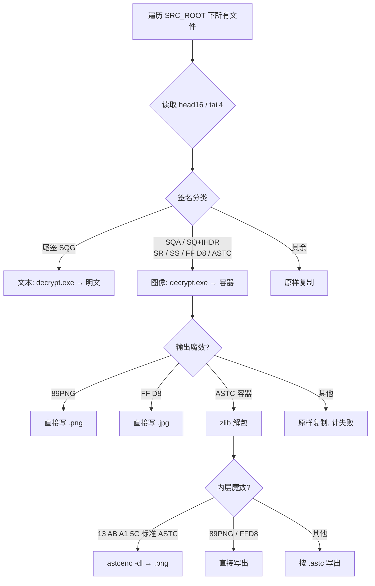

本文由OpenCode 2.0生成，人工微调

解密工具集：
- 关联脚本：`decryptor_in_one.py`（工作区根目录）
- 底层工具：`decutils/decrypt.exe`，源码见 `decutils/decrypt.cpp`
- 逆向参考：`decutils/revd_codes/`（从 `libMyGame.so` 还原出的原始 C 代码）

本文分析 `decryptor_in_one.py` 如何把一个**完全加密的游戏资源目录**整体还原为可用资源。分两层看：
- **编排层**（`decryptor_in_one.py`）：按文件签名分流、调用外部工具、处理容器、编排并行与统计。
- **算法层**（`decrypt.exe`，算法源自 `libMyGame.so`）：真正的密码学解密。

---

## 1. 总览

游戏资源有两种独立的加密策略，`decryptor_in_one.py` 据此把每个文件分成三类：

| 类别     | 判定                                               | 处理方式                                      | 步骤  |
| ------ | ------------------------------------------------ | ----------------------------------------- | --- |
| **文本** | 尾部 `SQG\0`                                       | `decrypt.exe` → 直接得明文                     | 1 步 |
| **图像** | 尾部 `SQA\0`、头部 `SQ+IHDR`、`SR`/`SS`、`FF D8`、`ASTC` | `decrypt.exe` → 容器 → 解包 → `astcenc` → PNG | 2 步 |
| **原样** | 其余（mp3/plist/json/ccbi/moc3/skel/ttf/fnt…）       | 直接复制                                      | 0 步 |

输出目录固定为 `<SRC>_decrypted`，保持原有目录结构。




音频（mp3 等）并未加密，属于「原样复制」路径。

---

## 2. 文件签名分类

分类只看**文件头 16 字节（`head16`）**与**文件尾 4 字节（`tail4`）**，见 `classify_signature()` 与 `read_signature()`。

| 位置 | 匹配值 | 含义 | `decrypt.exe` 中的密文初值 |
| --- | --- | --- | --- |
| 尾部 | `53 51 47 00`（`"SQG\0"`） | 文本（lua / csv / xml） | XOR base `0x54` |
| 尾部 | `53 51 41 00`（`"SQA\0"`） | ASTC / 二进制图像 | XOR base `0x41` |
| 头部 | 前 2 字节 `SQ`，且偏移 12 处为 `IHDR`（LE `0x52444849`） | PNG | XOR base `0x50` |
| 头部 | 前 2 字节 `SR` | JPEG（含 SOF0 段） | XOR base `0x52` |
| 头部 | 前 2 字节 `SS` | JPEG | XOR base `0x53` |
| 头部 | 前 2 字节 `FF D8` | 已是标准 JPEG | 直通 |
| 头部 | 前 4 字节 `ASTC` | ASTC「容器」 | XOR base `0x41` |
| — | 以上都不匹配 | 未加密 / 未知 | 原样复制 |

**优先级差异（易踩坑）**

- `decryptor_in_one.py` 的 `classify_signature()` 先判尾签（`SQG`/`SQA`），再判头签（`SQ+IHDR` → `SR`/`SS` → `FF D8` → `ASTC`）。
- `decrypt.exe`（`decrypt.cpp` 的 `detect_type()`）把前缀 `ASTC`、`SQ+IHDR`、`SR`、`SS`、`FF D8` 放在**更高优先级**，尾签 `SQG`/`SQA` 放在后面。
- 两者对实际资源目录的判定结果一致；但**同一文件同时满足多条件时优先级不同**，写新工具时需留意。

`ASTC` 前缀与 `SQA\0` 尾签最终都走同一条解密分支（base `0x41`）：加密文件是「`ASTC`+长度+zlib 负载」经过 XOR/Blowfish 加密、再追加 `SQA\0` 尾签的产物，所以解密后其开头正好是 `ASTC`。

---

## 3. 底层解密算法（`decrypt.exe` / `decrypt.cpp`）

### 3.1 密钥派生

在 `revd_codes/init.c` 中，游戏启动时：

```c
getMd5HexStr(&DAT_03d1b008, 1, acStack_5c);  // 对 1 字节做 MD5，输出 32 字符十六进制
blf_key(acStack_5c, 0x20);                    // 32 字节 ASCII 作为 Blowfish key
```

该字节静态值为 `0x62`（`'b'`），所以：

```
密钥 = ASCII( MD5( 单字节 0x62 ) )
     = "92eb5ffee6ae2fec3ad71c777531578f"      （32 字节 ASCII，非 16 字节原始摘要）
```

`decrypt.exe` 通过 `init_decryptor(0x62)` 硬编码这一取值；`decrypt_v2.py` 则提供了「暴力枚举 256 个单字节 + 用可打印率打分」的 `--find-key` 兜底手段。

> 注意：`getMd5HexStr` 输出的是**十六进制字符串**，所以 Blowfish 实际 key 长度是 32 字节。若运行时重定位改动该地址，密钥可能变化。

### 3.2 通用三步（`common_decrypt`）

除 JPEG 外，文本、ASTC、PNG 走的都是同一套对称结构。设去掉尾签后的数据长度为 `N`，XOR 基准为 `base`：

```text
1) 首尾镜像交换（仅前 n1 对字节）
       n1 = (N >> 3) << 2          # 约 N/2，向下取整到 4 的倍数
2) Blowfish ECB 解密
       blocks = N >> 3
3) 首尾镜像交换（仅前 n2 对字节）
       n2 = N >> 1
```

镜像交换 pass 中，第 `i` 对（`0 ≤ i < n`，`end = N-1`）执行：

```text
t = data[i]
data[i]     = data[end-i] ^ k_i
data[end-i] = t          ^ k_i
```

每对的 XOR 键**只与 `i` 和 `base` 有关**，两趟 pass 公式相同：

```text
k_i = ( base + i + ⌊ (base + i) / 255 ⌋ ) & 0xFF
```

其中 `base` 随文件类型变化（`0x54` / `0x41` / `0x50` / `0x52` / `0x53`）。

### 3.3 Blowfish 细节

- 标准 Blowfish：18 个 P 值 + 4×256 个 S 盒，均取自 π 的十六进制常数。
- P/S 初值直接来自 `libMyGame.so` 中提取的 S 盒（与教科书常数一致）。
- 密钥扩展：将 32 字节 key 循环与 P 数组异或，再用标准 `bf_enc` 迭代重填 P、S。
- 解密按 8 字节块、以小端 32 位字读取 `L`、`R`，执行 16 轮 Feistel 网络后写回。
- 实现见 `decrypt.cpp` 的 `bf_init` / `bf_dec` / `bf_decrypt_blocks`，等价于 `revd_codes/blf_dec.c`。

### 3.4 各类型的差异

| 类型             | 尾签/定位                             | 数据范围                              | XOR base | 收尾修补                    |
| -------------- | --------------------------------- | --------------------------------- | -------- | ----------------------- |
| **文本 `SQG`**   | 尾 4 字节 `SQG\0`                    | 去掉尾签，`N = len-4`                  | `0x54`   | 无（尾签 4 字节写回 `0x20`）     |
| **ASTC `SQA`** | 尾 4 字节 `SQA\0`                    | 去掉尾签，`N = len-4`                  | `0x41`   | 无                       |
| **PNG `SQ`**   | `data[0:2]=="SQ"` 且偏移 12 为 `IHDR` | 从 **偏移 16** 起，长度 = 全字长字节序翻转后 `+4` | `0x50`   | 头部写 `89 50`，其余 16 字节头保留 |
| **JPEG `SR`**  | 头 `SR`，扫描 `FF C0`（SOF0）           | 从 `SOF0+4` 起，段长字节序翻转 `-2`         | `0x52`   | 魔数写 `FF D8`             |
| **JPEG `SS`**  | 头 `SS`                            | 从 **偏移 2** 起，`N = len-2`          | `0x53`   | 魔数写 `FF D8`             |

要点：

- **文本**：剥掉 4 字节尾签后整体做「镜像交换 + Blowfish + 镜像交换」，一次到底。
- **PNG**：前 16 字节是特殊头（含改序的长度字段），只对偏移 16 之后的负载做三步解密；长度字段 `u32` 经过「相邻字节交换 + 高低半字交换」（即整字字节序翻转），再 `+4` 得负载长度。
- **JPEG `SR`**：先在密文中扫描 `FF C0`，用其后的 2 字节段长（翻转后 `-2`）确定负载长度，再解密并补回 `FF D8` 文件头。
- **JPEG `SS`**：整个文件从偏移 2 起就是负载，直接解密。

> `decrypt_v2.py` 与 `revd_codes`、`decrypt.cpp` 是同一算法的不同实现（`decrypt_v2.py` 用纯 Python 复刻，便于调试/找密钥）。

---

## 4. 编排层：`decryptor_in_one.py`

### 4.1 关键函数

| 函数 | 职责 |
| --- | --- |
| `parse_args()` | 解析 `--src`（必填）与 `--workers`（默认 1） |
| `read_signature(path)` | 读 `head16` + `tail4`，用于分类 |
| `classify_signature(head16, tail4)` | 返回 `text` / `image` / `plain` |
| `process_text(src, dst, tmpdir)` | 调 `decrypt.exe` 出明文；失败则原样复制 |
| `process_image(src, dst_dir, basename, src_ext, tmpdir)` | 解密 → 容器解包 → `astcenc`，见下 |
| `copy_plain(src, dst)` | 直接复制 |
| `process_one(src, rel, dst_root, tmpdir)` | 单文件调度 + 「已存在则跳过」+ 异常兜底 |
| `main()` | 遍历、线程池、进度与统计 |
| `unwrap_astc(data)` | 去掉 `ASTC`+4 字节长度后 `zlib.decompress(data[8:])` |
| `inner_format(payload)` | 按魔数判内层为 ASTC / PNG / JPEG / unknown |
| `final_output_name(basename, fmt)` | 决定输出扩展名（`.png` / `.jpg` / `.astc`） |

### 4.2 图像两步流水线（`process_image`）

1. `decrypt.exe <src> <tmp>` 做第一步解密。
2. 读取 `tmp` 内容：
   - 以 `89 50 4E 47…`（PNG 魔数）开头 → 直接写 `.png`，完成。
   - 以 `FF D8`（JPEG）开头 → 直接写 `.jpg`，完成。
   - 以 `ASTC`（容器魔数）开头 → 走第 3 步。
   - 其他 → 视为失败，原样复制源文件（计 `img_fail`）。
3. 容器解包 `unwrap_astc`：丢弃前 8 字节（`ASTC` + 4 字节长度），对剩余部分 `zlib.decompress`，得到内层载荷。若 `zlib.error` → 回退原样复制，计失败。
4. 按内层魔数分流：
   - `13 AB A1 5C`（标准 ASTC）→ 落盘为临时 `.astc`，调用
     `astcenc-avx2.exe -dl <tmp>.astc <out>.png` 转成 PNG。
   - `89 PNG` / `FF D8` → 直接写出。
   - 未知魔数 → 仍按 `.astc` 扩展名写出原始载荷，并**计为成功**（`img_ok`），不做 astcenc 转换。

> 之所以要先写成 `*.astc` 临时文件，是因为 `astcenc` **依赖文件扩展名嗅探输入格式**；直接喂字节流会被误判。

### 4.3 中间容器格式

`decrypt.exe` 对 `SQA`/`ASTC` 类图像的输出并不是裸 ASTC，而是一个自描述容器：

```
偏移 0        4 字节  ASCII "ASTC"                容器魔数
偏移 4        4 字节  uint32 小端 = 解压后长度      （unwrap 时被忽略，decompress_images.py 用它校验）
偏移 8        ...     zlib 压缩流                  解压后为内层载荷
```

内层载荷再按魔数分为：标准 ASTC（`13 AB A1 5C`）、PNG（`89 PNG`）、JPEG（`FF D8`）。

对照工具：`decutils/decompress_images.py` 对已解密的图像做同样的容器解包，并用 4 字节长度字段做一致性告警。

### 4.4 并行、断点续跑与统计

- **遍历**：`os.walk` 收集全部文件并 `sort()`，保证顺序稳定。
- **并行**：`ThreadPoolExecutor(max_workers=workers)`；每个文件在**独立临时目录**（`tempfile.mkdtemp`）下用 `mkstemp` 生成线程安全的临时文件，退出时整体清理。
- **断点续跑**：`process_one` 对文本/原样文件检查 `dst` 是否已存在；对图像检查 `<base>.png` / `<base>.jpg` 是否已存在，命中即计 `skip`，从而支持中断后重跑。
- **统计键**（`_STATS_KEYS`）：`text_ok` / `text_fail` / `img_ok` / `img_fail` / `plain` / `skip` / `error`。
- **进度**：每 500 个文件打印 `[完成/总数] ok=? fail=? 速率 ETA`。
- **失败即回退**：任何一步失败都把**原始密文**原样复制到输出目录，绝不丢文件；异常被 `try/except` 捕获并计入 `error`。

---

## 5. 关键常量速查

| 常量 | 值 | 用途 |
| --- | --- | --- |
| 文本尾签 | `53 51 47 00` (`SQG\0`) | 文本分类 + 解密剥离 |
| 图像尾签 | `53 51 41 00` (`SQA\0`) | ASTC 分类 + 解密剥离 |
| PNG 头特征 | 偏移 12 = `IHDR` (`0x52444849`) | PNG 分类 |
| 容器魔数 | `41 53 54 43` (`ASTC`) | `decrypt.exe` 图像输出容器 |
| 标准 ASTC 魔数 | `13 AB A1 5C` | 内层 ASTC 判定 |
| PNG 魔数 | `89 50 4E 47 0D 0A 1A 0A` | 内层/直出判定 |
| JPEG 魔数 | `FF D8` | 内层/直出判定 |
| XOR base（文本） | `0x54` | `SQG` |
| XOR base（ASTC） | `0x41` | `SQA` / `ASTC` |
| XOR base（PNG） | `0x50` | `SQ+IHDR` |
| XOR base（JPEG） | `0x52` / `0x53` | `SR` / `SS` |
| Blowfish 密钥 | `MD5(0x62)` 的十六进制串 | `92eb5ffee6ae2fec3ad71c777531578f` |

---

## 6. 注意事项与限制

1. **外部依赖**：必须存在 `decutils/decrypt.exe` 与 `decutils/astcenc-5.5/astcenc-avx2.exe`，`main()` 会在启动时校验，缺失直接报错退出。
2. **输出目录固定**：不提供 `--dst`，恒为 `<SRC>_decrypted`；`--src` 不存在的目录会报错返回 1。
3. **密钥硬编码**：依赖运行时字节恒为 `0x62`。若游戏版本更新导致该字节变化，需借助 `decrypt_v2.py --find-key` 重新确定。
4. **失败不丢数据**：任何解密/转换失败都会回退为原样复制，并以 `*_fail` / `error` 计数体现；排查时重点看这两类。
5. **`skip` 语义**：图像以 `base.png` / `base.jpg` 是否存在判断是否已处理，若上一次失败产生了同名回退文件，重跑会被跳过。
6. **容器长度字段被忽略**：`unwrap_astc` 不校验 `ASTC` 后的长度字段；如需诊断，用 `decompress_images.py`（它会打印长度不一致告警）。
7. **线程数**：`--workers` 默认 1（顺序），磁盘 I/O 密集时多线程收益有限，且外部进程并发会增加开销。

---

## 7. 工具与目录地图

```text
血族/
├─ decryptor_in_one.py          # 本次分析主体：全量解密编排
├─ decutils/
│  ├─ decrypt.exe               # 第一步解密（文本/图像）
│  ├─ decrypt.cpp               # decrypt.exe 的源码（含 MD5 + Blowfish + XOR）
│  ├─ astcenc-5.5/astcenc-avx2.exe  # ASTC → PNG
│  ├─ decompress_images.py      # 图像容器（ASTC+长度+zlib）解包工具
│  ├─ decryptors/
│  │  ├─ decrypt.py             # 早期按扩展名的简易修复脚本
│  │  └─ decrypt_v2.py          # 纯 Python 复刻 + --find-key 暴力找密钥
│  └─ revd_codes/               # 从 libMyGame.so 还原的原始 C 代码
│     ├─ init.c                 # 密钥派生（getMd5HexStr + blf_key）
│     ├─ decryptFile.c          # 文件类型分发入口
│     ├─ decryptTxt.c / decryptASTC.c / decryptPNG.c / decryptJPG.c
│     ├─ getMd5HexStr.c         # MD5 → 十六进制字符串
│     └─ blf_*.c / InitializeBlowfish.c
├─ tests/
│  └─ test_decryptor_in_one.py  # 分类/解包/端到端测试（用真实游戏文件做夹具）
└─ com.sdg.woool.xuezu.x7sy/    # 原始加密资源（SRC_ROOT）
```

### 运行方式

```powershell
# 顺序解密整个资源目录 → 输出到 <SRC>_decrypted
python decryptor_in_one.py --src com.sdg.woool.xuezu.x7sy

# 多线程（例如 8 线程）
python decryptor_in_one.py --src com.sdg.woool.xuezu.x7sy --workers 8

# 运行测试
python -m unittest tests.test_decryptor_in_one
```

---

## 8. 一句话总结

《血族》的文本与图像资源被同一套「**XOR 首尾镜像交换 + Blowfish ECB**（密钥 = `MD5(0x62)` 的十六进制串）」加密，文本直接一步还原；图像还需由 `decrypt.exe` 输出 `ASTC+长度+zlib` 容器、经 zlib 解包后再由 `astcenc` 转为 PNG。`decryptor_in_one.py` 的价值在于**按签名自动分流、编排这条两步流水线、并行处理并在失败时安全回退**。
