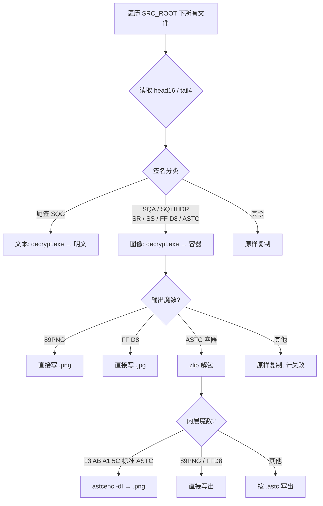

本文由OpenCode 2.0生成，人工微调

解密工具集：
- 关联脚本：`decryptor_in_one.py`（工作区根目录）
- 底层工具：`decutils/decrypt.exe`，源码见 `decutils/decrypt.cpp`
- 逆向参考：`decutils/revd_codes/`（从 `libMyGame.so` 还原出的原始 C 代码）

本文分析 `decryptor_in_one.py` 如何把一个**完全加密的游戏资源目录**整体还原为可用资源。分两层看：
- **编排层**（`decryptor_in_one.py`）：按文件签名分流、调用外部工具、处理容器、编排并行与统计。
- **算法层**（`decrypt.exe`，算法源自 `libMyGame.so`）：真正的密码学解密。

---

## 1. 总览

游戏资源有两种独立的加密策略，`decryptor_in_one.py` 据此把每个文件分成三类：

| 类别     | 判定                                               | 处理方式                                      | 步骤  |
| ------ | ------------------------------------------------ | ----------------------------------------- | --- |
| **文本** | 尾部 `SQG\0`                                       | `decrypt.exe` → 直接得明文                     | 1 步 |
| **图像** | 尾部 `SQA\0`、头部 `SQ+IHDR`、`SR`/`SS`、`FF D8`、`ASTC` | `decrypt.exe` → 容器 → 解包 → `astcenc` → PNG | 2 步 |
| **原样** | 其余（mp3/plist/json/ccbi/moc3/skel/ttf/fnt…）       | 直接复制                                      | 0 步 |

输出目录固定为 `<SRC>_decrypted`，保持原有目录结构。




音频（mp3 等）并未加密，属于「原样复制」路径。

---

## 2. 文件签名分类

分类只看**文件头 16 字节（`head16`）**与**文件尾 4 字节（`tail4`）**，见 `classify_signature()` 与 `read_signature()`。

| 位置 | 匹配值 | 含义 | `decrypt.exe` 中的密文初值 |
| --- | --- | --- | --- |
| 尾部 | `53 51 47 00`（`"SQG\0"`） | 文本（lua / csv / xml） | XOR base `0x54` |
| 尾部 | `53 51 41 00`（`"SQA\0"`） | ASTC / 二进制图像 | XOR base `0x41` |
| 头部 | 前 2 字节 `SQ`，且偏移 12 处为 `IHDR`（LE `0x52444849`） | PNG | XOR base `0x50` |
| 头部 | 前 2 字节 `SR` | JPEG（含 SOF0 段） | XOR base `0x52` |
| 头部 | 前 2 字节 `SS` | JPEG | XOR base `0x53` |
| 头部 | 前 2 字节 `FF D8` | 已是标准 JPEG | 直通 |
| 头部 | 前 4 字节 `ASTC` | ASTC「容器」 | XOR base `0x41` |
| — | 以上都不匹配 | 未加密 / 未知 | 原样复制 |

**优先级差异（易踩坑）**

- `decryptor_in_one.py` 的 `classify_signature()` 先判尾签（`SQG`/`SQA`），再判头签（`SQ+IHDR` → `SR`/`SS` → `FF D8` → `ASTC`）。
- `decrypt.exe`（`decrypt.cpp` 的 `detect_type()`）把前缀 `ASTC`、`SQ+IHDR`、`SR`、`SS`、`FF D8` 放在**更高优先级**，尾签 `SQG`/`SQA` 放在后面。
- 两者对实际资源目录的判定结果一致；但**同一文件同时满足多条件时优先级不同**，写新工具时需留意。

`ASTC` 前缀与 `SQA\0` 尾签最终都走同一条解密分支（base `0x41`）：加密文件是「`ASTC`+长度+zlib 负载」经过 XOR/Blowfish 加密、再追加 `SQA\0` 尾签的产物，所以解密后其开头正好是 `ASTC`。

---

## 3. 底层解密算法（`decrypt.exe` / `decrypt.cpp`）

### 3.1 密钥派生

在 `revd_codes/init.c` 中，游戏启动时：

```c
getMd5HexStr(&DAT_03d1b008, 1, acStack_5c);  // 对 1 字节做 MD5，输出 32 字符十六进制
blf_key(acStack_5c, 0x20);                    // 32 字节 ASCII 作为 Blowfish key
```

该字节静态值为 `0x62`（`'b'`），所以：

```
密钥 = ASCII( MD5( 单字节 0x62 ) )
     = "92eb5ffee6ae2fec3ad71c777531578f"      （32 字节 ASCII，非 16 字节原始摘要）
```

`decrypt.exe` 通过 `init_decryptor(0x62)` 硬编码这一取值；`decrypt_v2.py` 则提供了「暴力枚举 256 个单字节 + 用可打印率打分」的 `--find-key` 兜底手段。

> 注意：`getMd5HexStr` 输出的是**十六进制字符串**，所以 Blowfish 实际 key 长度是 32 字节。若运行时重定位改动该地址，密钥可能变化。

### 3.2 通用三步（`common_decrypt`）

除 JPEG 外，文本、ASTC、PNG 走的都是同一套对称结构。设去掉尾签后的数据长度为 `N`，XOR 基准为 `base`：

```text
1) 首尾镜像交换（仅前 n1 对字节）
       n1 = (N >> 3) << 2          # 约 N/2，向下取整到 4 的倍数
2) Blowfish ECB 解密
       blocks = N >> 3
3) 首尾镜像交换（仅前 n2 对字节）
       n2 = N >> 1
```

镜像交换 pass 中，第 `i` 对（`0 ≤ i < n`，`end = N-1`）执行：

```text
t = data[i]
data[i]     = data[end-i] ^ k_i
data[end-i] = t          ^ k_i
```

每对的 XOR 键**只与 `i` 和 `base` 有关**，两趟 pass 公式相同：

```text
k_i = ( base + i + ⌊ (base + i) / 255 ⌋ ) & 0xFF
```

其中 `base` 随文件类型变化（`0x54` / `0x41` / `0x50` / `0x52` / `0x53`）。

### 3.3 Blowfish 细节

- 标准 Blowfish：18 个 P 值 + 4×256 个 S 盒，均取自 π 的十六进制常数。
- P/S 初值直接来自 `libMyGame.so` 中提取的 S 盒（与教科书常数一致）。
- 密钥扩展：将 32 字节 key 循环与 P 数组异或，再用标准 `bf_enc` 迭代重填 P、S。
- 解密按 8 字节块、以小端 32 位字读取 `L`、`R`，执行 16 轮 Feistel 网络后写回。
- 实现见 `decrypt.cpp` 的 `bf_init` / `bf_dec` / `bf_decrypt_blocks`，等价于 `revd_codes/blf_dec.c`。

### 3.4 各类型的差异

| 类型             | 尾签/定位                             | 数据范围                              | XOR base | 收尾修补                    |
| -------------- | --------------------------------- | --------------------------------- | -------- | ----------------------- |
| **文本 `SQG`**   | 尾 4 字节 `SQG\0`                    | 去掉尾签，`N = len-4`                  | `0x54`   | 无（尾签 4 字节写回 `0x20`）     |
| **ASTC `SQA`** | 尾 4 字节 `SQA\0`                    | 去掉尾签，`N = len-4`                  | `0x41`   | 无                       |
| **PNG `SQ`**   | `data[0:2]=="SQ"` 且偏移 12 为 `IHDR` | 从 **偏移 16** 起，长度 = 全字长字节序翻转后 `+4` | `0x50`   | 头部写 `89 50`，其余 16 字节头保留 |
| **JPEG `SR`**  | 头 `SR`，扫描 `FF C0`（SOF0）           | 从 `SOF0+4` 起，段长字节序翻转 `-2`         | `0x52`   | 魔数写 `FF D8`             |
| **JPEG `SS`**  | 头 `SS`                            | 从 **偏移 2** 起，`N = len-2`          | `0x53`   | 魔数写 `FF D8`             |

要点：
- **文本**：剥掉 4 字节尾签后整体做「镜像交换 + Blowfish + 镜像交换」，一次到底。
- **PNG**：前 16 字节是特殊头（含改序的长度字段），只对偏移 16 之后的负载做三步解密；长度字段 `u32` 经过「相邻字节交换 + 高低半字交换」（即整字字节序翻转），再 `+4` 得负载长度。
- **JPEG `SR`**：先在密文中扫描 `FF C0`，用其后的 2 字节段长（翻转后 `-2`）确定负载长度，再解密并补回 `FF D8` 文件头。
- **JPEG `SS`**：整个文件从偏移 2 起就是负载，直接解密。

> `decrypt_v2.py` 与 `revd_codes`、`decrypt.cpp` 是同一算法的不同实现（`decrypt_v2.py` 用纯 Python 复刻，便于调试/找密钥）。

---

## 4. 编排层：`decryptor_in_one.py`

### 4.1 关键函数

| 函数 | 职责 |
| --- | --- |
| `parse_args()` | 解析 `--src`（必填）与 `--workers`（默认 1） |
| `read_signature(path)` | 读 `head16` + `tail4`，用于分类 |
| `classify_signature(head16, tail4)` | 返回 `text` / `image` / `plain` |
| `process_text(src, dst, tmpdir)` | 调 `decrypt.exe` 出明文；失败则原样复制 |
| `process_image(src, dst_dir, basename, src_ext, tmpdir)` | 解密 → 容器解包 → `astcenc`，见下 |
| `copy_plain(src, dst)` | 直接复制 |
| `process_one(src, rel, dst_root, tmpdir)` | 单文件调度 + 「已存在则跳过」+ 异常兜底 |
| `main()` | 遍历、线程池、进度与统计 |
| `unwrap_astc(data)` | 去掉 `ASTC`+4 字节长度后 `zlib.decompress(data[8:])` |
| `inner_format(payload)` | 按魔数判内层为 ASTC / PNG / JPEG / unknown |
| `final_output_name(basename, fmt)` | 决定输出扩展名（`.png` / `.jpg` / `.astc`） |

### 4.2 图像两步流水线（`process_image`）

1. `decrypt.exe <src> <tmp>` 做第一步解密。
2. 读取 `tmp` 内容：
   - 以 `89 50 4E 47…`（PNG 魔数）开头 → 直接写 `.png`，完成。
   - 以 `FF D8`（JPEG）开头 → 直接写 `.jpg`，完成。
   - 以 `ASTC`（容器魔数）开头 → 走第 3 步。
   - 其他 → 视为失败，原样复制源文件（计 `img_fail`）。
3. 容器解包 `unwrap_astc`：丢弃前 8 字节（`ASTC` + 4 字节长度），对剩余部分 `zlib.decompress`，得到内层载荷。若 `zlib.error` → 回退原样复制，计失败。
4. 按内层魔数分流：
   - `13 AB A1 5C`（标准 ASTC）→ 落盘为临时 `.astc`，调用
     `astcenc-avx2.exe -dl <tmp>.astc <out>.png` 转成 PNG。
   - `89 PNG` / `FF D8` → 直接写出。
   - 未知魔数 → 仍按 `.astc` 扩展名写出原始载荷，并**计为成功**（`img_ok`），不做 astcenc 转换。

> 之所以要先写成 `*.astc` 临时文件，是因为 `astcenc` **依赖文件扩展名嗅探输入格式**；直接喂字节流会被误判。

### 4.3 中间容器格式

`decrypt.exe` 对 `SQA`/`ASTC` 类图像的输出并不是裸 ASTC，而是一个自描述容器：

```
偏移 0        4 字节  ASCII "ASTC"                容器魔数
偏移 4        4 字节  uint32 小端 = 解压后长度      （unwrap 时被忽略，decompress_images.py 用它校验）
偏移 8        ...     zlib 压缩流                  解压后为内层载荷
```

内层载荷再按魔数分为：标准 ASTC（`13 AB A1 5C`）、PNG（`89 PNG`）、JPEG（`FF D8`）。

对照工具：`decutils/decompress_images.py` 对已解密的图像做同样的容器解包，并用 4 字节长度字段做一致性告警。

### 4.4 并行、断点续跑与统计

- **遍历**：`os.walk` 收集全部文件并 `sort()`，保证顺序稳定。
- **并行**：`ThreadPoolExecutor(max_workers=workers)`；每个文件在**独立临时目录**（`tempfile.mkdtemp`）下用 `mkstemp` 生成线程安全的临时文件，退出时整体清理。
- **断点续跑**：`process_one` 对文本/原样文件检查 `dst` 是否已存在；对图像检查 `<base>.png` / `<base>.jpg` 是否已存在，命中即计 `skip`，从而支持中断后重跑。
- **统计键**（`_STATS_KEYS`）：`text_ok` / `text_fail` / `img_ok` / `img_fail` / `plain` / `skip` / `error`。
- **进度**：每 500 个文件打印 `[完成/总数] ok=? fail=? 速率 ETA`。
- **失败即回退**：任何一步失败都把**原始密文**原样复制到输出目录，绝不丢文件；异常被 `try/except` 捕获并计入 `error`。

---

## 5. 关键常量速查

| 常量             | 值                             | 用途                                 |
| -------------- | ----------------------------- | ---------------------------------- |
| 文本尾签           | `53 51 47 00` (`SQG\0`)       | 文本分类 + 解密剥离                        |
| 图像尾签           | `53 51 41 00` (`SQA\0`)       | ASTC 分类 + 解密剥离                     |
| PNG 头特征        | 偏移 12 = `IHDR` (`0x52444849`) | PNG 分类                             |
| 容器魔数           | `41 53 54 43` (`ASTC`)        | `decrypt.exe` 图像输出容器               |
| 标准 ASTC 魔数     | `13 AB A1 5C`                 | 内层 ASTC 判定                         |
| PNG 魔数         | `89 50 4E 47 0D 0A 1A 0A`     | 内层/直出判定                            |
| JPEG 魔数        | `FF D8`                       | 内层/直出判定                            |
| XOR base（文本）   | `0x54`                        | `SQG`                              |
| XOR base（ASTC） | `0x41`                        | `SQA` / `ASTC`                     |
| XOR base（PNG）  | `0x50`                        | `SQ+IHDR`                          |
| XOR base（JPEG） | `0x52` / `0x53`               | `SR` / `SS`                        |
| Blowfish 密钥    | `MD5(0x62)` 的十六进制串            | `92eb5ffee6ae2fec3ad71c777531578f` |

---

## 6. 注意事项与限制

1. **外部依赖**：必须存在 `decutils/decrypt.exe` 与 `decutils/astcenc-5.5/astcenc-avx2.exe`，`main()` 会在启动时校验，缺失直接报错退出。astcenc可以在GitHub上下载。
2. **输出目录固定**：不提供 `--dst`，恒为 `<SRC>_decrypted`；`--src` 不存在的目录会报错返回 1。
3. **密钥硬编码**：依赖运行时字节恒为 `0x62`。若游戏版本更新导致该字节变化，需借助 `decrypt_v2.py --find-key` 重新确定。
4. **失败不丢数据**：任何解密/转换失败都会回退为原样复制，并以 `*_fail` / `error` 计数体现；排查时重点看这两类。
5. **`skip` 语义**：图像以 `base.png` / `base.jpg` 是否存在判断是否已处理，若上一次失败产生了同名回退文件，重跑会被跳过。
6. **容器长度字段被忽略**：`unwrap_astc` 不校验 `ASTC` 后的长度字段；如需诊断，用 `decompress_images.py`（它会打印长度不一致告警）。
7. **线程数**：`--workers` 默认 1（顺序），磁盘 I/O 密集时多线程收益有限，且外部进程并发会增加开销。

---

## 7. 工具与目录地图

```text
血族/
├─ decryptor_in_one.py          # 本次分析主体：全量解密编排
├─ decutils/
│  ├─ decrypt.exe               # 第一步解密（文本/图像）
│  ├─ decrypt.cpp               # decrypt.exe 的源码（含 MD5 + Blowfish + XOR）
│  ├─ astcenc-5.5/astcenc-avx2.exe  # ASTC → PNG
│  ├─ decompress_images.py      # 图像容器（ASTC+长度+zlib）解包工具
│  ├─ decryptors/
│  │  ├─ decrypt.py             # 早期按扩展名的简易修复脚本
│  │  └─ decrypt_v2.py          # 纯 Python 复刻 + --find-key 暴力找密钥
│  └─ revd_codes/               # 从 libMyGame.so 还原的原始 C 代码
│     ├─ init.c                 # 密钥派生（getMd5HexStr + blf_key）
│     ├─ decryptFile.c          # 文件类型分发入口
│     ├─ decryptTxt.c / decryptASTC.c / decryptPNG.c / decryptJPG.c
│     ├─ getMd5HexStr.c         # MD5 → 十六进制字符串
│     └─ blf_*.c / InitializeBlowfish.c
├─ tests/
│  └─ test_decryptor_in_one.py  # 分类/解包/端到端测试（用真实游戏文件做夹具）
└─ com.sdg.woool.xuezu.x7sy/    # 原始加密资源（SRC_ROOT）
```

### 运行方式

```powershell
# 顺序解密整个资源目录 → 输出到 <SRC>_decrypted
python decryptor_in_one.py --src com.sdg.woool.xuezu.x7sy

# 多线程（例如 8 线程）
python decryptor_in_one.py --src com.sdg.woool.xuezu.x7sy --workers 8

# 运行测试
python -m unittest tests.test_decryptor_in_one
```

---

## 8. 一句话总结

《血族》的文本与图像资源被同一套「**XOR 首尾镜像交换 + Blowfish ECB**（密钥 = `MD5(0x62)` 的十六进制串）」加密，文本直接一步还原；图像还需由 `decrypt.exe` 输出 `ASTC+长度+zlib` 容器、经 zlib 解包后再由 `astcenc` 转为 PNG。`decryptor_in_one.py` 的价值在于**按签名自动分流、编排这条两步流水线、并行处理并在失败时安全回退**。

## A1. decrypt.cpp

```cpp
#include <cstdint>
#include <cstdio>
#include <cstring>
#include <filesystem>
#include <fstream>
#include <iostream>
#include <string>
#include <vector>

namespace fs = std::filesystem;

// ============================================================
// MD5 Implementation
// ============================================================
struct MD5Context {
  uint32_t state[4];
  uint64_t count;
  uint8_t buffer[64];
};

static const uint32_t MD5_K[64] = {
    0xd76aa478, 0xe8c7b756, 0x242070db, 0xc1bdceee, 0xf57c0faf, 0x4787c62a,
    0xa8304613, 0xfd469501, 0x698098d8, 0x8b44f7af, 0xffff5bb1, 0x895cd7be,
    0x6b901122, 0xfd987193, 0xa679438e, 0x49b40821, 0xf61e2562, 0xc040b340,
    0x265e5a51, 0xe9b6c7aa, 0xd62f105d, 0x02441453, 0xd8a1e681, 0xe7d3fbc8,
    0x21e1cde6, 0xc33707d6, 0xf4d50d87, 0x455a14ed, 0xa9e3e905, 0xfcefa3f8,
    0x676f02d9, 0x8d2a4c8a, 0xfffa3942, 0x8771f681, 0x6d9d6122, 0xfde5380c,
    0xa4beea44, 0x4bdecfa9, 0xf6bb4b60, 0xbebfbc70, 0x289b7ec6, 0xeaa127fa,
    0xd4ef3085, 0x04881d05, 0xd9d4d039, 0xe6db99e5, 0x1fa27cf8, 0xc4ac5665,
    0xf4292244, 0x432aff97, 0xab9423a7, 0xfc93a039, 0x655b59c3, 0x8f0ccc92,
    0xffeff47d, 0x85845dd1, 0x6fa87e4f, 0xfe2ce6e0, 0xa3014314, 0x4e0811a1,
    0xf7537e82, 0xbd3af235, 0x2ad7d2bb, 0xeb86d391};

static const uint32_t MD5_SHIFT[64] = {
    7, 12, 17, 22, 7, 12, 17, 22, 7, 12, 17, 22, 7, 12, 17, 22,
    5, 9,  14, 20, 5, 9,  14, 20, 5, 9,  14, 20, 5, 9,  14, 20,
    4, 11, 16, 23, 4, 11, 16, 23, 4, 11, 16, 23, 4, 11, 16, 23,
    6, 10, 15, 21, 6, 10, 15, 21, 6, 10, 15, 21, 6, 10, 15, 21};

static const uint32_t MD5_IDX[64] = {
    0, 1, 2,  3,  4,  5,  6,  7,  8,  9,  10, 11, 12, 13, 14, 15,
    1, 6, 11, 0,  5,  10, 15, 4,  9,  14, 3,  8,  13, 2,  7,  12,
    5, 8, 11, 14, 1,  4,  7,  10, 13, 0,  3,  6,  9,  12, 15, 2,
    0, 7, 14, 5,  12, 3,  10, 1,  8,  15, 6,  13, 4,  11, 2,  9};

static inline uint32_t rotl32(uint32_t x, uint32_t n) {
  return (x << n) | (x >> (32 - n));
}

static void md5_transform(uint32_t state[4], const uint8_t block[64]) {
  uint32_t a = state[0], b = state[1], c = state[2], d = state[3];
  uint32_t x[16];
  for (int i = 0; i < 16; i++)
    x[i] = (uint32_t)block[i * 4] | ((uint32_t)block[i * 4 + 1] << 8) |
           ((uint32_t)block[i * 4 + 2] << 16) |
           ((uint32_t)block[i * 4 + 3] << 24);
  for (int i = 0; i < 64; i++) {
    uint32_t f, g = MD5_IDX[i];
    if (i < 16)
      f = (b & c) | (~b & d);
    else if (i < 32)
      f = (d & b) | (~d & c);
    else if (i < 48)
      f = b ^ c ^ d;
    else
      f = c ^ (b | ~d);
    f += a + MD5_K[i] + x[g];
    a = d;
    d = c;
    c = b;
    b += rotl32(f, MD5_SHIFT[i]);
  }
  state[0] += a;
  state[1] += b;
  state[2] += c;
  state[3] += d;
}

static void md5_init(MD5Context* ctx) {
  ctx->state[0] = 0x67452301;
  ctx->state[1] = 0xEFCDAB89;
  ctx->state[2] = 0x98BADCFE;
  ctx->state[3] = 0x10325476;
  ctx->count = 0;
}

static void md5_update(MD5Context* ctx, const uint8_t* data, size_t len) {
  size_t idx = (size_t)(ctx->count >> 3) & 0x3F;
  ctx->count += (uint64_t)len << 3;
  size_t pos = 0;
  if (idx && idx + len >= 64) {
    size_t copy = 64 - idx;
    memcpy(ctx->buffer + idx, data, copy);
    md5_transform(ctx->state, ctx->buffer);
    pos += copy;
    idx = 0;
  }
  while (pos + 64 <= len) {
    md5_transform(ctx->state, data + pos);
    pos += 64;
  }
  if (pos < len) memcpy(ctx->buffer + idx, data + pos, len - pos);
}

static void md5_final(MD5Context* ctx, uint8_t digest[16]) {
  size_t idx = (size_t)(ctx->count >> 3) & 0x3F;
  ctx->buffer[idx++] = 0x80;
  if (idx > 56) {
    memset(ctx->buffer + idx, 0, 64 - idx);
    md5_transform(ctx->state, ctx->buffer);
    idx = 0;
  }
  memset(ctx->buffer + idx, 0, 56 - idx);
  for (int i = 0; i < 8; i++)
    ctx->buffer[56 + i] = (uint8_t)(ctx->count >> (i * 8));
  md5_transform(ctx->state, ctx->buffer);
  for (int i = 0; i < 16; i++)
    digest[i] = (uint8_t)(ctx->state[i >> 2] >> ((i & 3) * 8));
}

static void md5_to_hex(const uint8_t digest[16], char hex[33]) {
  const char* hx = "0123456789abcdef";
  for (int i = 0; i < 16; i++) {
    hex[i * 2] = hx[digest[i] >> 4];
    hex[i * 2 + 1] = hx[digest[i] & 0xF];
  }
  hex[32] = '\0';
}

// ============================================================
// Blowfish - from the .so extracted S-boxes
// ============================================================
static const uint32_t BF_P[18] = {
    0x243F6A88, 0x85A308D3, 0x13198A2E, 0x03707344, 0xA4093822, 0x299F31D0,
    0x082EFA98, 0xEC4E6C89, 0x452821E6, 0x38D01377, 0xBE5466CF, 0x34E90C6C,
    0xC0AC29B7, 0xC97C50DD, 0x3F84D5B5, 0xB5470917, 0x9216D5D9, 0x8979FB1B};

// S-boxes exactly as extracted from libMyGame.so
static const uint32_t BF_S0[256] = {
    0xD1310BA6, 0x98DFB5AC, 0x2FFD72DB, 0xD01ADFB7, 0xB8E1AFED, 0x6A267E96,
    0xBA7C9045, 0xF12C7F99, 0x24A19947, 0xB3916CF7, 0x0801F2E2, 0x858EFC16,
    0x636920D8, 0x71574E69, 0xA458FEA3, 0xF4933D7E, 0x0D95748F, 0x728EB658,
    0x718BCD58, 0x82154AEE, 0x7B54A41D, 0xC25A59B5, 0x9C30D539, 0x2AF26013,
    0xC5D1B023, 0x286085F0, 0xCA417918, 0xB8DB38EF, 0x8E79DCB0, 0x603A180E,
    0x6C9E0E8B, 0xB01E8A3E, 0xD71577C1, 0xBD314B27, 0x78AF2FDA, 0x55605C60,
    0xE65525F3, 0xAA55AB94, 0x57489862, 0x63E81440, 0x55CA396A, 0x2AAB10B6,
    0xB4CC5C34, 0x1141E8CE, 0xA15486AF, 0x7C72E993, 0xB3EE1411, 0x636FBC2A,
    0x2BA9C55D, 0x741831F6, 0xCE5C3E16, 0x9B87931E, 0xAFD6BA33, 0x6C24CF5C,
    0x7A325381, 0x28958677, 0x3B8F4898, 0x6B4BB9AF, 0xC4BFE81B, 0x66282193,
    0x61D809CC, 0xFB21A991, 0x487CAC60, 0x5DEC8032, 0xEF845D5D, 0xE98575B1,
    0xDC262302, 0xEB651B88, 0x23893E81, 0xD396ACC5, 0x0F6D6FF3, 0x83F44239,
    0x2E0B4482, 0xA4842004, 0x69C8F04A, 0x9E1F9B5E, 0x21C66842, 0xF6E96C9A,
    0x670C9C61, 0xABD388F0, 0x6A51A0D2, 0xD8542F68, 0x960FA728, 0xAB5133A3,
    0x6EEF0B6C, 0x137A3BE4, 0xBA3BF050, 0x7EFB2A98, 0xA1F1651D, 0x39AF0176,
    0x66CA593E, 0x82430E88, 0x8CEE8619, 0x456F9FB4, 0x7D84A5C3, 0x3B8B5EBE,
    0xE06F75D8, 0x85C12073, 0x401A449F, 0x56C16AA6, 0x4ED3AA62, 0x363F7706,
    0x1BFEDF72, 0x429B023D, 0x37D0D724, 0xD00A1248, 0xDB0FEAD3, 0x49F1C09B,
    0x075372C9, 0x80991B7B, 0x25D479D8, 0xF6E8DEF7, 0xE3FE501A, 0xB6794C3B,
    0x976CE0BD, 0x04C006BA, 0xC1A94FB6, 0x409F60C4, 0x5E5C9EC2, 0x196A2463,
    0x68FB6FAF, 0x3E6C53B5, 0x1339B2EB, 0x3B52EC6F, 0x6DFC511F, 0x9B30952C,
    0xCC814544, 0xAF5EBD09, 0xBEE3D004, 0xDE334AFD, 0x660F2807, 0x192E4BB3,
    0xC0CBA857, 0x45C8740F, 0xD20B5F39, 0xB9D3FBDB, 0x5579C0BD, 0x1A60320A,
    0xD6A100C6, 0x402C7279, 0x679F25FE, 0xFB1FA3CC, 0x8EA5E9F8, 0xDB3222F8,
    0x3C7516DF, 0xFD616B15, 0x2F501EC8, 0xAD0552AB, 0x323DB5FA, 0xFD238760,
    0x53317B48, 0x3E00DF82, 0x9E5C57BB, 0xCA6F8CA0, 0x1A87562E, 0xDF1769DB,
    0xD542A8F6, 0x287EFFC3, 0xAC6732C6, 0x8C4F5573, 0x695B27B0, 0xBBCA58C8,
    0xE1FFA35D, 0xB8F011A0, 0x10FA3D98, 0xFD2183B8, 0x4AFCB56C, 0x2DD1D35B,
    0x9A53E479, 0xB6F84565, 0xD28E49BC, 0x4BFB9790, 0xE1DDF2DA, 0xA4CB7E33,
    0x62FB1341, 0xCEE4C6E8, 0xEF20CADA, 0x36774C01, 0xD07E9EFE, 0x2BF11FB4,
    0x95DBDA4D, 0xAE909198, 0xEAAD8E71, 0x6B93D5A0, 0xD08ED1D0, 0xAFC725E0,
    0x8E3C5B2F, 0x8E7594B7, 0x8FF6E2FB, 0xF2122B64, 0x8888B812, 0x900DF01C,
    0x4FAD5EA0, 0x688FC31C, 0xD1CFF191, 0xB3A8C1AD, 0x2F2F2218, 0xBE0E1777,
    0xEA752DFE, 0x8B021FA1, 0xE5A0CC0F, 0xB56F74E8, 0x18ACF3D6, 0xCE89E299,
    0xB4A84FE0, 0xFD13E0B7, 0x7CC43B81, 0xD2ADA8D9, 0x165FA266, 0x80957705,
    0x93CC7314, 0x211A1477, 0xE6AD2065, 0x77B5FA86, 0xC75442F5, 0xFB9D35CF,
    0xEBCDAF0C, 0x7B3E89A0, 0xD6411BD3, 0xAE1E7E49, 0x00250E2D, 0x2071B35E,
    0x226800BB, 0x57B8E0AF, 0x2464369B, 0xF009B91E, 0x5563911D, 0x59DFA6AA,
    0x78C14389, 0xD95A537F, 0x207D5BA2, 0x02E5B9C5, 0x83260376, 0x6295CFA9,
    0x11C81968, 0x4E734A41, 0xB3472DCA, 0x7B14A94A, 0x1B510052, 0x9A532915,
    0xD60F573F, 0xBC9BC6E4, 0x2B60A476, 0x81E67400, 0x08BA6FB5, 0x571BE91F,
    0xF296EC6B, 0x2A0DD915, 0xB6636521, 0xE7B9F9B6, 0xFF34052E, 0xC5855664,
    0x53B02D5D, 0xA99F8FA1, 0x08BA4799, 0x6E85076A};
static const uint32_t BF_S1[256] = {
    0x4B7A70E9, 0xB5B32944, 0xDB75092E, 0xC4192623, 0xAD6EA6B0, 0x49A7DF7D,
    0x9CEE60B8, 0x8FEDB266, 0xECAA8C71, 0x699A17FF, 0x5664526C, 0xC2B19EE1,
    0x193602A5, 0x75094C29, 0xA0591340, 0xE4183A3E, 0x3F54989A, 0x5B429D65,
    0x6B8FE4D6, 0x99F73FD6, 0xA1D29C07, 0xEFE830F5, 0x4D2D38E6, 0xF0255DC1,
    0x4CDD2086, 0x8470EB26, 0x6382E9C6, 0x021ECC5E, 0x09686B3F, 0x3EBAEFC9,
    0x3C971814, 0x6B6A70A1, 0x687F3584, 0x52A0E286, 0xB79C5305, 0xAA500737,
    0x3E07841C, 0x7FDEAE5C, 0x8E7D44EC, 0x5716F2B8, 0xB03ADA37, 0xF0500C0D,
    0xF01C1F04, 0x0200B3FF, 0xAE0CF51A, 0x3CB574B2, 0x25837A58, 0xDC0921BD,
    0xD19113F9, 0x7CA92FF6, 0x94324773, 0x22F54701, 0x3AE5E581, 0x37C2DADC,
    0xC8B57634, 0x9AF3DDA7, 0xA9446146, 0x0FD0030E, 0xECC8C73E, 0xA4751E41,
    0xE238CD99, 0x3BEA0E2F, 0x3280BBA1, 0x183EB331, 0x4E548B38, 0x4F6DB908,
    0x6F420D03, 0xF60A04BF, 0x2CB81290, 0x24977C79, 0x5679B072, 0xBCAF89AF,
    0xDE9A771F, 0xD9930810, 0xB38BAE12, 0xDCCF3F2E, 0x5512721F, 0x2E6B7124,
    0x501ADDE6, 0x9F84CD87, 0x7A584718, 0x7408DA17, 0xBC9F9ABC, 0xE94B7D8C,
    0xEC7AEC3A, 0xDB851DFA, 0x63094366, 0xC464C3D2, 0xEF1C1847, 0x3215D908,
    0xDD433B37, 0x24C2BA16, 0x12A14D43, 0x2A65C451, 0x50940002, 0x133AE4DD,
    0x71DFF89E, 0x10314E55, 0x81AC77D6, 0x5F11199B, 0x043556F1, 0xD7A3C76B,
    0x3C11183B, 0x5924A509, 0xF28FE6ED, 0x97F1FBFA, 0x9EBABF2C, 0x1E153C6E,
    0x86E34570, 0xEAE96FB1, 0x860E5E0A, 0x5A3E2AB3, 0x771FE71C, 0x4E3D06FA,
    0x2965DCB9, 0x99E71D0F, 0x803E89D6, 0x5266C825, 0x2E4CC978, 0x9C10B36A,
    0xC6150EBA, 0x94E2EA78, 0xA5FC3C53, 0x1E0A2DF4, 0xF2F74EA7, 0x361D2B3D,
    0x1939260F, 0x19C27960, 0x5223A708, 0xF71312B6, 0xEBADFE6E, 0xEAC31F66,
    0xE3BC4595, 0xA67BC883, 0xB17F37D1, 0x018CFF28, 0xC332DDEF, 0xBE6C5AA5,
    0x65582185, 0x68AB9802, 0xEECEA50F, 0xDB2F953B, 0x2AEF7DAD, 0x5B6E2F84,
    0x1521B628, 0x29076170, 0xECDD4775, 0x619F1510, 0x13CCA830, 0xEB61BD96,
    0x0334FE1E, 0xAA0363CF, 0xB5735C90, 0x4C70A239, 0xD59E9E0B, 0xCBAADE14,
    0xEECC86BC, 0x60622CA7, 0x9CAB5CAB, 0xB2F3846E, 0x648B1EAF, 0x19BDF0CA,
    0xA02369B9, 0x655ABB50, 0x40685A32, 0x3C2AB4B3, 0x319EE9D5, 0xC021B8F7,
    0x9B540B19, 0x875FA099, 0x95F7997E, 0x623D7DA8, 0xF837889A, 0x97E32D77,
    0x11ED935F, 0x16681281, 0x0E358829, 0xC7E61FD6, 0x96DEDFA1, 0x7858BA99,
    0x57F584A5, 0x1B227263, 0x9B83C3FF, 0x1AC24696, 0xCDB30AEB, 0x532E3054,
    0x8FD948E4, 0x6DBC3128, 0x58EBF2EF, 0x34C6FFEA, 0xFE28ED61, 0xEE7C3C73,
    0x5D4A14D9, 0xE864B7E3, 0x42105D14, 0x203E13E0, 0x45EEE2B6, 0xA3AAABEA,
    0xDB6C4F15, 0xFACB4FD0, 0xC742F442, 0xEF6ABBB5, 0x654F3B1D, 0x41CD2105,
    0xD81E799E, 0x86854DC7, 0xE44B476A, 0x3D816250, 0xCF62A1F2, 0x5B8D2646,
    0xFC8883A0, 0xC1C7B6A3, 0x7F1524C3, 0x69CB7492, 0x47848A0B, 0x5692B285,
    0x095BBF00, 0xAD19489D, 0x1462B174, 0x23820E00, 0x58428D2A, 0x0C55F5EA,
    0x1DADF43E, 0x233F7061, 0x3372F092, 0x8D937E41, 0xD65FECF1, 0x6C223BDB,
    0x7CDE3759, 0xCBEE7460, 0x4085F2A7, 0xCE77326E, 0xA6078084, 0x19F8509E,
    0xE8EFD855, 0x61D99735, 0xA969A7AA, 0xC50C06C2, 0x5A04ABFC, 0x800BCADC,
    0x9E447A2E, 0xC3453484, 0xFDD56705, 0x0E1E9EC9, 0xDB73DBD3, 0x105588CD,
    0x675FDA79, 0xE3674340, 0xC5C43465, 0x713E38D8, 0x3D28F89E, 0xF16DFF20,
    0x153E21E7, 0x8FB03D4A, 0xE6E39F2B, 0xDB83ADF7};
static const uint32_t BF_S2[256] = {
    0xE93D5A68, 0x948140F7, 0xF64C261C, 0x94692934, 0x411520F7, 0x7602D4F7,
    0xBCF46B2E, 0xD4A20068, 0xD4082471, 0x3320F46A, 0x43B7D4B7, 0x500061AF,
    0x1E39F62E, 0x97244546, 0x14214F74, 0xBF8B8840, 0x4D95FC1D, 0x96B591AF,
    0x70F4DDD3, 0x66A02F45, 0xBFBC09EC, 0x03BD9785, 0x7FAC6DD0, 0x31CB8504,
    0x96EB27B3, 0x55FD3941, 0xDA2547E6, 0xABCA0A9A, 0x28507825, 0x530429F4,
    0x0A2C86DA, 0xE9B66DFB, 0x68DC1462, 0xD7486900, 0x680EC0A4, 0x27A18DEE,
    0x4F3FFEA2, 0xE887AD8C, 0xB58CE006, 0x7AF4D6B6, 0xAACE1E7C, 0xD3375FEC,
    0xCE78A399, 0x406B2A42, 0x20FE9E35, 0xD9F385B9, 0xEE39D7AB, 0x3B124E8B,
    0x1DC9FAF7, 0x4B6D1856, 0x26A36631, 0xEAE397B2, 0x3A6EFA74, 0xDD5B4332,
    0x6841E7F7, 0xCA7820FB, 0xFB0AF54E, 0xD8FEB397, 0x454056AC, 0xBA489527,
    0x55533A3A, 0x20838D87, 0xFE6BA9B7, 0xD096954B, 0x55A867BC, 0xA1159A58,
    0xCCA92963, 0x99E1DB33, 0xA62A4A56, 0x3F3125F9, 0x5EF47E1C, 0x9029317C,
    0xFDF8E802, 0x04272F70, 0x80BB155C, 0x05282CE3, 0x95C11548, 0xE4C66D22,
    0x48C1133F, 0xC70F86DC, 0x07F9C9EE, 0x41041F0F, 0x404779A4, 0x5D886E17,
    0x325F51EB, 0xD59BC0D1, 0xF2BCC18F, 0x41113564, 0x257B7834, 0x602A9C60,
    0xDFF8E8A3, 0x1F636C1B, 0x0E12B4C2, 0x02E1329E, 0xAF664FD1, 0xCAD18115,
    0x6B2395E0, 0x333E92E1, 0x3B240B62, 0xEEBEB922, 0x85B2A20E, 0xE6BA0D99,
    0xDE720C8C, 0x2DA2F728, 0xD0127845, 0x95B794FD, 0x647D0862, 0xE7CCF5F0,
    0x5449A36F, 0x877D48FA, 0xC39DFD27, 0xF33E8D1E, 0x0A476341, 0x992EFF74,
    0x3A6F6EAB, 0xF4F8FD37, 0xA812DC60, 0xA1EBDDF8, 0x991BE14C, 0xDB6E6B0D,
    0xC67B5510, 0x6D672C37, 0x2765D43B, 0xDCD0E804, 0xF1290DC7, 0xCC00FFA3,
    0xB5390F92, 0x690FED0B, 0x667B9FFB, 0xCEDB7D9C, 0xA091CF0B, 0xD9155EA3,
    0xBB132F88, 0x515BAD24, 0x7B9479BF, 0x763BD6EB, 0x37392EB3, 0xCC115979,
    0x8026E297, 0xF42E312D, 0x6842ADA7, 0xC66A2B3B, 0x12754CCC, 0x782EF11C,
    0x6A124237, 0xB79251E7, 0x06A1BBE6, 0x4BFB6350, 0x1A6B1018, 0x11CAEDFA,
    0x3D25BDD8, 0xE2E1C3C9, 0x44421659, 0x0A121386, 0xD90CEC6E, 0xD5ABEA2A,
    0x64AF674E, 0xDA86A85F, 0xBEBFE988, 0x64E4C3FE, 0x9DBC8057, 0xF0F7C086,
    0x60787BF8, 0x6003604D, 0xD1FD8346, 0xF6381FB0, 0x7745AE04, 0xD736FCCC,
    0x83426B33, 0xF01EAB71, 0xB0804187, 0x3C005E5F, 0x77A057BE, 0xBDE8AE24,
    0x55464299, 0xBF582E61, 0x4E58F48F, 0xF2DDFDA2, 0xF474EF38, 0x8789BDC2,
    0x5366F9C3, 0xC8B38E74, 0xB475F255, 0x46FCD9B9, 0x7AEB2661, 0x8B1DDF84,
    0x846A0E79, 0x915F95E2, 0x466E598E, 0x20B45770, 0x8CD55591, 0xC902DE4C,
    0xB90BACE1, 0xBB8205D0, 0x11A86248, 0x7574A99E, 0xB77F19B6, 0xE0A9DC09,
    0x662D09A1, 0xC4324633, 0xE85A1F02, 0x09F0BE8C, 0x4A99A025, 0x1D6EFE10,
    0x1AB93D1D, 0x0BA5A4DF, 0xA186F20F, 0x2868F169, 0xDCB7DA83, 0x573906FE,
    0xA1E2CE9B, 0x4FCD7F52, 0x50115E01, 0xA70683FA, 0xA002B5C4, 0x0DE6D027,
    0x9AF88C27, 0x773F8641, 0xC3604C06, 0x61A806B5, 0xF0177A28, 0xC0F586E0,
    0x006058AA, 0x30DC7D62, 0x11E69ED7, 0x2338EA63, 0x53C2DD94, 0xC2C21634,
    0xBBCBEE56, 0x90BCB6DE, 0xEBFC7DA1, 0xCE591D76, 0x6F05E409, 0x4B7C0188,
    0x39720A3D, 0x7C927C24, 0x86E3725F, 0x724D9DB9, 0x1AC15BB4, 0xD39EB8FC,
    0xED545578, 0x08FCA5B5, 0xD83D7CD3, 0x4DAD0FC4, 0x1E50EF5E, 0xB161E6F8,
    0xA28514D9, 0x6C51133C, 0x6FD5C7E7, 0x56E14EC4, 0x362ABFCE, 0xDDC6C837,
    0xD79A3234, 0x92638212, 0x670EFA8E, 0x406000E0};
static const uint32_t BF_S3[256] = {
    0x3A39CE37, 0xD3FAF5CF, 0xABC27737, 0x5AC52D1B, 0x5CB0679E, 0x4FA33742,
    0xD3822740, 0x99BC9BBE, 0xD5118E9D, 0xBF0F7315, 0xD62D1C7E, 0xC700C47B,
    0xB78C1B6B, 0x21A19045, 0xB26EB1BE, 0x6A366EB4, 0x5748AB2F, 0xBC946E79,
    0xC6A376D2, 0x6549C2C8, 0x530FF8EE, 0x468DDE7D, 0xD5730A1D, 0x4CD04DC6,
    0x2939BBDB, 0xA9BA4650, 0xAC9526E8, 0xBE5EE304, 0xA1FAD5F0, 0x6A2D519A,
    0x63EF8CE2, 0x9A86EE22, 0xC089C2B8, 0x43242EF6, 0xA51E03AA, 0x9CF2D0A4,
    0x83C061BA, 0x9BE96A4D, 0x8FE51550, 0xBA645BD6, 0x2826A2F9, 0xA73A3AE1,
    0x4BA99586, 0xEF5562E9, 0xC72FEFD3, 0xF752F7DA, 0x3F046F69, 0x77FA0A59,
    0x80E4A915, 0x87B08601, 0x9B09E6AD, 0x3B3EE593, 0xE990FD5A, 0x9E34D797,
    0x2CF0B7D9, 0x022B8B51, 0x96D5AC3A, 0x017DA67D, 0xD1CF3ED6, 0x7C7D2D28,
    0x1F9F25CF, 0xADF2B89B, 0x5AD6B472, 0x5A88F54C, 0xE029AC71, 0xE019A5E6,
    0x47B0ACFD, 0xED93FA9B, 0xE8D3C48D, 0x283B57CC, 0xF8D56629, 0x79132E28,
    0x785F0191, 0xED756055, 0xF7960E44, 0xE3D35E8C, 0x15056DD4, 0x88F46DBA,
    0x03A16125, 0x0564F0BD, 0xC3EB9E15, 0x3C9057A2, 0x97271AEC, 0xA93A072A,
    0x1B3F6D9B, 0x1E6321F5, 0xF59C66FB, 0x26DCF319, 0x7533D928, 0xB155FDF5,
    0x03563482, 0x8ABA3CBB, 0x28517711, 0xC20AD9F8, 0xABCC5167, 0xCCAD925F,
    0x4DE81751, 0x3830DC8E, 0x379D5862, 0x9320F991, 0xEA7A90C2, 0xFB3E7BCE,
    0x5121CE64, 0x774FBE32, 0xA8B6E37E, 0xC3293D46, 0x48DE5369, 0x6413E680,
    0xA2AE0810, 0xDD6DB224, 0x69852DFD, 0x09072166, 0xB39A460A, 0x6445C0DD,
    0x586CDECF, 0x1C20C8AE, 0x5BBEF7DD, 0x1B588D40, 0xCCD2017F, 0x6BB4E3BB,
    0xDDA26A7E, 0x3A59FF45, 0x3E350A44, 0xBCB4CDD5, 0x72EACEA8, 0xFA6484BB,
    0x8D6612AE, 0xBF3C6F47, 0xD29BE463, 0x542F5D9E, 0xAEC2771B, 0xF64E6370,
    0x740E0D8D, 0xE75B1357, 0xF8721671, 0xAF537D5D, 0x4040CB08, 0x4EB4E2CC,
    0x34D2466A, 0x0115AF84, 0xE1B00428, 0x95983A1D, 0x06B89FB4, 0xCE6EA048,
    0x6F3F3B82, 0x3520AB82, 0x011A1D4B, 0x277227F8, 0x611560B1, 0xE7933FDC,
    0xBB3A792B, 0x344525BD, 0xA08839E1, 0x51CE794B, 0x2F32C9B7, 0xA01FBAC9,
    0xE01CC87E, 0xBCC7D1F6, 0xCF0111C3, 0xA1E8AAC7, 0x1A908749, 0xD44FBD9A,
    0xD0DADECB, 0xD50ADA38, 0x0339C32A, 0xC6913667, 0x8DF9317C, 0xE0B12B4F,
    0xF79E59B7, 0x43F5BB3A, 0xF2D519FF, 0x27D9459C, 0xBF97222C, 0x15E6FC2A,
    0x0F91FC71, 0x9B941525, 0xFAE59361, 0xCEB69CEB, 0xC2A86459, 0x12BAA8D1,
    0xB6C1075E, 0xE3056A0C, 0x10D25065, 0xCB03A442, 0xE0EC6E0E, 0x1698DB3B,
    0x4C98A0BE, 0x3278E964, 0x9F1F9532, 0xE0D392DF, 0xD3A0342B, 0x8971F21E,
    0x1B0A7441, 0x4BA3348C, 0xC5BE7120, 0xC37632D8, 0xDF359F8D, 0x9B992F2E,
    0xE60B6F47, 0x0FE3F11D, 0xE54CDA54, 0x1EDAD891, 0xCE6279CF, 0xCD3E7E6F,
    0x1618B166, 0xFD2C1D05, 0x848FD2C5, 0xF6FB2299, 0xF523F357, 0xA6327623,
    0x93A83531, 0x56CCCD02, 0xACF08162, 0x5A75EBB5, 0x6E163697, 0x88D273CC,
    0xDE966292, 0x81B949D0, 0x4C50901B, 0x71C65614, 0xE6C6C7BD, 0x327A140A,
    0x45E1D006, 0xC3F27B9A, 0xC9AA53FD, 0x62A80F00, 0xBB25BFE2, 0x35BDD2F6,
    0x71126905, 0xB2040222, 0xB6CBCF7C, 0xCD769C2B, 0x53113EC0, 0x1640E3D3,
    0x38ABBD60, 0x2547ADF0, 0xBA38209C, 0xF746CE76, 0x77AFA1C5, 0x20756060,
    0x85CBFE4E, 0x8AE88DD8, 0x7AAAF9B0, 0x4CF9AA7E, 0x1948C25C, 0x02FB8A8C,
    0x01C36AE4, 0xD6EBE1F9, 0x90D4F869, 0xA65CDEA0, 0x3F09252D, 0xC208E69F,
    0xB74E6132, 0xCE77E25B, 0x578FDFE3, 0x3AC372E6};

struct BlowfishContext {
  uint32_t P[18];
  uint32_t S[4][256];
};

static uint32_t BF_F(const BlowfishContext* ctx, uint32_t x) {
  return ((ctx->S[1][(x >> 16) & 0xFF] + ctx->S[0][x >> 24]) ^
          ctx->S[2][(x >> 8) & 0xFF]) +
         ctx->S[3][x & 0xFF];
}

static void bf_enc(const BlowfishContext* ctx, uint32_t* L, uint32_t* R) {
  uint32_t l = *L, r = *R;
  for (int i = 0; i < 16; i++) {
    l ^= ctx->P[i];
    r ^= BF_F(ctx, l);
    uint32_t t = l;
    l = r;
    r = t;
  }
  uint32_t t = l;
  l = r;
  r = t;
  r ^= ctx->P[16];
  l ^= ctx->P[17];
  *L = l;
  *R = r;
}

static void bf_dec(const BlowfishContext* ctx, uint32_t* L, uint32_t* R) {
  uint32_t l = *L, r = *R;
  for (int i = 17; i >= 2; i--) {
    l ^= ctx->P[i];
    r ^= BF_F(ctx, l);
    uint32_t t = l;
    l = r;
    r = t;
  }
  uint32_t t = l;
  l = r;
  r = t;
  r ^= ctx->P[1];
  l ^= ctx->P[0];
  *L = l;
  *R = r;
}

static void bf_decrypt_blocks(BlowfishContext* ctx, uint8_t* data, int blocks) {
  for (int b = 0; b < blocks; b++) {
    uint32_t* p = (uint32_t*)(data + (size_t)b * 8);
    uint32_t l = p[0], r = p[1];
    bf_dec(ctx, &l, &r);
    p[0] = l;
    p[1] = r;
  }
}

static void bf_init(BlowfishContext* ctx, const uint8_t* key, int keylen) {
  memcpy(ctx->P, BF_P, sizeof(ctx->P));
  memcpy(ctx->S[0], BF_S0, 1024);
  memcpy(ctx->S[1], BF_S1, 1024);
  memcpy(ctx->S[2], BF_S2, 1024);
  memcpy(ctx->S[3], BF_S3, 1024);

  int k = 0;
  for (int i = 0; i < 18; i++) {
    uint32_t kw = ((uint32_t)key[k % keylen] << 24) |
                  ((uint32_t)key[(k + 1) % keylen] << 16) |
                  ((uint32_t)key[(k + 2) % keylen] << 8) |
                  (uint32_t)key[(k + 3) % keylen];
    ctx->P[i] ^= kw;
    k = (k + 4) % keylen;
  }

  uint32_t L = 0, R = 0;
  for (int i = 0; i < 18; i += 2) {
    bf_enc(ctx, &L, &R);
    ctx->P[i] = L;
    ctx->P[i + 1] = R;
  }
  for (int b = 0; b < 4; b++)
    for (int i = 0; i < 256; i += 2) {
      bf_enc(ctx, &L, &R);
      ctx->S[b][i] = L;
      ctx->S[b][i + 1] = R;
    }
}

// ============================================================
// XOR swap
// ============================================================
static uint8_t xor_key(int i, uint8_t key_start) {
  // Original: (char)i + (char)((key_start + i) / 0xff) + key_start
  int term = (key_start + i) / 0xFF;
  return (uint8_t)((uint8_t)i + (uint8_t)term + key_start);
}

static void xor_swap_pass(uint8_t* data, int data_len, uint8_t key_start) {
  int n = (data_len >> 3) << 2;
  int end = data_len - 1;
  for (int i = 0; i < n; i++) {
    uint8_t k = xor_key(i, key_start);
    uint8_t t = data[i];
    data[i] = data[end - i] ^ k;
    data[end - i] = t ^ k;
  }
}

static void xor_swap_pass2(uint8_t* data, int data_len, uint8_t key_start) {
  int n = data_len >> 1;
  int end = data_len - 1;
  for (int i = 0; i < n; i++) {
    uint8_t k = xor_key(i, key_start);
    uint8_t t = data[i];
    data[i] = data[end - i] ^ k;
    data[end - i] = t ^ k;
  }
}

// ============================================================
// Global Blowfish context
// ============================================================
BlowfishContext g_ctx;
static bool g_init = false;

static bool init_decryptor(uint8_t md5_input_byte = 0x62) {
  if (g_init) return true;
  uint8_t input = md5_input_byte;
  MD5Context md5;
  md5_init(&md5);
  md5_update(&md5, &input, 1);
  uint8_t digest[16];
  md5_final(&md5, digest);
  char hex_key[33];
  md5_to_hex(digest, hex_key);
  printf("Key: MD5(0x%02X) = %s\n", md5_input_byte, hex_key);
  bf_init(&g_ctx, (const uint8_t*)hex_key, 32);
  g_init = true;
  return true;
}

// ============================================================
// Decryption dispatchers
// ============================================================
static void common_decrypt(uint8_t* data, int data_len, uint8_t key_start) {
  xor_swap_pass(data, data_len, key_start);
  int blocks = data_len >> 3;
  bf_decrypt_blocks(&g_ctx, data, blocks);
  xor_swap_pass2(data, data_len, key_start);
}

static bool decrypt_csv_sqg(uint8_t* data, int& len) {
  if (len < 4) return false;
  int new_len = len - 4;
  memset(data + new_len, 0x20, 4);
  common_decrypt(data, new_len, 0x54);
  len = new_len;
  return true;
}

static bool decrypt_astc_sqa(uint8_t* data, int& len) {
  if (len < 4) return false;
  int new_len = len - 4;
  memset(data + new_len, 0x20, 4);
  common_decrypt(data, new_len, 0x41);
  len = new_len;
  return true;
}

static bool decrypt_png(uint8_t* data, int& len) {
  // Check: starts with "SQ" and has "IHDR" at offset 12
  if (len < 16) return false;
  if (data[0] != 'S' || data[1] != 'Q') return false;
  // 0x52444849 = "IHDR" in LE
  uint32_t ihdr_check = (uint32_t)data[12] | ((uint32_t)data[13] << 8) |
                        ((uint32_t)data[14] << 16) | ((uint32_t)data[15] << 24);
  if (ihdr_check != 0x52444849) return false;

  // Fix PNG magic: 0x5089 = 89 50 in LE
  data[0] = (uint8_t)0x89;
  data[1] = 'P';

  // Read size field at offset 8, byte-swap
  uint32_t raw = (uint32_t)data[8] | ((uint32_t)data[9] << 8) |
                 ((uint32_t)data[10] << 16) | ((uint32_t)data[11] << 24);
  uint32_t swapped = ((raw & 0xFF00FF00) >> 8) | ((raw & 0x00FF00FF) << 8);
  uint32_t uVar5 = (swapped >> 16) | (swapped << 16);
  uint32_t uVar4 = uVar5 + 4;

  uint8_t* payload = data + 16;
  int payload_len = (int)uVar4;
  if (payload_len > len - 16) payload_len = len - 16;
  if (payload_len < 8) return false;

  common_decrypt(payload, payload_len, 0x50);
  // Note: common_decrypt includes both XOR passes + Blowfish
  len = 16 + payload_len;
  return true;
}

static bool decrypt_jpg_sr(uint8_t* data, int len) {
  if (len < 6) return false;
  if (data[0] != 'S' || data[1] != 'R') return false;

  // Scan for 0xFF 0xC0 (SOF0 marker)
  int scan_pos = -1;
  for (int i = 1; i < len - 2; i++) {
    if (data[i] == (uint8_t)0xFF && data[i + 1] == (uint8_t)0xC0) {
      scan_pos = i;
      break;
    }
  }
  if (scan_pos < 0) return false;

  // Read 2-byte length at scan_pos + 2 (big-endian)
  uint16_t seg_len =
      (uint16_t)data[scan_pos + 2] | ((uint16_t)data[scan_pos + 3] << 8);
  uint32_t raw_len = ((seg_len & 0xFF00) >> 8) | ((seg_len & 0x00FF) << 8);
  uint32_t uVar6 = raw_len - 2;
  // uVar5 = (uVar6 >= 0) ? uVar6 : (raw_len + 5)
  uint32_t uVar5 = (raw_len + 5);
  if ((int)uVar6 >= 0) uVar5 = uVar6;

  uint8_t* payload = data + scan_pos + 4;
  int plen = (int)uVar6;
  if (plen > len - (scan_pos + 4)) plen = len - (scan_pos + 4);
  if (plen < 8) return false;

  // XOR pass 1: n = ((int)uVar5 >> 3) << 2
  int n = ((int)uVar5 >> 3) << 2;
  int end = plen - 1;
  for (int i = 0; i < n && i < plen && (end - i) >= 0; i++) {
    uint8_t k = xor_key(i, 0x52);
    uint8_t t = payload[i];
    payload[i] = payload[end - i] ^ k;
    payload[end - i] = t ^ k;
  }

  // Blowfish: blocks = uVar5 >> 3
  int blocks = (int)(uVar5 >> 3);
  bf_decrypt_blocks(&g_ctx, payload, blocks);

  // XOR pass 2: n = uVar6 >> 1
  int n2 = (int)(uVar6 >> 1);
  end = plen - 1;
  for (int i = 0; i < n2 && i < plen && (end - i) >= 0; i++) {
    uint8_t k = xor_key(i, 0x52);
    uint8_t t = payload[i];
    payload[i] = payload[end - i] ^ k;
    payload[end - i] = t ^ k;
  }

  // Fix JPEG SOI marker
  data[0] = (uint8_t)0xFF;
  data[1] = (uint8_t)0xD8;
  return true;
}

static bool decrypt_jpg_ss(uint8_t* data, int len) {
  if (len < 4) return false;
  if (data[0] != 'S' || data[1] != 'S') return false;

  // Fix JPEG SOI
  data[0] = (uint8_t)0xFF;
  data[1] = (uint8_t)0xD8;

  // uVar5 = len - 2
  int uVar5 = len - 2;
  // uVar4 = (uVar5 >= 0) ? uVar5 : (len + 5)
  int uVar4 = len + 5;
  if (uVar5 >= 0) uVar4 = uVar5;

  uint8_t* payload = data + 2;
  int plen = uVar5;
  if (plen < 8) return false;

  // XOR pass 1: n = ((int)uVar4 >> 3) << 2
  int n = ((int)uVar4 >> 3) << 2;
  int end = plen - 1;
  for (int i = 0; i < n && i < plen && (end - i) >= 0; i++) {
    uint8_t k = xor_key(i, 0x53);
    uint8_t t = payload[i];
    payload[i] = payload[end - i] ^ k;
    payload[end - i] = t ^ k;
  }

  // Blowfish: blocks = uVar4 >> 3
  int blocks = (int)(uVar4 >> 3);
  bf_decrypt_blocks(&g_ctx, payload, blocks);

  // XOR pass 2: n = uVar5 >> 1
  int n2 = (int)(uVar5 >> 1);
  end = plen - 1;
  for (int i = 0; i < n2 && i < plen && (end - i) >= 0; i++) {
    uint8_t k = xor_key(i, 0x53);
    uint8_t t = payload[i];
    payload[i] = payload[end - i] ^ k;
    payload[end - i] = t ^ k;
  }

  return true;
}

// ============================================================
// File type detection
// ============================================================
enum FileType {
  FT_UNKNOWN,
  FT_CSV_SQG,
  FT_ASTC_SQA,
  FT_PNG_SQ,
  FT_JPG_SR,
  FT_JPG_SS
};

static FileType detect_type(const uint8_t* data, int len) {
  if (len >= 4) {
    // Prefix-based detection (highest priority)
    if (data[0] == 'A' && data[1] == 'S' && data[2] == 'T' && data[3] == 'C')
      return FT_ASTC_SQA;
    // SQ-PNG: first 2 bytes "SQ" and "IHDR" at offset 12
    if (len >= 16 && data[0] == 'S' && data[1] == 'Q') {
      uint32_t ihdr = (uint32_t)data[12] | ((uint32_t)data[13] << 8) |
                      ((uint32_t)data[14] << 16) | ((uint32_t)data[15] << 24);
      if (ihdr == 0x52444849) return FT_PNG_SQ;
    }
    // JPG patterns
    if (data[0] == 'S' && data[1] == 'R') return FT_JPG_SR;
    if (data[0] == 'S' && data[1] == 'S') return FT_JPG_SS;
    if (data[0] == (uint8_t)0xFF && data[1] == (uint8_t)0xD8)
      return FT_JPG_SS;  // standard JPEG passthrough

    // Suffix-based detection (lower priority)
    if (data[len - 4] == 'S' && data[len - 3] == 'Q' && data[len - 2] == 'G' &&
        data[len - 1] == 0)
      return FT_CSV_SQG;
    if (data[len - 4] == 'S' && data[len - 3] == 'Q' && data[len - 2] == 'A' &&
        data[len - 1] == 0)
      return FT_ASTC_SQA;
  }
  return FT_UNKNOWN;
}

static bool is_all_ascii(const uint8_t* data, int len) {
  for (int i = 0; i < len; i++)
    if (data[i] >= 128) return false;
  return true;
}

// ============================================================
// Main
// ============================================================
static bool try_decrypt(const std::string& input_path,
                        const std::string& output_path, uint8_t md5_byte,
                        std::string& out_type, bool quiet) {
  g_init = false;
  if (!init_decryptor(md5_byte)) return false;

  FILE* f = fopen(input_path.c_str(), "rb");
  if (!f) return false;
  fseek(f, 0, SEEK_END);
  long file_size = ftell(f);
  fseek(f, 0, SEEK_SET);
  std::vector<uint8_t> buf(file_size);
  if (fread(buf.data(), 1, file_size, f) != (size_t)file_size) {
    fclose(f);
    return false;
  }
  fclose(f);

  int len = (int)file_size;
  FileType ft = detect_type(buf.data(), len);
  bool ok = false;

  switch (ft) {
    case FT_CSV_SQG:
      out_type = "CSV(SQG)";
      ok = decrypt_csv_sqg(buf.data(), len);
      break;
    case FT_ASTC_SQA:
      out_type = "ASTC(SQA)";
      ok = decrypt_astc_sqa(buf.data(), len);
      break;
    case FT_PNG_SQ:
      out_type = "PNG(SQ)";
      ok = decrypt_png(buf.data(), len);
      break;
    case FT_JPG_SR:
      out_type = "JPG(SR)";
      ok = decrypt_jpg_sr(buf.data(), len);
      break;
    case FT_JPG_SS:
      out_type = "JPG(SS)";
      ok = decrypt_jpg_ss(buf.data(), len);
      break;
    default:
      out_type = "UNKNOWN";
      return false;
  }

  if (!ok) return false;

  // Write output (always for non-quiet mode; for quiet/auto mode skip write)
  if (!quiet) {
    FILE* out = fopen(output_path.c_str(), "wb");
    if (!out) return false;
    fwrite(buf.data(), 1, len, out);
    fclose(out);
  }

  if (!quiet) {
    printf("[OK] %s -> %s (type=%s, md5_byte=0x%02X, size=%d)\n",
           input_path.c_str(), output_path.c_str(), out_type.c_str(), md5_byte,
           len);
    printf("  First 32: ");
    for (int i = 0; i < 32 && i < len; i++) printf("%02X ", buf[i]);
    printf("\n");
  }
  return true;
}

int main(int argc, char* argv[]) {
  if (argc < 2) {
    printf("Usage: decrypt <input_file> [output_file]\n");
    return 1;
  }

  std::string input_path = argv[1];
  std::string output_path = (argc >= 3) ? argv[2] : (input_path + ".dec");

  // Try the known-correct MD5 byte value 0x62 (verified from .so analysis)
  std::string type;
  if (try_decrypt(input_path, output_path, 0x62, type, false)) {
    return 0;
  }

  printf("[FAIL] Unrecognized or unsupported file format\n");
  return 1;
}

```

## A2. decryptor_in_one.py

```python
"""《血族》资源全量解密脚本(单文件)。

遍历 SRC_ROOT(加密游戏资源目录),按文件签名分类:
  - SQG\0 尾签          -> 文本(lua/csv/xml),decrypt.exe 直接解密为明文
  - SQA\0 尾签 / SQ+IHDR / SR / SS / FF D8 / ASTC 前缀 -> 图像
      decrypt.exe -> "ASTC"+4字节长度+zlib 容器 -> 解包 -> astcenc -> PNG
  - 其余(mp3/plist/json/ccbi/moc3/skel/ttf/fnt 等) -> 原样复制

输出到 <SRC>_decrypted,保持目录结构。

命令行参数:
  --src <dir>      加密文件根目录(必填)
  --workers <int>  并行解密线程数,默认 1(顺序执行)
"""
import argparse
import os
import shutil
import subprocess
import tempfile
import time
import zlib
from concurrent.futures import ThreadPoolExecutor, as_completed

# ---------------------------------------------------------------- 路径常量
BASE = os.path.dirname(os.path.abspath(__file__))
DECRYPT_EXE = os.path.join(BASE, 'decutils', 'decrypt.exe')
ASTCENC_EXE = os.path.join(BASE, 'decutils', 'astcenc-5.5', 'astcenc-avx2.exe')

# ---------------------------------------------------------------- 类型常量
SIGNATURE_TEXT = 'text'
SIGNATURE_IMAGE = 'image'
SIGNATURE_PLAIN = 'plain'

FMT_ASTC = 'astc'
FMT_PNG = 'png'
FMT_JPEG = 'jpeg'
FMT_UNKNOWN = 'unknown'

_MAGIC_ASTC_WRAPPER = b'ASTC'          # decrypt.exe 输出的容器魔数
_MAGIC_ASTC = b'\x13\xab\xa1\x5c'      # 标准 ASTC 魔数
_MAGIC_PNG = b'\x89PNG\r\n\x1a\n'
_MAGIC_JPEG = b'\xff\xd8'

_STATS_KEYS = ('text_ok', 'text_fail', 'img_ok', 'img_fail',
               'plain', 'skip', 'error')


def parse_args():
    """解析命令行参数。"""
    p = argparse.ArgumentParser(
        description='《血族》资源全量解密(按签名分流,多线程并行)。')
    p.add_argument('--src', required=True,
                   help='加密文件根目录(必填)')
    p.add_argument('--workers', type=int, default=1,
                   help='并行解密线程数,默认 1')
    args = p.parse_args()
    if args.workers < 1:
        p.error('--workers 必须 >= 1')
    return args


def classify_signature(head16, tail4):
    """按文件头 16 字节与尾 4 字节分类。返回 SIGNATURE_TEXT/IMAGE/PLAIN。"""
    if tail4 == b'SQG\x00':
        return SIGNATURE_TEXT
    if tail4 == b'SQA\x00':
        return SIGNATURE_IMAGE
    if len(head16) >= 16 and head16[:2] == b'SQ' and head16[12:16] == b'IHDR':
        return SIGNATURE_IMAGE
    if len(head16) >= 2 and head16[:2] in (b'SR', b'SS'):
        return SIGNATURE_IMAGE
    if len(head16) >= 2 and head16[:2] == _MAGIC_JPEG:
        return SIGNATURE_IMAGE
    if len(head16) >= 4 and head16[:4] == _MAGIC_ASTC_WRAPPER:
        return SIGNATURE_IMAGE
    return SIGNATURE_PLAIN


def read_signature(path):
    """读取文件的 head16 与 tail4,返回 (head16, tail4)。"""
    with open(path, 'rb') as f:
        head16 = f.read(16)
        f.seek(0, os.SEEK_END)
        size = f.tell()
        f.seek(max(0, size - 4))
        tail4 = f.read(4)
    return head16, tail4


def unwrap_astc(data):
    """把 decrypt.exe 的 "ASTC"+长度+zlib 容器解包为内层载荷。"""
    return zlib.decompress(data[8:])


def inner_format(payload):
    """按魔数判断内层载荷格式。返回 FMT_ASTC/FMT_PNG/FMT_JPEG/FMT_UNKNOWN。"""
    if payload[:4] == _MAGIC_ASTC:
        return FMT_ASTC
    if payload[:8] == _MAGIC_PNG:
        return FMT_PNG
    if payload[:2] == _MAGIC_JPEG:
        return FMT_JPEG
    return FMT_UNKNOWN


def final_output_name(basename, fmt):
    """按内容决定最终输出文件名扩展名。"""
    if fmt == FMT_JPEG:
        return basename + '.jpg'
    if fmt == FMT_UNKNOWN:
        return basename + '.astc'
    return basename + '.png'


def run_tool(cmd):
    """运行外部工具,静默输出,返回 CompletedProcess。"""
    return subprocess.run(cmd, stdout=subprocess.DEVNULL,
                          stderr=subprocess.DEVNULL)


def _tmp_path(tmpdir, kind, suffix=''):
    """在 tmpdir 下生成唯一临时文件路径(线程/进程安全)。

    suffix 用于给外部分工工具的文件类型嗅探(如 astcenc 需要 .astc 扩展名)。
    """
    fd, path = tempfile.mkstemp(prefix='%s_' % kind, suffix=suffix, dir=tmpdir)
    os.close(fd)
    return path


def process_text(src, dst, tmpdir):
    """第一步解密文本:decrypt.exe -> 明文;失败则原样复制。返回成功与否。"""
    tmp = _tmp_path(tmpdir, 'txt')
    r = run_tool([DECRYPT_EXE, src, tmp])
    if r.returncode == 0 and os.path.isfile(tmp):
        shutil.move(tmp, dst)
        return True
    if os.path.isfile(tmp):
        os.remove(tmp)
    shutil.copy2(src, dst)
    return False


def _write_bytes(path, data):
    with open(path, 'wb') as f:
        f.write(data)


def process_image(src, dst_dir, basename, src_ext, tmpdir):
    """图像:decrypt.exe -> 容器 -> 解包 -> astcenc/直接写出。返回成功与否。"""
    tmp = _tmp_path(tmpdir, 'img')
    r = run_tool([DECRYPT_EXE, src, tmp])
    if r.returncode != 0 or not os.path.isfile(tmp):
        if os.path.isfile(tmp):
            os.remove(tmp)
        shutil.copy2(src, os.path.join(dst_dir, basename + src_ext))
        return False

    with open(tmp, 'rb') as f:
        data = f.read()
    os.remove(tmp)

    # decrypt.exe 直接给出的已解密 PNG/JPEG
    if data[:8] == _MAGIC_PNG:
        _write_bytes(os.path.join(dst_dir, final_output_name(basename, FMT_PNG)), data)
        return True
    if data[:2] == _MAGIC_JPEG:
        _write_bytes(os.path.join(dst_dir, final_output_name(basename, FMT_JPEG)), data)
        return True

    # "ASTC" 容器 -> 解包 -> 内层分流
    if data[:4] == _MAGIC_ASTC_WRAPPER:
        try:
            payload = unwrap_astc(data)
        except zlib.error:
            shutil.copy2(src, os.path.join(dst_dir, basename + src_ext))
            return False
        fmt = inner_format(payload)
        out = os.path.join(dst_dir, final_output_name(basename, fmt))
        if fmt == FMT_ASTC:
            # astcenc 通过文件扩展名嗅探输入类型,必须有 .astc
            astc_tmp = _tmp_path(tmpdir, 'astc', suffix='.astc')
            _write_bytes(astc_tmp, payload)
            r2 = run_tool([ASTCENC_EXE, '-dl', astc_tmp, out])
            os.remove(astc_tmp)
            return r2.returncode == 0 and os.path.isfile(out)
        _write_bytes(out, payload)
        return True

    # 意外输出:原样复制
    shutil.copy2(src, os.path.join(dst_dir, basename + src_ext))
    return False


def copy_plain(src, dst):
    """未加密文件原样复制。"""
    shutil.copy2(src, dst)
    return True


def process_one(src, rel, dst_root, tmpdir):
    """处理单个文件,返回 stats 增量字典(键含 _error_msg 表示异常)。"""
    stats = {k: 0 for k in _STATS_KEYS}
    try:
        head16, tail4 = read_signature(src)
        kind = classify_signature(head16, tail4)
        dst_dir = os.path.join(dst_root, os.path.dirname(rel))
        os.makedirs(dst_dir, exist_ok=True)

        if kind == SIGNATURE_IMAGE:
            rel_base = os.path.splitext(rel)[0]
            src_ext = os.path.splitext(rel)[1]
            candidates = [rel_base + '.png', rel_base + '.jpg']
            if any(os.path.isfile(os.path.join(dst_root, c))
                   for c in candidates):
                stats['skip'] += 1
                return stats
            basename = os.path.basename(rel_base)
            ok = process_image(src, dst_dir, basename, src_ext, tmpdir)
            stats['img_ok' if ok else 'img_fail'] += 1
        elif kind == SIGNATURE_TEXT:
            dst = os.path.join(dst_root, rel)
            if os.path.isfile(dst):
                stats['skip'] += 1
                return stats
            ok = process_text(src, dst, tmpdir)
            stats['text_ok' if ok else 'text_fail'] += 1
        else:
            dst = os.path.join(dst_root, rel)
            if os.path.isfile(dst):
                stats['skip'] += 1
                return stats
            copy_plain(src, dst)
            stats['plain'] += 1
    except Exception as e:  # noqa: BLE001
        stats['error'] += 1
        stats['_error_msg'] = '%s: %s' % (rel, e)
    return stats


def _progress(i, total, t0, ok, fail):
    elapsed = time.time() - t0
    rate = i / elapsed if elapsed > 0 else 0
    eta = (total - i) / rate if rate > 0 else 0
    print('  [%d/%d] ok=%d fail=%d %.0f f/s ETA %.0fs'
          % (i, total, ok, fail, rate, eta), flush=True)


def main():
    args = parse_args()
    src_root = os.path.abspath(args.src)
    workers = args.workers
    dst_root = src_root.rstrip(os.sep) + '_decrypted'

    if not os.path.isdir(src_root):
        print('SRC 不存在: %s' % src_root)
        return 1
    if not os.path.isfile(DECRYPT_EXE):
        print('DECRYPT_EXE 不存在: %s' % DECRYPT_EXE)
        return 1
    if not os.path.isfile(ASTCENC_EXE):
        print('ASTCENC_EXE 不存在: %s' % ASTCENC_EXE)
        return 1

    files = []
    for dirpath, _dirnames, filenames in os.walk(src_root):
        for fn in filenames:
            files.append(os.path.join(dirpath, fn))
    files.sort()
    total = len(files)
    print('共 %d 个文件;workers=%d' % (total, workers))
    print('  SRC=%s' % src_root)
    print('  DST=%s' % dst_root)

    tmpdir = tempfile.mkdtemp(prefix='decryptor_in_one_')
    totals = {k: 0 for k in _STATS_KEYS}
    t0 = time.time()
    try:
        completed = 0
        with ThreadPoolExecutor(max_workers=workers) as executor:
            futures = {executor.submit(process_one, src,
                                       os.path.relpath(src, src_root),
                                       dst_root, tmpdir): src
                       for src in files}
            for fut in as_completed(futures):
                src = futures[fut]
                rel = os.path.relpath(src, src_root)
                try:
                    s = fut.result()
                except Exception as e:  # noqa: BLE001
                    s = {k: 0 for k in _STATS_KEYS}
                    s['error'] += 1
                    s['_error_msg'] = '%s: %s' % (rel, e)
                for k in _STATS_KEYS:
                    totals[k] += s.get(k, 0)
                if '_error_msg' in s:
                    print('  [ERROR] %s' % s['_error_msg'], flush=True)
                completed += 1
                if completed % 500 == 0 or completed == total:
                    _progress(completed, total, t0,
                              totals['text_ok'] + totals['img_ok'],
                              totals['error'])
    finally:
        shutil.rmtree(tmpdir, ignore_errors=True)

    elapsed = time.time() - t0
    print('\n完成: %.0fs' % elapsed)
    print('  文本解密:  成功 %d, 失败 %d' % (totals['text_ok'], totals['text_fail']))
    print('  图像解密:  成功 %d, 失败 %d' % (totals['img_ok'], totals['img_fail']))
    print('  原样复制:  %d' % totals['plain'])
    print('  跳过已有:  %d' % totals['skip'])
    print('  异常:      %d' % totals['error'])
    return 0


if __name__ == '__main__':
    raise SystemExit(main())

```